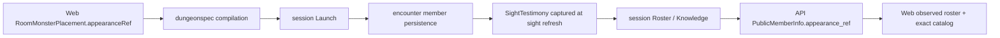

# NPC appearance refs — walkthrough

Law: [design.md](design.md). Consumer work: rpg-dnd5e-web#1253. The stat-block
assembly contract in `../stat-block/design.md` stays independent.

## What this is

One optional appearance choice on a placed combatant, carried through the
existing authored-document and observed-public-identity paths. It reuses the
monster placement, faction binding, perception store, public roster and pinned
NPC catalog. It introduces neither another stats system nor another renderer.

## Component shape

## Ownership and contracts

| Component | Owns | Input → output |
|---|---|---|
| Studio room owner | Authored appearance choice and history | Catalog ref → optional placement field and saved source |
| dungeonspec | Structural validation and compilation | RoomMonsterSource/PlaceSpec → MonsterPlacement |
| session Launch | Construction wiring, not rules | Compiled placement → encounter JoinInput |
| encounter | Captured member content and perception | MemberInput/JoinInput → MemberData and SightTestimony |
| session roster | Host-facing projection | Observer holdings → PublicMember.AppearanceRef |
| API/proto | Wire conversion | PublicMember → PublicMemberInfo.appearance_ref |
| Web renderer | Exact asset resolution | Observed ref → existing standing/downed model and animation path |

The compiler never checks an asset catalog or assigns stats from an appearance.
The roster never fills a missing observed ref from a live member. The API never
resolves refs. The renderer never recovers hidden appearance from the editor
source or changes an actor's faction/rules when choosing a model (R1–R6).

## Walk one choice through

An author selects `dnd5e:npcs:kingdom:merchant-01` for a placed actor whose rules
ref names an existing template. The room document keeps that actor's ID, rules
ref, starting cell and faction. Compilation carries the optional appearance;
launch supplies it to the encounter's member record. Sight refresh copies it
into the observer's testimony. Roster/Knowledge projects that captured string;
the API transports it and Web resolves its exact standing/downed URLs. Losing
sight keeps the captured choice, even if live data or authored content changes.

## Separations and trade-offs

| Query | Authority |
|---|---|
| Stats, attacks and HP | Existing rulebook/template assembly |
| Faction and stance | Existing bindings and encounter disposition graph |
| Authored look | Placement's optional appearance ref |
| Look this viewer may render | Captured observation projected on public identity |
| Model bytes and clips | Pinned private-provider catalog |

A live-member shortcut is smaller but cannot preserve remembered appearance.
A UI-only selector avoids provider work but loses the choice at persistence or
play. The chosen path pays for explicit field carriage and one captured fact;
it reuses the existing sight refresh rather than introducing polling.

Style and skin controls are three views of one complete-look choice (R9). The
provider publishes the available combinations and the family/default relationship;
the client performs exact lookup rather than constructing ref suffixes. Complete
GLBs cost duplicated geometry bytes but avoid another runtime material-mutation
path. Only the selected look loads, and observer memory keeps that whole look.

## Edges and where change lands

Absent fields retain legacy rendering. An explicit unresolvable ref is visible
as unavailable. Unknown-location legacy testimony remains empty; it is not a
request to consult live appearance. Existing known-location memories retain
their captured ref. This slice provides no runtime appearance-change verb,
equipment fitting or stat-block changes (R8). Palette choices use the existing
captured-ref path (R9).

New model choices belong in the provider/catalog. New appearance-changing game
behavior belongs with its rule owner and must refresh observation through the
existing perception path. Layout and picker behavior stay with the room owner.

## Source map

| Concern | Paths |
|---|---|
| Source and compiled placement | toolkit `encounter/dungeonspec/{single_room.go,single_room_decode.go,single_room_compile.go,compile.go,spec.go,validate.go}` |
| Persistence and sight capture | toolkit `encounter/{field.go,data.go,encounter.go,testimony.go}` |
| Launch and observed projection | toolkit `session/{launch.go,read.go,types.go}` |
| Wire | protos `dnd5e/api/session/v1alpha1/types.proto`; API `internal/handlers/dnd5e/session/v1alpha1/get_roster.go` |
| Authoring and render | Web `roomDraft.ts`, room codecs, `RoomActorMarkers.tsx`, `WorldBuildingConcept.tsx`, `SessionCanvas.tsx`, `sessionRefreshKeys.ts` |
