# Authored NPC appearance refs

## Shape

```mermaid
flowchart LR
    Studio[Studio actor: rules ref + appearanceRef] --> Source[Validated encounter source]
    Source --> Compiled[dungeonspec.MonsterPlacement]
    Compiled --> Member[Encounter member: opaque authored appearance]
    Member -->|sight refresh| Seen[Observer's captured SightTestimony]
    Seen --> Public[Session PublicMember]
    Public --> Wire[Proto PublicMemberInfo.appearance_ref]
    Wire --> Model[Web exact NPC catalog lookup]
```

## Law

- **R1 — Separate choices.** A combatant keeps its existing monster/template rules ref, stats and faction. Optional `appearanceRef` on its authored placement changes only presentation.
- **R2 — One authored source.** The existing encounter document carries the ref through validation, compilation, launch/reserve and encounter persistence. No new stats/faction proto payload or second NPC definition store is introduced.
- **R3 — Opaque content.** Toolkit validates the ref's structure and carries it unread; it does not consult asset catalogs, derive file paths, or infer rules/factions from its namespace.
- **R4 — Observation owns delivery.** Sight captures the member's appearance ref. Public roster delivery reads the observer's captured value, never enriches memory from a live member or edited source document, and excludes never-seen NPCs. Existing unknown-location testimony remains empty.
- **R5 — Thin transport.** Session projects one optional appearance ref on public member identity; API copies it into the additive proto field. Existing recipient knowledge refresh supplies the changed observation.
- **R6 — Exact rendering.** Web resolves an explicit ref only through the pinned NPC catalog. An unavailable explicit ref is visible as unavailable, not substituted. No ref preserves existing model resolution. Standing/downed selection and animation reuse the existing character renderer.
- **R7 — Authoring integrity.** Studio selection preserves actor ID, rules and faction, round-trips through JSON/YAML/reload, participates in undo/redo, and retains unknown-but-valid imported refs with a diagnostic. Clearing a choice removes the optional override.
- **R8 — Bounded slice.** No equipment fits, stat-block derivation, faction rules, live appearance-change verb, character customization redesign or full-document delivery to play is added.
- **R9 — Published complete looks.** Appearance, Style and Skin palette select one exact appearance ref using provider-declared family/style/skin metadata. No separate style fields travel through the actor or proto. The family ref names its default look; existing defaults keep their refs and bytes. A family change retains a combination only when the new family supplies it, otherwise selects its declared default; missing combinations are never invented. Atlas-only variants preserve every non-image model semantic and use the 512px cap.

## Rulings

| ID | status | scope | ruled by | date |
|---|---|---|---|---|
| R1–R3 | settled | appearance independent of existing authored stats/faction; opaque source carriage | KirkDiggler | 2026-10-11 |
| R4–R5 | settled | observer-safe identity delivery and appearance-only wire extension | KirkDiggler | 2026-10-11 |
| R6–R7 | settled | exact catalog rendering, explicit failure, persistence and legacy fallback | KirkDiggler | 2026-10-11 |
| R8 | settled | no gameplay, equipment-fit or live-change expansion | KirkDiggler | 2026-10-11 |
| R9 | settled | publish the three intended controls using complete look refs | KirkDiggler | 2026-10-11 |

## Open

None for this slice. Live shape-changing/disguise verbs remain separate use cases; this contract supplies captured appearance identity without implementing them.
