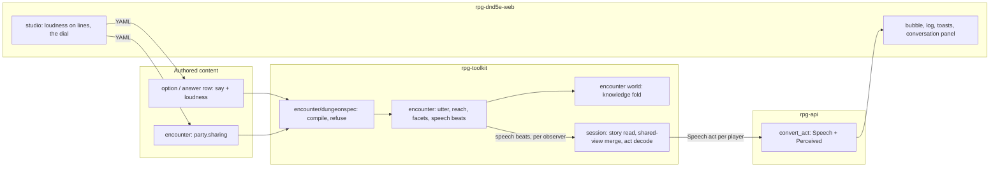

# One utterance, every observer's version

This is the proposed ownership and flow for
[perceived speech #930](https://github.com/KirkDiggler/rpg-project/issues/930).
[The design](design.md) holds the law and which rows are settled; open rows
are not implementation authority. [The slices](slices.md) carry the measured
starting point and the plan.

## What this is

A spoken line is **one event that each observer perceives through their own
senses**: sight tells them who (R1), the line's loudness decides whether the
words reach them (R2), and the roll goes wherever the words go (R3). The
encounter, which already owns sight, the wall partitions and hearing, computes
each observer's version of the utterance once and writes it to exactly that
observer (R8, the encounter assembles each version). The session, which already assembles each player's story, adds
the party's versions when the encounter's dial says the view is shared (R5, the sharing dial;
R11, shared view in the session). The wire carries one `Speech` message with its parts present or absent,
and a reusable `Perceived` part saying how it arrived (R6, one speech message).

It reuses the one sight answer (`audienceOf`), the partition graph and its
closed-door rule (`hopsFrom`), passive-Perception noticing (`hearersOf`), the
sounds channel NPC tables already read (`sound.Land`), the per-reader beat
pattern (`tellRecognition`) and the knowledge model's group grain
(`world/graph`). It introduces **no second visibility authority, no general
perceived-event envelope for every family, no player-to-player telling verb and
no change to clangs, crashes and booms**.

## Outcome and non-goals

It serves the table: a player in the next room hears a guard shout "Is anyone
in there a friend of hers?" without being told which guard; a player through
an open doorway sees two people whispering and learns nothing said; a friend's
natural 1 shows to everyone who heard the line. It serves the author: a line
can be whispered or shouted, and an encounter chooses how much the party
shares.

Not in this story:

- non-speech sounds beyond what the rulings need (they keep `Sound`);
- a perceived-event part on any family other than speech;
- a player-to-player telling verb, free-typed speech or languages;
- the shared-knowledge stop's targeting rules (designed in R12, shared knowledge at the party grain; built last);
- narrowing the beats that still reach every member (the shelf
  `audienceFor` keeps for rpg-toolkit#940), except a spoken pick's beat (R9: the record each utterance leaves).

## Component shape



## Ownership and contracts

Names marked **proposed** are new shapes, not existing APIs.

| Component | Owns | Input → output |
|---|---|---|
| `encounter/dungeonspec` | The authored words `loudness` (options, answer rows) and `party.sharing` | Document → `Option.Loudness`, `Answer.Loudness`, `FieldInput.Sharing` (**proposed**); refuses unknown words |
| `encounter` utterance | Loudness and its reach in rooms; who sees, who catches words, who notices; each observer's facets; the utterance id | `Speak`, `answer`, `answerTime`, a reaction's pick → **proposed `utter(utterance)`** → speech beats (`BeatSpeech`, **proposed**), one per facet group; `sound.Land` voice on non-player hearers |
| `encounter` world | Each member's knowledge fold; at shared knowledge, the party grain for party members' knowledge facts | `learnFact`, cell and concealment facts → journal facts audienced to the member, or to `FactionParty` at stop three (R12: shared knowledge at the party grain) |
| `session` story read | A player's acts; the shared-view merge; decoding speech beats into acts | `enc.Story(Audience)` per party member + `Sharing` → `Act{Speech, Perceived}` (**proposed**), retired `SpeakAct`/`TableAnswer.say`/voice `Sound` while they live |
| protos `session/v1alpha2` | The `Speech` message, `Loudness`, `Perceived`; the deprecation marks | — |
| `rpg-api` | Wire conversion only | session `Speech` → `sessionpb.Speech` in `convert_act.go`; no rule, no filtering |
| web | Rendering: a named or unnamed voice, "someone" on an unseen roll, the addressee only when present, "shared by" marks; the studio fields | `Act.speech` → bubble over a seen speaker, a voice cue at a place for an unseen one, the log line, the toast |

The refusals, one per boundary:

- **The compiler never defaults a loudness into the document**; unmarked stays
  unmarked and means speak.
- **The encounter never writes a part to a reader who did not perceive it**,
  and never asks who is in the party to decide what a character perceives.
- **The encounter's world never shares an NPC's holdings, a guard's intel or a
  character's live sight**, at any stop.
- **The session never widens what a character perceives**: the merge is a read
  for a player's screen, and nothing merged reaches `Afford`, `Speak` or any
  rule.
- **The api never filters or relabels**: who sees what was decided upstream.
- **The client never infers a speaker**: no name from a bubble position, a
  voice's place or a roll's owner; absent stays "someone".

## Walk one thing through

The castle's call from the gate (R7: speech first, the gate shout). Bea, a straggler, stands at the gate
beside `gate-1`. Ash, admitted earlier, stands in the gatehouse yard: the next
wall partition, through an open door, out of sight of the gate. Cole stands in
the great hall, two rooms in, behind a closed door. The dial is at shared view.

1. **Authored.** `gate-1`'s answer row for the straggler's ask carries
   `say: "Anyone in there vouch for her?"` and `loudness: shout`. The compiler
   lowers it to `Answer{Say, Loudness: Shout}`.
2. **Spoken.** Bea speaks the ask line (`loudness` unmarked → speak).
   `Speak` writes `spoke` (the check and deed) and calls `utter` for Bea's
   line: Bea and `gate-1` see and catch it; Ash is one room away, beyond a
   speak line's reach, and with passive Perception 13 against 5 + 5 notices a
   voice. Ash's version: place, one room, speak — no speaker, no words.
3. **Answered.** The row fires. `answered` goes to those who see `gate-1`
   (R9: the record each utterance leaves). `utter` for the shout: Bea sees `gate-1` and catches the words; Ash
   catches the words (one room, open door) but does not see `gate-1`; Cole is
   two rooms plus a closed door (three) beyond a shout's reach of one, and
   with passive Perception 10 against 0 + 15 notices nothing.
4. **Beats.** Three facet groups: `{Bea}` speaker + words + spoken-to;
   `{Ash}` words + place + one room + shout; `{gate-1}` (the speaker's own).
   Each is one `speech` beat with the same utterance id. `gate-1`'s sounds
   channel is untouched; any NPC that noticed holds a `voice` there.
5. **Read.** Ash's client asks for Ash's acts. At shared view the session
   also reads Bea's story and merges the two versions of the utterance:
   Bea's carries the speaker, so Ash's screen shows `gate-1` speaking, with
   `Perceived{senses: hearing, via: [Bea]}`. At each their own, Ash's screen
   shows only the words, from someone at the gate.
6. **Wire.** `Act{family: REACTION, speech: Speech{words, place, hops: 1,
   loudness: SHOUT, utterance}, perceived: Perceived{...}}`.
7. **Screen.** Ash's log: "Someone shouts from the gate: 'Anyone in there
   vouch for her?'" (each their own), or the guard's name with a "seen by
   Bea" mark (shared view). Ash walks back and vouches (#929).

## The wire

Proposed, in `dnd5e/api/session/v1alpha2/act.proto` (R6: one speech message). Every part is
optional; absent means this observer did not perceive it.

```proto
// Loudness is how loud an utterance was, which is how far its words reach.
enum Loudness {
  LOUDNESS_UNSPECIFIED = 0;
  LOUDNESS_WHISPER = 1;
  LOUDNESS_SPEAK = 2;
  LOUDNESS_SHOUT = 3;
  LOUDNESS_SCREAM = 4;
}

// Speech is one observer's version of one utterance.
message Speech {
  string utterance = 1;  // the same on every version of one utterance
  Party speaker = 2;     // absent unless the observer saw the speaker
  Party spoken_to = 3;   // absent unless the observer saw that person, or is them
  string words = 4;      // absent unless the words reached the observer
  string option = 5;     // the line's option id; present with words, for a player's own line and its menu
  Position place = 6;    // where it was said: the speaker's cell
  int32 hops = 7;        // rooms it carried to this observer; 0 in the speaker's room
  Loudness loudness = 8;
  Roll roll = 9;         // present only with words; owned by the speaker, or "someone" when speaker is absent
  string skill = 10;     // the check's skill; present with roll
}

// Perceived is how something reached this observer. Set on speech today;
// another family adopts it by setting it.
message Perceived {
  repeated Sense senses = 1;  // SENSE_SIGHT, SENSE_HEARING: which senses delivered it
  repeated Party via = 2;     // friends whose perception it came through at shared view; empty when own
}
```

`Act` gains `Speech speech = 39` in its body and `Perceived perceived = 11`
on the envelope. The family is the beat's, as today: a verb's own line is
`FAMILY_ACT` under its act; a creature's answer or reaction is
`FAMILY_REACTION` under the act it answers; a creature speaking on its own
time is `FAMILY_ACT` under its pick. A speech act never folds another speech
into itself: the line and its answer are two acts under one act tag, each
with its own perceived parts.

Retirement, in protos' deprecate-don't-break form:

| Old | Mark | Sent until |
|---|---|---|
| `SpeakAct` and `Act.speak = 24` | `option deprecated = true;` on the message, `[deprecated = true]` on the field | the web reads `Speech` (the wire slice) |
| `TableAnswer.say = 6`, `TableAnswer.to = 13` | `[deprecated = true]` | same; `TableAnswer` stays for table arithmetic and temperament deals (Open) |
| `Sound.kind = "voice"` | a comment on `Sound.kind` naming `voice` retired for players (a string value carries no option) | same; NPC holdings keep the `voice` kind |

While both are sent, the session builds each retired message from the same
speech version, so a retired message never carries a part the speech version
withholds: a words-only observer gets no `SpeakAct` and keeps a voice `Sound`.

## Separations that look like one thing

| Query | Source of truth |
|---|---|
| Who sees the speaker | the one sight answer, `audienceOf` |
| Who catches the words | the line's loudness over the partition graph (R2: reach by loudness) |
| Who notices a voice | passive Perception against the voice's difficulty plus rooms (`hearersOf`) |
| Who was spoken to, as shown | sight of the addressee (R4: spoken-to is seen) |
| What a player is shown | the session's read, by the dial (R11: shared view in the session) |
| What a character knows | the encounter's world fold, by the dial at stop three only (R12: shared knowledge at the party grain) |
| What an NPC holds of a voice | its sounds channel: kind, place, time; never words, never a maker |

The hazard: **an implementation that takes "who sees" as the audience of the
words** keeps today's behaviour, where a line travels sixty feet by sight
through an open doorway and a guard's shout reaches nobody who cannot see
him. **One that takes "what a player is shown" as "what a character knows"**
lets shared view leak into rules — a friend's overheard password unlocking a
line for a character who never heard it.

## Trade-offs

| Decision | Benefit | Cost / boundary | Not taken |
|---|---|---|---|
| Facets assembled in the encounter (R8: the encounter assembles each version) | One honest truth per observer; the record never holds a part its reader lacked | Up to a handful of beats per utterance instead of one; the encounter pays | One beat to all with the client hiding parts |
| Beat per facet group, not per observer (R8: the encounter assembles each version) | Beats bounded by facet combinations, not roster size | A reader's version is found by audience, as `recognized` is | One beat per observer |
| Shared view in the session (R11) | The engine's truth stays per character; the dial changes no rule | The session reads up to party-size stories per delivery | Widening audiences in the encounter |
| Shared knowledge at the party's group grain (R12) | Reuses the knowledge model's group audience; the fold stays the one reader | Stop three changes who learns, so every knowledge reader is in scope at once | A party-wide copy of facts |
| `Perceived` on the act envelope (R6: one speech message) | Any family adopts it by setting one field | Set only on speech in this story | A perceived envelope for every family now |
| Rooms, not feet (R2) | One graph for every sound; doors matter | A huge open hall carries a speak line end to end | Distance in cells |

## Edges

- A room is a wall partition; two regions painted on one open floor are one
  room (R2: reach by loudness).
- Deafened, Silence, blinded, invisible, illusory voices, Message and
  languages are future facets; the shape holds them as follows, and none is
  designed here:
  - **deafened** removes the words and the noticing for one observer;
  - **Silence** is a zone the reach search does not enter or leave, as a sight
    area screens sight;
  - **blinded** and **invisible** fall out of the sight answer: no speaker part;
  - **an illusory voice** is an utterance with no speaking member: never a
    speaker part, words and place present;
  - **Message** is a whisper whose reach is a named target at range,
    bypassing rooms;
  - **Thieves' Cant and languages** split "caught the words" from "understood
    them": a words part present but unintelligible.
- Speaking to a creature that cannot see the speaker stays refused (Open).

## Refusals and costs by stop

| Stop | Taken away from today |
|---|---|
| each their own | A player no longer sees a friend's line or roll unless they see or hear it themselves; a friend's line in another room is a voice or nothing |
| shared view | Words a seer could not hear no longer arrive by sight; a guard's reaction lines no longer reach every member; nothing a friend perceives changes what a character can do |
| shared knowledge | A character can be offered a line on a fact only a friend learned; the party cannot keep a secret from itself |

**Every stop also adds**: a player's own lines become voices other creatures
can notice, so a passive-10 guard one open doorway away notices a party
talking at the gate.

**Performance.** Per utterance the encounter asks one sight answer (already
asked by every line), one partition search bounded at the largest reach any
listener on the roster could use (scream's two rooms for words; for noticing,
the best passive Perception less the voice's difficulty, in steps of 5), and
one pass over the roster. Today's partition search visits every partition with
no bound; the utterance search stops at its bound. Beats per utterance are
bounded by the facet table (at most eight with the spoken-to split), not by
roster size. The shared-view merge costs one story read per party member per
delivery.

**Save and load.** The dial is construction truth on the field data and loads
with it; loudness rides on the options and tables the members already persist.
Speech beats are ordinary record entries; the utterance id is derived from the
record, so a reload replays the same versions. The shared-view merge is a read
and stores nothing.

## Where a change lands

- **A new loudness, or a different reach for one:** the encounter's reach
  table and the compiler's word list; the wire enum gains a value.
- **Deafened:** a sheet fact the encounter's utterance reads per observer; no
  wire change.
- **A friend's sight on the map at shared view:** the session's `View`, not
  the encounter (Open).
- **Shared view for clangs and crashes:** the session merge already covers
  per-observer perception acts; nothing in the encounter moves.

## Source map

| Concern | Path |
|---|---|
| Speak, the spoke beat, witnesses | `rpg-toolkit` `rulebooks/dnd5e/encounter/option.go` (`Speak`, `appendSpokeBeat`, `Witnesses`) |
| The one sight answer | `encounter/deed.go` (`audienceOf`); `encounter/sneak.go` (`placedSightReach`) |
| Answers and time picks | `encounter/answer.go` (`answer`, `answerTime`, `appendAnsweredBeat`); `encounter/clocks.go` (`appendPickBeat`) |
| Hearing | `encounter/noise.go` (`soundDCs`, `dcPerHop`, `hopsFrom`, `hearersOf`, `makeSound`, `BeatHeard`); `mind/behavior/sound` |
| Per-reader beats | `encounter/recognition.go` (`tellRecognition`); `encounter/sightedbeat.go` |
| The everyone shelf | `encounter/encounter.go` (`audienceFor`) |
| Knowledge fold | `encounter/world.go`, `encounter/flip.go` (`learnFact`); `world/graph` (`GrainGroup`, `AudienceOf`) |
| Party | `encounter/field.go` (`FactionParty`) |
| Authored fields | `encounter/dungeonspec/spec.go` (`OptionSpec`, `AnswerSpec`), `dungeonspec/compile.go` (`Compiled`) |
| Acts | `rulebooks/dnd5e/session/act_family.go` (`familyOf`, `spokePiece`, `answeredPiece`), `session/acts_read.go` |
| Wire | `rpg-api-protos` `dnd5e/api/session/v1alpha2/act.proto` (`Act`, `SpeakAct`, `TableAnswer`, `Sound`, `Perception`, `Party`, `Roll`) |
| Conversion | `rpg-api` `internal/handlers/dnd5e/session/v1alpha2/convert_act.go` |
| Rendering | `rpg-dnd5e-web` `src/components/session/combat-experience/` (`toastPolicy.ts`, `speechAtSpeakers.ts`, `describeAct.ts`, `ConversationPanel.tsx`, `RecentActs.tsx`), `src/components/session/heardBeat.ts` |
| Studio | `rpg-dnd5e-web` `src/concepts/encounter-studio/EncounterStudioWorkspace.tsx` (the encounter home's sections), `src/concepts/world-building/TablesPanel.tsx` |
