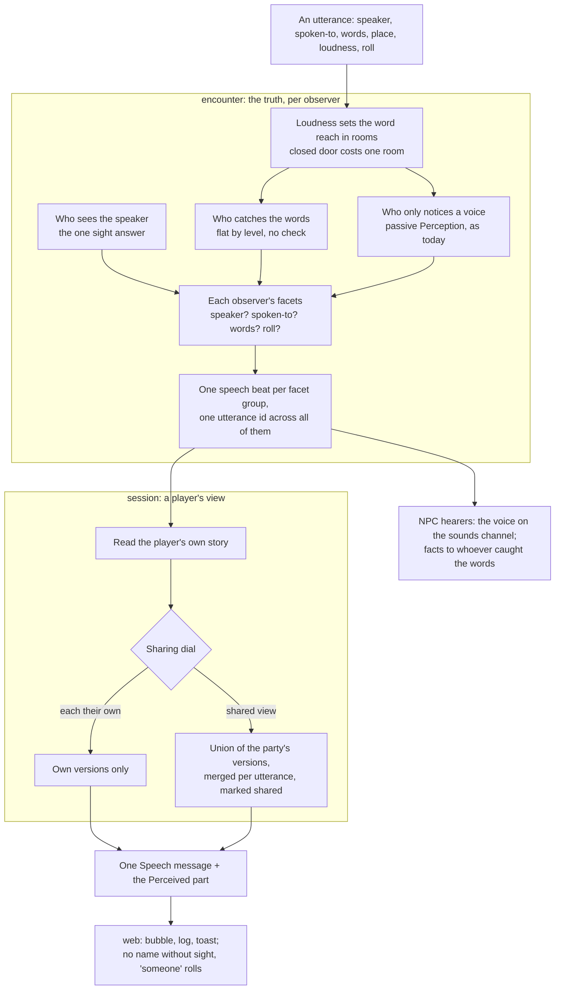

# Perceived speech

## Shape

[Story #930](https://github.com/KirkDiggler/rpg-project/issues/930) carries
the operator's direction and every ruling's record. [The walkthrough](README.md)
explains owners, the measured state today, the wire field by field and one
utterance walked to the screen. [The slices](slices.md) are the working plan.
Rows marked **settled** below are agreed law; a lead's call inside a row is
law until the operator vetoes it. A deferred row is not implementation
authority.

## Law

### R1 — Sight tells who; hearing tells what — settled

An observer is told who spoke only if they see the speaker, by the one sight
answer every deed and line already uses. An observer is told the words only if
the words reach them (R2: reach by loudness). An unseen speaker — out of sight, beyond a wall,
invisible, beaten by a sneak — is heard and not named. No reader of the record
learns a speaker's identity from a speech it was not shown seeing.

### R2 — Loudness reaches in rooms; a closed door costs one room — settled

Every utterance has a loudness. The words reach:

| loudness | the words reach |
|---|---|
| whisper | only the member addressed, and only from beside them |
| speak | every member in the speaker's room |
| shout | the speaker's room and the next room over |
| scream | two rooms over |

A room is the engine's wall partition; rooms join through doors. A closed door
on the way costs one room more, the rule every sound already follows. So a
shout crosses an open doorway and stops at a closed door; a scream passes one
closed door or two open doorways. An authored region is presentation and is
never a room.

Catching the words is flat by level: no roll and no Perception. Noticing that
somebody spoke, without the words, stays on passive Perception against the
voice's difficulty plus one step per room, as every sound today. A member who
is down catches and notices nothing. The speaker always perceives their own
line.

This amends the shout ruling recorded on rpg-project#925 ("hearing stays
passive … a shout carries further"): the words of a shout reach by level, not
by passive Perception.

Lead's calls recorded on #930 and not vetoed: catching the words is flat by
level; noticing stays passive; a whisper needs the speaker beside the person
addressed; a room is the wall partition, not an authored region.

### R3 — The roll travels with the words — settled

Whoever catches the words of a line sees its dice. The roll is the speaker's
when the observer also sees the speaker, and belongs to "someone" when they do
not. An observer who sees the speaker but does not catch the words sees no
roll. A speaker always sees their own roll.

### R4 — Who was spoken to is seen, not heard — settled

An observer learns who a line was spoken to only if they can see that person,
or are that person. Catching the words does not name the addressee.

Lead's call recorded on #930 and not vetoed.

### R5 — Sharing is one dial per encounter, three stops — settled

| stop | what a player is shown | what their character can act on |
|---|---|---|
| each their own | only what their own character perceives | only that |
| shared view (default) | what any party member perceives | only what their own character perceives |
| shared knowledge | what any party member perceives | what any party member has learned |

One setting per encounter, authored in the studio. An encounter that does not
author it is at shared view. At the first two stops a character learns from a
friend only in the world: telling, whispering, shouting. At no stop does party
sharing change what any other character holds: a guard recognising one member
is his knowledge about that member, and a party that shares knowledge teaches
the guard nothing.

Shared view changes only what a player is shown; the encounter's truth, each
character's knowledge and every rule's input stay per character. Shared
knowledge reaches rules and is built after the first two stops.

### R6 — One speech message, with a reusable "how you perceived it" part — settled

Every spoken thing rides one speech message on the wire: a player's line, a
creature's answer, a hail, a shout, an overheard word. Its parts are present or
absent: speaker, spoken-to, words, place, loudness, roll. Beside it, a small
part says how it reached this observer: seen, heard, shared by a friend. That
part is its own message so other families can carry it later, one family at a
time, when a use calls for it.

Other sounds (a clang, a crash, a boom) keep today's sound message. `SpeakAct`,
the speech fields of `TableAnswer` and the voice kind of `Sound` keep working,
marked retired, until the client has moved; then they stop being sent and stay
in the contract as deprecated.

### R7 — Speech goes in first; the castle's call from the gate uses it — settled

This lands before more is layered on the gate. The castle's use: a straggler
asks a gate guard to call inside; the guard shouts; a recognised friend in
earshot catches the words, not who said them, and can come back and vouch
(rpg-project#929).

### R8 — The encounter assembles every observer's version — settled

The encounter computes, once per utterance, who sees the speaker, who catches
the words, who only notices a voice and who sees the addressee, and writes
each observer exactly the parts their senses delivered (R1, sight tells who;
R2, reach by loudness; R3, the roll travels with the words; R4, spoken-to is
seen). Every version of one utterance carries the same utterance id. A version
never carries a part its reader did not perceive; absent is absent, never
blanked.

| sees speaker | catches words | the version carries |
|---|---|---|
| yes | yes | speaker, words, roll, place, loudness; spoken-to when seen |
| no | yes | words, roll, place, distance in rooms, loudness; spoken-to when seen |
| yes | no | speaker, place, loudness; spoken-to when seen |
| no | no, but noticed | place, distance in rooms, loudness |
| no | no, not noticed | nothing |

Lead's calls, open to veto: the versions are written as one speech beat per
distinct set of parts, audienced to exactly the members that set describes
(the per-reader shape of the `sighted` and `recognized` beats); the member a
line is spoken to always catches its words (a line is only said within Speak
reach); a whisper makes no sound anyone else notices; noticing difficulty by
level is content tuned on the walk, starting at speak 5, shout 0, scream 0,
one step of 5 per room as today.

### R9 — A line teaches whoever catches its words — settled

A fact a spoken line teaches, and the `heard` channel of a recognition, reach
the members the words reach, never those who only see the speaker. An alarm
spreads to the next room only when it is shouted; the castle's alarm lines are
authored `shout`. A creature's spoken answer or reaction stops writing its
words onto a beat every member reads: the `answered` beat of a pick that says
something reaches those who see the creature, and its words travel only in
the speech versions. Non-player hearers keep holding a voice on the sounds
channel, kind and place only, so every `heard: { kind: voice }` table keeps
working. Every line said makes its voice, a player's included.

Lead's calls, open to veto: the `spoke` beat keeps the check and the deed for
the verb; the arithmetic of a creature's pick (die, candidates, entry,
temperament) stays on `TableAnswer` for those who see the creature, and only
its speech fields (`say`, `to`) retire.

### R10 — A line's loudness is the author's — settled

A line's loudness is authored where its words are: on a creature's option and
on an answer row's `say`, as `loudness: whisper | speak | shout | scream`.
Unmarked is speak. A player does not choose how loudly to speak in this story.
The dial is authored once on the encounter document as
`party: { sharing: own | view | knowledge }`; unmarked is view. The compiler
refuses any other word. A whispered line is offered and admitted only from
beside the member it is said to. The studio round-trips both fields.

### R11 — Shared view shares what friends hear and notice — settled

Shared view covers speech and every per-observer perception act: sounds,
sightings, discoveries, and the rolls that travel with words. A friend's sight
drawn on the map is not part of this story. The session assembles a player's
story from their own character's versions and, at shared view, every party
member's versions, merged per utterance: each part present in any party
member's version is present, and the Perceived part names the friends whose
senses contributed. It never asks the encounter to widen an audience, and it
never feeds a merged version back into any rule.

### R12 — Shared knowledge folds facts at the party's grain — deferred until the shared-knowledge slice

At shared knowledge, a fact a party member comes to know is a fact the party
knows: the encounter audiences that member's knowledge facts (learned facts,
learned cells, pierced concealments) to the party group, the knowledge model's
group grain, so every party member's fold carries them. It never changes what a
non-party member holds, never shares a character's live sight, and never moves
an NPC's records.

Lead's call, open to veto: acting on a creature only a friend can see is
settled with the slice that builds this stop, from its own measurement.

### R13 — Speaking to a creature that cannot see you stays refused — settled

Speak keeps refusing a line said to a creature that does not see the speaker.
Overhearing an unseen speaker follows from R1 (sight tells who); addressing a
creature from out of its sight waits for a use case.

Lead's call, open to veto.

### R14 — The hint is the author's tool — settled

A shout is how an author gives a party a hint across rooms. In the castle, an
unrecognised speaker at the gate has a plain line asking whether the guard saw
their friends go in; the guard's answer hints that a friend can speak for them,
and is a shout, so a friend inside catches the words and not who said them.

## Rulings

| ID | status | scope | ruled by | date |
|---|---|---|---|---|
| R1 | settled | Sight tells who, hearing tells what; an unseen speaker is heard and not named | KirkDiggler | 2026-11-12 |
| R2 | settled | Whisper / speak / shout / scream reach by rooms; closed door costs one room; words flat by level; noticing stays passive; room is the wall partition; amends the #925 shout ruling | KirkDiggler | 2026-11-12 |
| R3 | settled | The roll travels with the words; named when the speaker is seen, "someone" otherwise | KirkDiggler | 2026-11-12 |
| R4 | settled | Spoken-to is shown only to an observer who sees that person | KirkDiggler | 2026-11-12 |
| R5 | settled | One sharing dial per encounter: each their own / shared view (default) / shared knowledge; first two built in this story; party sharing never changes others' holdings | KirkDiggler | 2026-11-12 |
| R6 | settled | One speech message with parts present or absent, plus a reusable Perceived part; other sounds keep `Sound`; old messages deprecated, not broken | KirkDiggler | 2026-11-12 |
| R7 | settled | Speech goes in before more gate work; the castle's guard shouts inside for a straggler | KirkDiggler | 2026-11-12 |
| R8 | settled | The facet table per observer, one utterance id; lead's calls open to veto: beat per facet group, addressee always catches, whisper unnoticed, noticing DCs per level | KirkDiggler (from R1–R4); lead's calls | 2026-11-12 |
| R9 | settled | A line's fact and recognition's heard channel go to whoever catches the words; alarms shouted; a spoken pick's beat to who sees the creature; NPC voice holdings kept; lead's calls: `spoke` keeps the check, `TableAnswer` keeps pick arithmetic, only `say`/`to` retire | KirkDiggler; lead's calls | 2026-11-12 |
| R10 | settled | Loudness is authored on options and answer rows (default speak), no player choice in this story; `party.sharing` on the encounter (default view); studio round-trip for both | KirkDiggler | 2026-11-12 |
| R11 | settled | Shared view covers speech and every per-observer perception act, merged in the session, read-only; a friend's sight on the map is a later slice | KirkDiggler | 2026-11-12 |
| R12 | deferred-until-the-shared-knowledge-slice | Shared knowledge audiences a party member's knowledge facts to the party group; targeting on a friend's sight settled with that slice | — | — |
| R13 | settled | Speaking to a creature that cannot see the speaker stays refused in this story | lead's call, open to veto | 2026-11-12 |
| R14 | settled | The castle hint: a plain line at the gate, answered by a shouted hint a friend inside catches | KirkDiggler | 2026-11-12 |

## Open

- **Shared knowledge (R12, the party grain):** the fold and acting on what only
  a friend perceives are settled with the shared-knowledge slice, from its own
  measurement of every knowledge reader.
