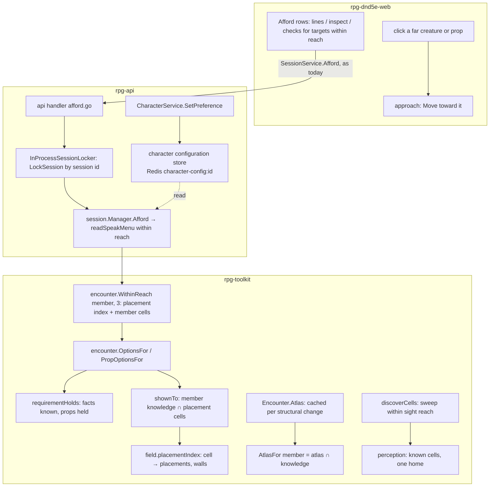

# Server at the keep's scale — walkthrough

Story: rpg-project#753. Law: [design.md](design.md). This explains how the
pieces meet; the design doc says what holds.

## What this is

A player is offered what the creatures and props within three hexes of them
offer, and nothing farther; a far target is walked to, and its options appear
on arrival. The field indexes what stands on each
cell, the atlas is projected once per structural change and filtered per
member, a discovery sweep covers an observer's reach rather than the whole
site, a member's known cells have one home, sessions lock by session, and
player preferences live in a character configuration store. It reuses the
encounter's option machinery (`OptionsFor`, `PropOptionsFor`, `Speak`, the
requirement filter), the intel's per-observer knowledge, the in-process
locker's two key spaces and the api's Redis repositories. It introduces **no
second sight authority** (knowledge answers "shown", the atlas is derived from
it), **no new verb economy** (the approach is a Move, the line is a Speak) and
**no caching layer outside the encounter** (the projection cache lives with
the field it projects).

## Component shape

## Ownership and contracts

| Component | Owns | Input → output |
|---|---|---|
| web approach gesture (`components/session/combat-experience`) | walking to a far target | a click on a creature or prop out of reach → `Move` toward it; `speakOptions.ts` keeps reading Afford's rows, which now cover only targets within reach |
| `SessionService.Afford` (protos, unchanged) | the wire | `Declaration.speak_options` carries the rows for targets within reach; no proto change |
| `InProcessSessionLocker` (api) | serialising one session's verbs | `LockSession{Session}` → that session's guard; `LockCharacter{Character}` → that character's guard; `sharedStoreLocker` is removed |
| character configuration store (api, Redis `character-config:<id>`) | preferences across sessions | `CharacterService.SetPreference{character, discovery_sharing}` under the character guard; the session reads through `sdk.CharacterConfigReader.DiscoverySharing(ctx, character)` |
| `session.readSpeakMenu` (bounded) | the menu within reach | `encounter.WithinReach(member, reach)` → for each target `OptionsFor` / `PropOptionsFor`, the witness test for a creature → rows with the Speak selector id; nothing farther is asked |
| `encounter.WithinReach` | who and what is near | member, reach in hexes → creatures and props whose cells lie within the hex ring, from the member's cell and the placement index |
| `encounter.OptionsFor` / `PropOptionsFor` | a target's admitted options | target id → authored options whose `Requires` holds, deep-copied; `ErrNoProp` for a thing the member cannot be shown |
| `encounter.shownTo` (replaces `showsCellTo` / `showsAnyCellTo`) | the oracle | member, cells → any cell ∈ the member's known cells in `perception`; no projection |
| `field.placementIndex` | what stands where | built at construction and on placement change: cell → placements and walls; `placedCells(placement)`, `wallFootprintCells(wall)` read it |
| `Encounter.Atlas` cache | the field's projection | derived on structural change (door state, placement moved/arrived/gone), read otherwise; `AtlasFor(member)` = cached atlas filtered by the member's knowledge |
| `discoverCells` | one observer's sweep | observer → the cells within its sight reach tested; a monster's sweep updates its holdings only and emits no beat |
| `perception` known cells | the one home of what a member knows | a seat's `cells_revealed` beat carries newly revealed cells; the journal carries no `known:cells` fact |
| harness (`tools/browser/bench/run.sh`) | before and after | the same table every slice posts on #753 |

Refusals, one per boundary:

- The web does not compute reach; it shows the rows the server offers and turns a click on a far target into a Move.
- The api does not compute options; it converts and locks.
- `readSpeakMenu` does not ask about a target outside reach.
- The locker does not take a key wider than the session for a session verb.
- The session does not write character configuration.
- `OptionsFor` and `PropOptionsFor` do not project an atlas to decide what the member can be shown.
- The atlas cache does not answer a sight question; it is read for rendering and reveal only.
- A sweep does not visit cells beyond the observer's reach to prove them unseen.
- The record does not carry a second copy of a member's known set.

## Walk one thing through

A player in the keep's forecourt clicks the guard-captain at the gatehouse,
twelve hexes off. The client issues a `Move` toward the captain, like any
directed move. When the player stops three hexes from him, the next Afford's
menu is read within reach: `WithinReach(player, 3)` walks the 37 cells around
the player through the placement index and finds the captain and a brazier.
For the captain, `OptionsFor(player, captain)` keeps each authored option whose
`requirementHolds` (the player knows the fact, holds the prop) and
`Witnesses(player)` filtered to the captain confirms he sees them; for the
brazier, `PropOptionsFor` asks `shownTo` of the player's known cells. No atlas
is projected and nothing beyond three hexes is asked about. The rows come back
carrying the Speak selector id the player's `Speak` act will echo. The api
releases this session's guard; the tomb's table two doors down never
waited. The identity that survives is the captain's member id and the option
id; admission, the requirement filter and the witness test are derived at the
hop.

## Separations that look like one thing

| Query | Source of truth |
|---|---|
| Can this member be shown this cell | the member's known cells (perception) |
| What this member's map looks like | the atlas cache filtered by those known cells |
| What stands on this cell | the field's placement index |
| What this target offers this member | the target's authored options through the requirement filter |
| Can this target hear this member | `Witnesses`: the target's sight of the member |
| Who is near enough to interact with | `WithinReach`: the hex ring and the placement index |
| What a player chose for their character | the character configuration store |
| What a verb may stall | its own session's guard |

The hazard: answering "can I be shown it" by projecting the map makes every
such question cost the map; answering "what does my map look like" from
knowledge without a cache makes every render cost the knowledge. Each question
has its own source, and the cache is downstream of knowledge.

## Trade-offs

| Decision | Benefit | Cost / boundary | Not taken |
|---|---|---|---|
| Interaction by reach (R1, R4) | the offer costs 37 cells, on any site; no new RPC | a line cannot be said across a hall; a far target is walked to first | read one target by id after a click (a new RPC); memoise one projection per Afford (655 → 1, still placements × cells) |
| Knowledge as the oracle | sight questions cost a set lookup | known cells must be complete and current for every member | the atlas as oracle |
| Placement index | `placedCells` is a lookup | rebuilt on placement change | scan every cell per call |
| Atlas cached per structural change | projection cost moves to the change | invalidation grain (O3); the change paths are the only writers | project per call |
| Reach-bounded sweep | observers × reach, not observers × cells | an unbounded reach still sweeps the field | sweep every cell |
| No monster beats (O2) | 99 of 100 beats gone at 10k | a future reader brings its own | keep writing them |
| One home for known cells | the blob stops carrying the set twice | readers of `known:cells` move to perception | keep the duplicate |
| Per-session lock (R2) | a slow table stalls itself | preferences leave the session's write path first | store-wide key |
| Character configuration store (R2) | preferences owned by the character, read by any session | a new store and a character verb; the session's `Explorations` writer becomes a configuration reader | preferences inside session data |

## Edges

- A target the member cannot be shown is not offered; proximity cannot reveal what no map shows.
- The approach is a Move with Move's costs and refusals; a line is offered within reach only, so nothing is said across a hall.
- The cache serves rendering and reveal; combat sight still asks the reach.
- The locker stays process-local, per session; no distributed locking.
- Only discovery sharing moves to the configuration store here; other preferences follow their own use cases (O4).

## Where a change lands

- **An author adds an "inspect" option to a prop.** Content only; the menu within reach returns it.
- **An option that demands adjacency.** A per-option reach on the authored option, read by `readSpeakMenu`; the constant stays.
- **A new preference, say dice colour.** The character configuration store and `SetPreference`; no session change.
- **A new structural change, say a collapsing wall.** It becomes a writer of the atlas cache and the placement index, nowhere else.
- **Monsters remember what they saw across sessions.** Their holdings in perception, not beats; O2 reopens only if a client must see it.

## Source map

| concern | path |
|---|---|
| speak menu, bounded by reach | `rpg-toolkit/rulebooks/dnd5e/session/offers.go` (`compileOffersFor`, `readSpeakMenu`, `speakableProps`), `afford.go` (`Afford`, `speakRowOnTheWorldClock`); `rpg-toolkit/rulebooks/dnd5e/encounter` new `reach.go` (`WithinReach`) |
| options and the oracle | `rpg-toolkit/rulebooks/dnd5e/encounter/option.go` (`OptionsFor`, `PropOptionsFor`, `speakableProp`), `hold.go` (`showsCellTo`, `showsAnyCellTo`) |
| placement index, projection | `rpg-toolkit/rulebooks/dnd5e/encounter/atlas.go` (`Atlas`, `placedCellsOf`), `placed_props.go` (`placedCells`, `footprintObservationCells`), `structural_walls.go` (`wallFootprintCells`), `projection.go` |
| sweep and knowledge | `rpg-toolkit/rulebooks/dnd5e/encounter/roomknowledge.go` (`discoverCells`, `learnCells`), `roomreveal.go` (`appendCellsRevealedBeat`), `encounter.go` (`rebuildPercepts`), `board.go` (`refreshSight`) |
| preferences in the session | `rpg-toolkit/rulebooks/dnd5e/session/exploration.go` (`ExplorationData`, `ExplorationRepository`, `SetDiscoverySharing`), `session.go` (`Config.Explorations`) |
| locker, store | `rpg-api/internal/orchestrators/session/locker.go`, `exploration.go` (`sharedStoreLocker`), `orchestrator.go` |
| wire (unchanged for interaction) | `rpg-api-protos/dnd5e/api/session/v1alpha1/service.proto` (`Afford`, `Speak`, `SetDiscoverySharing`), `types.proto` (`Declaration.speak_options`), `dnd5e/api/v1alpha1/character.proto` (`CharacterService`, gains `SetPreference`) |
| client | `rpg-dnd5e-web/src/components/session/combat-experience/` (`speakOptions.ts`, `ConversationPanel.tsx`, `TargetSurface.tsx`, `useSessionCombatExperience.ts`), `src/api/useSessionSpeak.ts` |
| yardstick | `game-dev/tools/browser/bench/` |
