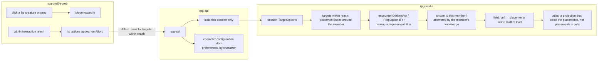

# Server at the keep's scale — what a verb may cost

Story rpg-project#753. Lane rpg-project#754. Walkthrough: [README.md](README.md).
Plan: [plan.md](plan.md). The yardstick is site format R1
([../site-format/design.md](../site-format/design.md)); the fixtures and the
harness are the benchmark keep's ([../benchmark-keep/design.md](../benchmark-keep/design.md)).

## Shape

## Law

**Interaction is by reach.** A member is offered the options of the creatures
and props within interaction reach of them, and of nothing farther, the way
an automatic discovery check fires when they come close to a concealed thing.
The offer is the target's authored options that the member's requirements
admit: lines for a creature; lines, inspection and checks for a prop. A far
target is approached by moving toward it, and its options appear on arrival.
No verb enumerates the map; the cost of an offer is the cells within reach.

**Interaction reach.** Three hexes. One constant for every target; an
author's option may demand adjacency when a use case asks for it. A creature
within reach is offered when the member sees it and it witnesses the member;
a prop within reach is offered when the member can be shown it; anything else
within reach is simply not offered, so proximity reveals nothing a map does
not show. A line said to a target out of reach is refused at the door.

**Knowledge is the oracle.** Whether a member can be shown a cell or a prop is
answered by that member's known cells under that member's concealment mask,
the same answer the visible-cells and watch-zone readers already give without
a projection. Whether a member can be shown a creature is answered by the
member's own sightings in perception. The atlas is a projection of knowledge
and is never consulted to answer either, so no sight question costs a
projection.

**The field indexes its placements.** The cells a placement or a wall covers
are derived once when the field is built from its data, in time linear in the
cells, and read as a lookup after that; a placement that moves updates its own
entries. Nothing scans every cell to find what stands on one, so a projection
costs the placements it lists, not placements times cells. Nothing derived is
stored, and no projection is cached across verbs: the encounter is rebuilt
from its data on every verb, so a cache would be rebuilt with it.

**A sweep covers what can be seen.** An observer's discovery sweep, cold at
launch and warm on every step, visits the cells within its sight reach, not
every cell of the field. A monster's sweep learns what it knows like any
observer and writes no revealed-cells beat; a beat is an atlas delta for a
seat's client, and a monster has none.

**Knowledge is written once, compactly.** What a member knows of the floor is
the journal's known-cells facts, the one persisted home, written as row runs
rather than one entry per cell. A revealed-cells beat carries a seat's newly
shown atlas, never a copy of what the seat already knows. The encounter's
stored size follows what happened, not what is known times who knows it.

**Sessions lock by session.** A verb on one session holds that session's
guard and nothing wider. A slow verb stalls its own table only.

**Preferences are character configuration.** What a player chooses for their
character across sessions, discovery sharing today, lives in a first-class
character configuration store keyed by character with its own guard, written
by character verbs and read by the session at the moment it needs the answer.
No session verb writes it and the session keeps no copy of it, so no session
needs a lock wider than itself and no change needs delivering to a live
encounter.

**A step costs its reach.** A Move's sight refresh is a warm sweep within
reach plus the load and save of the encounter's data, so the per-Move budget
of site format R1 holds on the keep when the sweep is bounded and the data is
compact.

**No row gets worse.** Every slice posts its before and after rows from the
harness on the story the day it lands; a slice that worsens any row does not
merge.

## Rulings

| ID | ruling | status | scope | ruled by | date |
|---|---|---|---|---|---|
| R1 | Speaking and interacting are intent-driven and by id: click a creature or a prop, approach, read that one target's option list; no speak menu computed on Afford; props carry lines, inspection and checks the same way. | settled | session, encounter, api, web | KirkDiggler | 2026-10-31 |
| R2 | Sessions lock by session, and player preferences live in a first-class character configuration store with its own guard; the discovery-sharing preference moves there. | settled | api, session | KirkDiggler | 2026-10-31 |
| R3 | Server first: this story precedes the studio's own costs and the GPU, because nothing on a keep can be played until launch and the per-verb cost come down. | settled | story order | KirkDiggler | 2026-10-31 |
| R4 | Interaction is offered automatically within a set reach in hexes, melee to about three, for just the targets in that range, like the automatic perception check near a concealed thing; a far target is approached first. Amends R1's read-by-id into an offer-by-reach. | settled | session, encounter, web | KirkDiggler | 2026-10-31 |

## Open

- **O1 Interaction reach's value.** Three hexes is the default under R4;
  the first walk on the castle and the keep may move it.
- **O2 Monster beats.** No reader of a monster's revealed-cells beat is known;
  the law drops them. A reader that appears reopens this.
- **O3 The known-cells encoding.** Row runs are the default; the first
  measured blob after S4 says whether a seat's beat needs the same.
- **O4 The configuration store's shape.** Which preferences move with
  discovery sharing, and the store's wire; a character-service concern the
  plan names and this story only needs the one field of. The session's own
  discovery-sharing verb goes; the api's RPC stays deprecated and writes the
  store.
