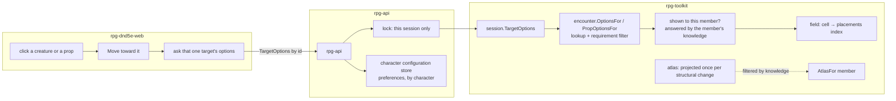

# Server at the keep's scale — what a verb may cost

Story rpg-project#753. Lane rpg-project#754. Walkthrough: [README.md](README.md).
Plan: [plan.md](plan.md). The yardstick is site format R1
([../site-format/design.md](../site-format/design.md)); the fixtures and the
harness are the benchmark keep's ([../benchmark-keep/design.md](../benchmark-keep/design.md)).

## Shape

## Law

**Interaction is by intent.** A member asks what one target offers, by that
target's id, after approaching it. The answer is the target's authored options
that the member's requirements admit: lines for a creature; lines, inspection
and checks for a prop. No verb enumerates every creature and every prop on
the map to light up candidates, so the cost of asking scales with the one
thing asked about.

**Knowledge is the oracle.** Whether a member can be shown a cell, a creature
or a prop is answered by that member's own knowledge, the per-observer
testimony the intel already keeps. The atlas is a projection of knowledge and
is never consulted to answer it, so no sight question costs a projection.

**The field indexes its placements.** The cells a placement or a wall covers
are derived when the field is built and when a placement changes, and are
read as a lookup after that. Nothing scans every cell to find what stands on
one.

**Project once per change.** The atlas of a field is derived when the field
changes structurally, a door, a placement that moves, arrives or goes, and is
read until the next change. A member's atlas is the field's atlas filtered by
that member's knowledge. A projection costs what changed, not what exists.

**A sweep covers what can be seen.** An observer's discovery sweep visits the
cells within its sight reach, not every cell of the field. A monster's sweep
learns intel for its own holdings and writes no revealed-cells beat; beats
are for seats, which have a client to show them to.

**Known cells have one home.** A member's known cells live in that member's
perception. The record carries the event that revealed them, never a second
copy of the set, so the encounter's stored size follows what happened, not
what is known times who knows it.

**Sessions lock by session.** A verb on one session holds that session's
guard and nothing wider. A slow verb stalls its own table only.

**Preferences are character configuration.** What a player chooses for their
character across sessions, discovery sharing today, lives in a first-class
character configuration store keyed by character with its own guard, written
by character verbs and read by the session. No session verb writes it, so no
session needs a lock wider than itself.

**No row gets worse.** Every slice posts its before and after rows from the
harness on the story the day it lands; a slice that worsens any row does not
merge.

## Rulings

| ID | ruling | status | scope | ruled by | date |
|---|---|---|---|---|---|
| R1 | Speaking and interacting are intent-driven and by id: click a creature or a prop, approach, read that one target's option list; no speak menu computed on Afford; props carry lines, inspection and checks the same way. | settled | session, encounter, api, web | KirkDiggler | 2026-10-31 |
| R2 | Sessions lock by session, and player preferences live in a first-class character configuration store with its own guard; the discovery-sharing preference moves there. | settled | api, session | KirkDiggler | 2026-10-31 |
| R3 | Server first: this story precedes the studio's own costs and the GPU, because nothing on a keep can be played until launch and the per-verb cost come down. | settled | story order | KirkDiggler | 2026-10-31 |

## Open

- **O1 Where the approach stops.** A fixed distance, or when the target
  witnesses the speaker and the speaker can be shown it, an author's line
  allowed to demand closer. The design carries the second as its default.
- **O2 Monster beats.** No reader of a monster's revealed-cells beat is known;
  the law drops them. A reader that appears reopens this.
- **O3 Invalidation grain.** Whether a door's state change re-derives the
  whole atlas or only the partition it touches; settled by the first measured
  row after the cache exists.
- **O4 The configuration store's shape.** Which preferences move with
  discovery sharing, and the store's wire; a character-service concern the
  plan names and this story only needs the one field of.
