# Site format — regions are the floor

Story rpg-project#725. Walkthrough: [README.md](README.md).

## Shape

```mermaid
flowchart LR
    subgraph web [rpg-dnd5e-web — studio]
        Brush[brush into the active region] --> Region[region: id, name, lighting, cells as row runs, optional construction]
        Region --> File[site YAML: regions, walls, props, bindings — no walkable list, no canvas dimensions]
    end
    File -->|PutDungeon, verbatim| api[rpg-api content / world store]
    api --> Decode[dungeonspec decode]
    subgraph toolkit [rpg-toolkit — encounter]
        Decode -->|one RegionInput per region| Compile[compileField]
        Compile --> Floor[floor = union of region cells − footprints]
        Compile --> Partitions[partitions = floor split by walls]
        Floor --> Atlas[atlas: authored regions with their cells and lighting]
        Partitions -.internal: hearing, seats, arrival.-> Play
    end
    Atlas -->|per seat, per cell| Play[play: floor and lighting per region, hearing per partition]
```

## Law

**Floor.** The floor of a site is the union of its regions. No cell belongs to
two regions. A cell painted outside a named region belongs to the implicit
region, which every site has. A region may be listed with no cells; it is a
place declared and not yet painted, and the compiler skips it. The dialect
carries no walkable list apart from the regions, so there is one source of
truth for where the floor is.

**Region.** A region is what it lists: an id, a name, the cells it owns, an
archetype, and a lighting level. Sound attaches here when its use case arrives
and not before. A region's name is its label on the map.

**Encoding.** A region's cells are written as row runs: for each `r`, a list of
inclusive `[qStart, qEnd]` spans in the site's axial frame. The runs are
canonical and are what the compiler reads. A region may also carry the
author's construction, the rectangles or polygons the studio tools drew, so a
hall can be resized rather than repainted. When construction and runs
disagree the runs win and the studio reports the difference. No bitmap,
outline-fill or hole grammar exists.

**Canvas.** The canvas is unbounded. The file carries no workspace
dimensions, only content and its coordinate frame. The studio derives the grid
it draws from the content's bounding box plus a margin and keeps the author's
view as local state, never in the document. Shipping a site needs no trim
because nothing empty is stored.

**Two divisions.** Authored regions and wall partitions are independent
divisions of the same cells. A partition is what walls make and owns the
mechanics: hearing hops, door footing, seat derivation, the hop count an alarm
travels. An authored region owns presentation: name, lighting, sound, label. The
compiled field answers both for a cell; the atlas and the wire carry only the
authored region, because partitions are derived and nothing derived is sent. An authored edge has no mechanical meaning of any kind, so an author
can split an open hall into two places without changing how sound or sight
crosses it. The compiler reads a cell's lighting from its authored region.

**Derivation.** The compiler subtracts wall and prop footprints from the floor
at load. Nothing derived is written, so the file carries only what the author
painted.

**Equality.** A site's compiled cell set is determined by its regions, walls
and props alone, and the content goldens pin it. The server stores the file
verbatim and the wire is per cell.

**Target.** One site, no fade, up to 30,000 hexes. Each layer is measured
against its budget on the castle and on a generated 30,000-hex fixture:

| layer | budget |
|---|---|
| file | under 100 KB of geometry at 30k hexes |
| step | under 100 ms server time per Move |
| studio | fluid paint, pan and zoom at full size |
| play | 60 fps on an integrated GPU |

## Rulings

| ID | ruling | status | scope | ruled by | date |
|---|---|---|---|---|---|
| R1 | The scale target is one site of up to 30,000 hexes with no fade, with the per-layer budgets above as the shared yardstick. | settled | this story and its siblings | KirkDiggler | 2026-10-29 |
| R2 | A region's cells are row runs, canonical and lossless; the author's construction may ride alongside and the runs win on disagreement. No bitmap or outline-fill grammar. | settled | dialect, studio | KirkDiggler | 2026-10-29 |
| R3 | The canvas is unbounded; the file carries no workspace dimensions and keeps its coordinate frame; the studio derives the grid and keeps the view locally. | settled | dialect, studio | KirkDiggler | 2026-10-29 |
| R4 | Authored regions own presentation and wall partitions own mechanics; they are independent divisions and no authored edge is mechanical. Lighting is read from the cell's authored region. | settled | encounter compiler, atlas | KirkDiggler | 2026-10-29 |
| R5 | The author paints into the active region with the implicit region as default; the label is the region's name; brushing with a region active reassigns cells. | settled | studio | KirkDiggler | 2026-10-29 |
| R6 | The content converts once by script; no dual-dialect period; the three byte pins regenerate in the same PRs; the goldens prove the compiled cell set is unchanged by the conversion. | settled | toolkit, api | KirkDiggler | 2026-10-29 |
| R7 | This story owns the format in toolkit, web and api, in that order, and the file budget of R1; protos are untouched. The compiled-field cache, region-graph pathfinding and per-region render batching are sibling stories that own the other budgets under R1's yardstick. | settled | story scope | KirkDiggler | 2026-10-29 |
| R8 | Partitions are derived at field construction and at every load from the persisted regions, walls and doors; nothing derived is stored in the field data. The per-load cost is measured on the castle and the 30k fixture; a high cost reopens this as persistence with a rebuild path. | settled | encounter field | KirkDiggler | 2026-10-29 |

## Open

- **O1 Sound on a region.** The field exists in the model and not in the
  dialect until a use case brings it.
- **O2 Region authoring gesture.** R5 is brush-only and is held loosely until
  the studio slice is played. Whether an outline tool returns, and what the
  construction's schema is under R2, is decided then; until then a
  construction is carried verbatim and unread.
- **O3 Placed rooms.** rpg-project#528 wants a room authored on its own and
  placed into a site, possibly twice. Whether a placed room is a region, a
  group of regions or a document of its own is that story's question and rides
  on this one.
- **O4 The 30k fixture.** What a realistic 30,000-hex site looks like for the
  generator: how many regions, walls and doors, and how open. Settled by the
  first sibling that needs it.
- **O5 Runs on the wire.** The atlas sends cells one by one for fog. Whether
  it ever carries runs waits on a measurement that asks for it.
