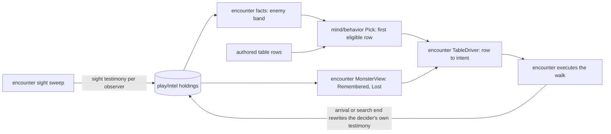

# Smarter monsters: walkthrough

The law is [design.md](design.md). This page explains it for a teammate who
codes and reads it cold.

## Component shape

## Ownership and contracts

| noun | owner | crosses the seam as | refuses |
|------|-------|---------------------|---------|
| the words `lost`, `search` | mind/behavior | `EnemyWord`, `Answer.Search` carried as data | reading positions, resolving targets |
| a decider's belief about a subject | play/intel, written by encounter | sight testimony payload (state, cell, facing) | telling a lie from the truth |
| the band a decider is in | encounter facts | `Facts.EnemyLost` beside the other bands | a live read of the subject |
| the search cell | encounter TableDriver, derived per turn | a routed walk toward a cell | keeping a step counter on the member |
| giving up | encounter, after the walk | the decider's testimony rewritten to unknown | deleting the testimony |
| returning | the author's `enemy: none` rows | an ordinary patrol or post row | a remembered "where I left" store |

## One value walked

The QA castle, gate guard on its loop (rpg-project#639):

1. The hero steps into the guard's sight. The sweep lands current testimony
   with the hero's cell and facing. Band `seen`; the guard closes.
2. The hero steps round the corner wall. The next sweep drops currency; the
   testimony keeps the last cell and facing. Band `remembered`; `toward: enemy`
   walks the remembered route.
3. The guard stands on that corner cell and sees nobody. Its testimony turns
   lost. Band `lost`; `search: { distance: 6 }` walks to the cell six on along
   the hero's last facing.
4. The guard stands on the search cell. Its testimony turns unknown. Band
   `none`; the patrol row walks it back to the nearest waypoint of its loop.

## Separations that look like one thing

- **Remembered and lost.** Both are stale. Remembered still points somewhere
  worth walking to; lost has been checked and found empty. Without the split a
  guard on the remembered cell would stand there forever, because its route is
  empty and its band never changes.
- **Unknown and no testimony.** Unknown is "I know they exist and lost them".
  No testimony is "I never saw them". Both read band `none` today; a later
  slice may give unknown a row of its own.

## Trade-offs

| taken | not taken | why |
|-------|-----------|-----|
| `toward: enemy` pursues memory | a `toward: remembered` word | the existing selector already falls back to memory when nothing is in sight; two words for one target is a second place to drift |
| return through `enemy: none` rows | a `return` word | the patrol already derives its next leg from where the walker stands; a `return` word needs a stored "where I left" and duplicates the rows the author wrote |
| search state in the testimony | a counter on the member | the testimony is per observer and per subject already; a counter would need its own lifecycle and save shape |
| a fifth band | arrival as a hidden driver rule | the author can write rows for "lost", such as a line or an alarm |

## Edges

- No route to the remembered cell: the testimony turns lost where the guard
  stands, and the search starts from the lost cell's heading.
- No route to the search cell, or a wall in the way: the router walks as close
  as it can; the search ends when no route brings it closer.
- A glimpse mid-search: fresh sight replaces the testimony and the band is
  `seen`.

## Where a likely change lands

- Dash while out of reach: the driver's walk budget, rpg-project#666.
- A pursuer bundle (S3): content folding the rows into one named table.
- Sharing a lost testimony with allies: the encounter's report path.

## Source map

- `rpg-toolkit/mind/behavior/table.go`: enemy bands and selector words.
- `rpg-toolkit/mind/behavior/answer.go`: the outcome words on a row.
- `rpg-toolkit/rulebooks/dnd5e/encounter/facts.go`: band projection.
- `rpg-toolkit/rulebooks/dnd5e/encounter/testimony.go`: sight testimony and its states.
- `rpg-toolkit/rulebooks/dnd5e/encounter/tabledriver.go`: rows to intents.
