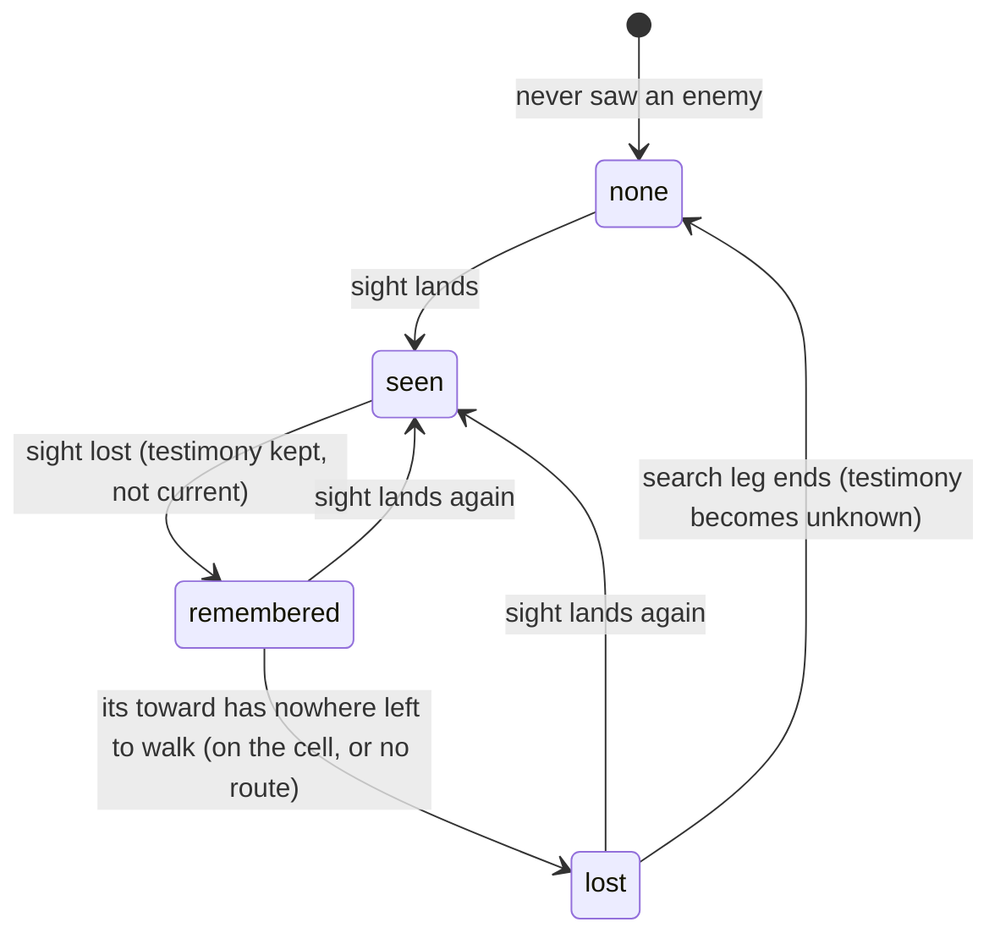

# Smarter monsters: pursuit

## Shape



Each state is a band of `when: { enemy: … }`, read from the decider's own
sight testimony of the subject. The rows an author writes per band carry the
behaviour:

| band | row in the castle | what the guard does |
|------|-------------------|---------------------|
| `seen` | `toward: enemy` | closes on where it sees the hero |
| `remembered` | `toward: enemy` | walks to the cell it last saw the hero on |
| `lost` | `search: { distance: 6 }` | walks on from there, along the heading it holds |
| `none` | `toward: { path }` or `toward: { at }` | resumes its loop or post |

## Law

- A table is ROLLED, not matched in order. The candidates are every row of the
  key whose whole `when` list holds and whose word the creature can pay for
  this pick. Each candidate's load is its weight (1 when omitted) times its
  temperament's percent for the row's word (100 for a soldier or no temper;
  `search` uses the `toward` percent). One die of the summed loads is rolled
  on the world's shared dice, and the candidate whose running total first
  reaches the face is the answer. Row order decides only which faces belong to
  which row, never priority: two rows eligible at once share the roll by
  load.
- The enemy bands are exclusive, so rows keyed on different bands never
  compete. Rows on other conditions (`heard`, `fact`, deeds) can be eligible
  beside a band row and then share the roll with it.
- A pursuit reads only the decider's own testimony. The remembered cell and
  heading are what this observer last saw, stale or wrong, never the subject's
  live position.
- `enemy: remembered` holds when the decider has a placed sight testimony of an
  opposed member that is not current and not lost.
- `toward: enemy` with no opposed member in sight walks the route to the
  remembered cell. No second selector word names the same target.
- A remembered testimony becomes lost when the decider's own `toward` has
  nowhere left to walk to it: the decider stands on its cell, or no route
  reaches that cell. Lost keeps the cell and the heading.
- Viewing never rewrites a memory, and neither does arriving on a cell. `lost`
  comes only from the driver's own `toward: enemy` with no route left: the
  creature stands on the remembered cell, or cannot reach it. `unknown` comes
  only from the creature's own search ending. A player's memory is never
  revised.
- `lost` is the creature's own observation that the cell is empty, kept with
  everything it saw there; it never erases the cell to patch staleness.
- `enemy: lost` holds when the decider's nearest opposed testimony is lost and
  none is seen, in reach or remembered. The bands stay exclusive.
- `search: { distance: N }` walks to the cell N cells from the lost cell
  along the held heading, in a straight line that ends where the next cell
  cannot be stepped to. N defaults to 6 and is at least 1.
- The held heading is the subject's facing in the testimony, as snapshotted at
  the last sighting. A step turns the walker along it and an attack turns the
  attacker, but speech does not, so the heading is the way the subject faced
  when last seen, not the way it went after. With none held, it is the
  decider's own facing on arriving, which is its direction of travel.
- A search ends when the decider stands on the search cell or no route brings
  it closer. Its testimony of that subject then becomes unknown: known to
  exist, not placed.
- Return is the `none` band. Unknown testimony places nobody, so the rows the
  author wrote under `enemy: none` fire, and a patrol resumes from the nearest
  waypoint. A decider with no such row stands where the search ended.
- Fresh sight replaces a lost or unknown testimony, so a glimpse at any point
  restarts the chase.
- A decider that never saw the subject holds no testimony of it and never
  pursues.
- The search holds no state of its own. The search cell is derived each turn
  from the lost testimony and the row's distance, as a patrol's next leg is
  derived from where the walker stands.

## Bundles (S3, rpg-project#670): the shape of a group

What the story wants from a bundle, read off the lane (rpg-project#683):

- N1 reuse: author a behaviour once, use it on many tables by one line, with parameters (`use: pursuer { distance: 6 }`).
- N2 a base per kind: every guard starts from `guard-base`.
- N3 one share for the group: a two-row branch must not take twice the share of a one-row `heard` row that is eligible at the same moment.
- N4 branches that carry their own roll: left or right inside the pursuit, decided when the pursuit is picked, not beside it.
- N5 flexible conditions: a pattern over an authored name (a fact key, a sound kind) instead of one literal.
- N6 the record still explains it: the `table` beat and the row verdicts (S6) show the group and what happened inside it.

Three shapes, against those needs and the seven principles:

| shape | what the decider sees | N3 one share | N4 inner roll | N6 explains | cost |
|-------|-----------------------|--------------|---------------|-------------|------|
| **A. expansion** — the compiler splices the bundle's rows into the table; `use:` is gone by runtime | flat rows | no: share = sum of rows. Exact only when the bundle's rows sit on exclusive bands (pursuit does; left/right does not) | no: the two rows roll beside everything else | rows tagged `from: pursuer` in the table beat | compiler only |
| **B. nested table** — `use:` becomes a row whose answer is a table: `{ weight, when?, rows: [...] }`; eligible when any inner row is; picked by the outer die, then an inner die over its eligible rows | a tree, one level or more | yes by construction | yes: the inner roll is the branch | the table beat carries the tree; `answered` carries the path `entry → entry`; the panel shows "pursuer → search left" | `Pick` recurses; `Answer` gains a `Rows` arm (sealed like `Search`); record and panel learn the path |
| **C. group marker** — expansion, but every spliced row carries a group id and the group's weight; `Pick` loads the group once and splits it among its eligible rows by their own weights | flat rows with ids | yes | one die, faces mapped group → row | rows tagged with group id and group load | `Pick` grows a grouping step; no nesting without more markers |

Reading:

- A is the band-aid shape for N3 and N4. It works today only because pursuit's rows are on exclusive bands; the first bundle with two rows eligible at once (left/right) breaks the "one line, one share" promise silently. Rejected.
- C buys N3 with one die but forecloses nesting: a bundle inside a bundle needs a second marker, and the record shows a flat list of ids pretending to be a structure. It is B with the tree flattened and the flattening paid for forever. Rejected.
- B is the primitive. A table is already a list of rows rolled by load; a row whose answer is a table is the same thing one level down. The same `Pick` serves both levels, the same verdicts explain both, and a bundle can hold a bundle. Base per kind (N2) is `use: guard-base` as the first line of the template's table, nothing new. The castle transcript is unchanged: with the route host's die of 1, the inner roll picks the first eligible inner row, as the flat row did. **Recommended.**

Where the name lives: `bundles:` is a dungeonspec section; the compiler resolves `use: <name> { params }` into the row's `rows` arm with parameters substituted, so `mind/behavior` holds no names, only the tree. The engine never looks a bundle up at runtime.

Sub-decisions under B, for the operator:

- **B1 the group's temperament percent.** A group row has no word, so what does a coward's `toward 50` do to a pursuer bundle? Options: (i) the group loads at 100 and temperament applies inside, so a coward's pursuer is picked like a soldier's and then flinches inside; (ii) the `use:` line names the word the group counts as (`as: toward`), default none; (iii) the group's percent is the maximum of its eligible inner rows' percents. *Proposed: (ii)*, because it is the author's statement and the panel can show it; (iii) is a hidden rule.
- **B2 depth.** Nesting unbounded, or one level? *Proposed: unbounded*, refused only by the validator's recursion guard; the record path shows the depth.
- **B3 the empty group.** A group none of whose rows is eligible is absent, not a hold. *Proposed: absent*, the same rule as a row.

N5, patterns in conditions, is orthogonal to the group shape and is NOT this slice. `When` is already a sum type with a sealed set of kinds; a pattern is a new value form on an existing kind (`heard: { kind: /clang|bell/ }`, `fact: /guards-.*/`), added where the kind is sealed. Two guards for when it comes: patterns match authored names only (fact keys, sound kinds, prop ids), never engine payload fields, so content never learns the engine's shape; and the row verdict's shorthand prints the pattern so the panel stays readable. Filed as a note on the lane, picked up when a use case brings it.

## Practical design: groups and patterns

### What the author types

```yaml
bundles:
  pursuer:                       # a named group, authored once
    params: { distance: 6, heading: went }
    rows:
      - when: { enemy: remembered }
        toward: enemy
      - when: { enemy: lost }
        search: { distance: $distance, heading: $heading }

  guesser:                       # a branch that carries its own roll
    rows:
      - when: { enemy: lost }
        search: { heading: left }
      - when: { enemy: lost }
        search: { heading: right }

  alarm-reactor:                 # patterns over authored sound kinds
    rows:
      - when: { heard: { kind: /clang|bell/, within: 3 } }
        toward: sound
      - when: { heard: { kind: /shout-.*/, within: 2 } }
        toward: sound
        weight: 2

templates:
  guard:
    base: guard-base             # the first line of every guard's time table
    time:
      - use: pursuer { distance: 8 }
        weight: 2
        as: toward               # the word this group counts as for temperament (B1 ii)
      - use: alarm-reactor
      - when: { enemy: none }
        toward: { path: east-loop }
```

A `use:` line is a row. It takes `weight`, an optional `when` of its own (a gate on the whole group), `as`, and the bundle's parameters. Everything else a row can carry, a `use:` row cannot: it has no word, its rows do.

### What it compiles to

`dungeonspec` resolves names; `mind/behavior` holds the tree and never a name.

```go
// mind/behavior
type Answer struct {
    Weight int
    When   []When
    // exactly one of the arms below, sealed by Validate:
    Hold, Attack, Toward, Away, Flee ...  // the words, as today
    Search *Search
    Rows   []Answer      // a GROUP: this row's answer is a table
    As     string        // a group's temperament word, "" = none (loads at 100)
    Say, Fact ...
}
```

Parameters are substituted at compile (`$distance` → 8); an unknown or missing parameter is refused with the bundle and the line. The group row keeps `From: "pursuer"` and its parameters in the compiled form for the record, not for the engine.

A pattern is a value form on an existing `when` kind, never a new kind:

```go
// mind/behavior
type Name struct { Literal string; Pattern string }  // one set, sealed by Validate
func (n Name) Matches(name string) bool
// Heard.Kind, When.Fact, a prop selector: Name instead of string.
```

### How the pick walks it

`Pick` is one function at every level.

1. **Eligibility at a level.** A word row is a candidate when its `when` all hold and the creature can pay for its word, as today. A group row is a candidate when its own `when` (if any) hold AND at least one of its rows is a candidate (B3: an empty group is absent, not a hold).
2. **Load.** A word row: weight × the temperament's percent for its word. A group row: weight × the percent for `as`, 100 when `as` is empty (B1).
3. **Roll.** One die over the level's summed loads, the world's shared dice, authored order mapping faces (R0 unchanged).
4. **Descend.** If the face lands on a group, roll again inside it over its candidates, with the same facts. Depth is bounded only by the validator's guard (B2).

The flat table is the special case of depth one. With the castle route host's die of 1, every level picks its first candidate, so the castle transcript is unchanged by the rewrite.

### What the record shows (S6 extended)

- The `table` beat carries the tree: a group row has `from`, `params`, `as` and `rows`.
- `answered` carries `path: [3, 1]` instead of `entry: 3`, and `rows` verdicts per level: a group's verdict holds its rows' verdicts.
- The panel's sentence: `gate-1 · time · rolled 61 of 200 → pursuer (2×100) · rolled 7 of 100 → enemy lost → search 8 went`. Expanded: every row at every level, ✓ load or ✗ reason. A pattern prints as written: `heard /clang|bell/ within 3`.

### What the compiler refuses (sentences for the form)

- `use: <name>` naming no bundle in the file.
- A parameter the bundle does not declare, or a declared parameter not given and without a default.
- A `use:` row carrying a word, a `search`, or `say`.
- A group whose rows are empty; a group nested past the depth guard; a bundle that uses itself.
- `as` naming anything but a temperament word.
- A pattern that matches no authored name of its kind in the file: no sound this file makes, no fact any row sets, no prop placed. Refused, never "never fires" (rpg-project#684 L3).
- A pattern anywhere but as the value of a `when` kind that takes a name (#684 L2).

### What the studio shows

A `use:` row reads as one line, `pursuer { distance: 8 } ×2 as toward`, and expands read-only to the bundle's rows with the parameters filled. The `bundles:` section is edited in its own list. A pattern is typed as `/…/` in the same field as the literal.

### Castle after the rewrite

Each gate guard's `time` table becomes `use: patrol { path: … }`, `use: pursuer`, `use: alarm-reactor`, and the `enemy: none` return row, with `heading: went` living in the pursuer's defaults. Same transcript, one `table` beat per guard carrying the tree.

### Slices

- S3a `mind/behavior`: `Rows`, `As`, `Name`, recursive `Pick`, path and nested verdicts. Tests: a group loads once; an empty group is absent; a die of 1 reproduces the flat pick; a pattern matches a literal set; validation refusals.
- S3b `rulebooks/dnd5e/encounter` + `dungeonspec`: `bundles:`, `use:`, parameters, `base:`, pattern-against-authored-names validation, table beat tree, `answered.path`; castle content rewritten; castle transcript test unchanged.
- S3c session classification if a beat shape changes (it does not; `table` and `answered` keep their names), api pins.
- S3d web: panel path rendering; studio `use:` line and `bundles:` list.
- Patterns ship with S3a/S3b only if a castle row needs one; otherwise the `Name` type lands with a literal-only test and the `/…/` form waits for its use case (#683).

## Rulings

| ID | ruling | status | scope | ruled by | date |
|----|--------|--------|-------|----------|------|
| R0 | rows are rolled by load (weight × temperament percent) among every eligible row; order only maps die faces; exclusivity comes from conditions, never position | settled (existing mind/behavior law) | table selection | recorded from the code | 2026-10-23 |
| R1 | `enemy: remembered` reads the decider's own non-current, placed, not-lost sight testimony of an opposed member | open | encounter bands | proposed | 2026-10-22 |
| R2 | pursuit walks with the existing `toward: enemy`; no `toward: remembered` word | open | table vocabulary | proposed | 2026-10-22 |
| R3 | arriving on the remembered cell, or finding no route to it, turns the testimony lost; `enemy: lost` is a fifth band | open | encounter bands, testimony | proposed | 2026-10-22 |
| R4 | `search: { distance: N }`, default 6, walks to the cell N along the held heading (subject's seen facing, else the decider's own facing) | open | table vocabulary | proposed | 2026-10-22 |
| R5 | a search's end turns the testimony unknown; return is the author's own `enemy: none` rows, not a word | open | table vocabulary, testimony | proposed | 2026-10-22 |
| R6 | a decider that never saw the subject holds no testimony and never pursues | open | encounter bands | proposed | 2026-10-22 |
| R7 | the words `lost` and `search` are sealed in mind/behavior, so the slice is two module PRs: mind/behavior first, then rulebooks/dnd5e/encounter on its pseudo-version | open | delivery | proposed | 2026-10-22 |
| R8 | viewing and arriving never rewrite a memory; `lost` comes only from the driver's own `toward: enemy` with no route left, `unknown` only from its search ending; a player's memory is never revised | open | encounter testimony | proposed | 2026-10-23 |
| R9 | a player's stale memory stays drawn as the ghost of where the creature was last seen; a player gets no observed-empty testimony, and whether to keep drawing is the client's (rpg-toolkit#1691) | ruled | player testimony, web | KirkDiggler | 2026-10-23 |
| R10 | a search's heading is the row's choice, not the engine's: testimony carries the way the subject WENT (its last seen step) beside the way it faced, and `search` names which heading it follows; a table that wants a guess writes two rows (left and right) that share the roll by weight | ruled, not built | encounter testimony, table vocabulary | KirkDiggler | 2026-10-23 |
| R11 | dash, and any choice that leads to a dash, is outside this story's pursuit slices (rpg-project#661, #666) | ruled | scope | KirkDiggler | 2026-10-23 |
| R12 | a bundle is a NESTED TABLE: `use:` is a row whose answer is a table; the outer die picks the group by its one weight, the inner die picks inside; the record carries the tree and the path (design §Bundles, shape B) | ruled | table grammar | KirkDiggler | 2026-10-25 |
| R13 | a group's temperament percent is the word its `as:` names; none = 100 (B1 ii) | ruled | table grammar | KirkDiggler | 2026-10-25 |
| R14 | nesting is unbounded, refused only by the validator's depth guard (B2) | ruled | table grammar | KirkDiggler | 2026-10-25 |
| R15 | a group none of whose rows is eligible is absent, not a hold (B3) | ruled | table selection | KirkDiggler | 2026-10-25 |
| R16 | content speaks in authored names; a pattern is a value of an existing `when` kind, matches authored names only, and one matching nothing authored is refused at compile (rpg-project#684 L1–L3) | ruled in principle ("goes without saying"), written at #684 | content/engine seam | KirkDiggler | 2026-10-25 |

## Open

- Ruled 2026-10-23, from O1: the ghost is the behaviour. A player who looks at
  a remembered creature's cell and sees it empty keeps the memory as drawn;
  the client decides when to stop drawing it (rpg-toolkit#1691). No
  observed-empty testimony for players. R9.
- Ruled 2026-10-23, from O2: the engine built the facing heading, and that is
  one option, not the rule. When the subject leaves view the observer holds
  something about the way it went, so testimony should carry that heading
  beside the facing, and the `search` row should say which one it follows. A
  smart table follows the way they went; a plainer table rolls left or right
  as two rows sharing the roll. R10. Not built; the need is filed on the
  story (rpg-project#667).
- Open: whether the table grammar needs a group that carries one load. Two
  rows under `enemy: lost` today hold two loads, so a branch's share grows
  with its row count against a `heard` row eligible at the same moment. That
  is the S3 bundle question (rpg-project#670), not this slice's.
- Open, its own story later: search as a behaviour of its own. Patterns,
  sweeping while walking, an npc that knows where the valuables are and
  checks there. This design's `search` is one straight leg.
- Dash while out of reach (rpg-project#666, shared with #661) is not in this
  story's pursuit slices (R11). Pursuit walks at the decider's movement.
- Whether allies share a lost or unknown testimony by report. This design
  keeps each guard's search its own.
