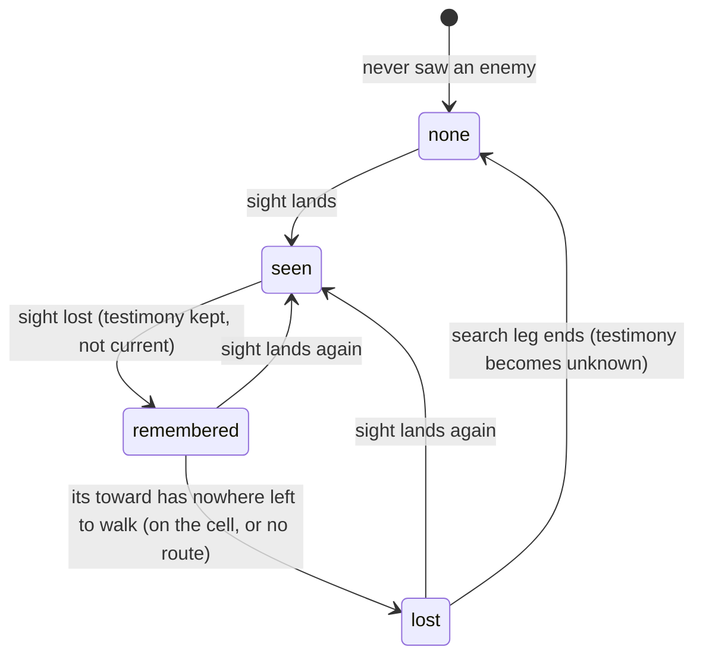

# Smarter monsters: pursuit

## Shape

Each state is a band of `when: { enemy: … }`, read from the decider's own
sight testimony of the subject. The rows an author writes per band carry the
behaviour:

| band | row in the castle | what the guard does |
|------|-------------------|---------------------|
| `seen` | `toward: enemy` | closes on where it sees the hero |
| `remembered` | `toward: enemy` | walks to the cell it last saw the hero on |
| `lost` | `search: { distance: 6 }` | walks on from there, along the heading it holds |
| `none` | `toward: { path }` or `toward: { at }` | resumes its loop or post |

## Law

- A pursuit reads only the decider's own testimony. The remembered cell and
  heading are what this observer last saw, stale or wrong, never the subject's
  live position.
- `enemy: remembered` holds when the decider has a placed sight testimony of an
  opposed member that is not current and not lost.
- `toward: enemy` with no opposed member in sight walks the route to the
  remembered cell. No second selector word names the same target.
- A remembered testimony becomes lost when the decider's own `toward` has
  nowhere left to walk to it: the decider stands on its cell, or no route
  reaches that cell. Lost keeps the cell and the heading.
- Viewing never rewrites a memory, and neither does arriving on a cell. `lost`
  comes only from the driver's own `toward: enemy` with no route left: the
  creature stands on the remembered cell, or cannot reach it. `unknown` comes
  only from the creature's own search ending. A player's memory is never
  revised.
- `lost` is the creature's own observation that the cell is empty, kept with
  everything it saw there; it never erases the cell to patch staleness.
- `enemy: lost` holds when the decider's nearest opposed testimony is lost and
  none is seen, in reach or remembered. The bands stay exclusive.
- `search: { distance: N }` walks to the cell N cells from the lost cell
  along the held heading, in a straight line that ends where the next cell
  cannot be stepped to. N defaults to 6 and is at least 1.
- The held heading is the subject's facing in the testimony, as snapshotted at
  the last sighting. A step turns the walker along it and an attack turns the
  attacker, but speech does not, so the heading is the way the subject faced
  when last seen, not the way it went after. With none held, it is the
  decider's own facing on arriving, which is its direction of travel.
- A search ends when the decider stands on the search cell or no route brings
  it closer. Its testimony of that subject then becomes unknown: known to
  exist, not placed.
- Return is the `none` band. Unknown testimony places nobody, so the rows the
  author wrote under `enemy: none` fire, and a patrol resumes from the nearest
  waypoint. A decider with no such row stands where the search ended.
- Fresh sight replaces a lost or unknown testimony, so a glimpse at any point
  restarts the chase.
- A decider that never saw the subject holds no testimony of it and never
  pursues.
- The search holds no state of its own. The search cell is derived each turn
  from the lost testimony and the row's distance, as a patrol's next leg is
  derived from where the walker stands.

## Rulings

| ID | ruling | status | scope | ruled by | date |
|----|--------|--------|-------|----------|------|
| R1 | `enemy: remembered` reads the decider's own non-current, placed, not-lost sight testimony of an opposed member | open | encounter bands | proposed | 2026-10-22 |
| R2 | pursuit walks with the existing `toward: enemy`; no `toward: remembered` word | open | table vocabulary | proposed | 2026-10-22 |
| R3 | arriving on the remembered cell, or finding no route to it, turns the testimony lost; `enemy: lost` is a fifth band | open | encounter bands, testimony | proposed | 2026-10-22 |
| R4 | `search: { distance: N }`, default 6, walks to the cell N along the held heading (subject's seen facing, else the decider's own facing) | open | table vocabulary | proposed | 2026-10-22 |
| R5 | a search's end turns the testimony unknown; return is the author's own `enemy: none` rows, not a word | open | table vocabulary, testimony | proposed | 2026-10-22 |
| R6 | a decider that never saw the subject holds no testimony and never pursues | open | encounter bands | proposed | 2026-10-22 |
| R7 | the words `lost` and `search` are sealed in mind/behavior, so the slice is two module PRs: mind/behavior first, then rulebooks/dnd5e/encounter on its pseudo-version | open | delivery | proposed | 2026-10-22 |
| R8 | viewing and arriving never rewrite a memory; `lost` comes only from the driver's own `toward: enemy` with no route left, `unknown` only from its search ending; a player's memory is never revised | open | encounter testimony | proposed | 2026-10-23 |

## Open

- O1: whether a player who sees a remembered creature's cell empty gets the
  same observed-empty (`lost`) testimony, or whether drawing a stale memory
  stays the client's decision (rpg-toolkit#1691's case). Not built.
- O2: whether the search heading is the last-seen facing (built) or the
  subject's last-seen direction of travel, the walk's own vector. A subject
  seen standing and facing one way, then leaving unseen another way, is
  searched for in the way it faced (rpg-project#668 walk evidence).

- Dash while out of reach (rpg-project#666, shared with #661) is not in this
  slice. Pursuit walks at the decider's movement.
- Whether a search leg should sweep, turning to face as it walks, or walk a
  straight line. This design walks the router's route to the search cell.
- Whether allies share a lost or unknown testimony by report. This design
  keeps each guard's search its own.
