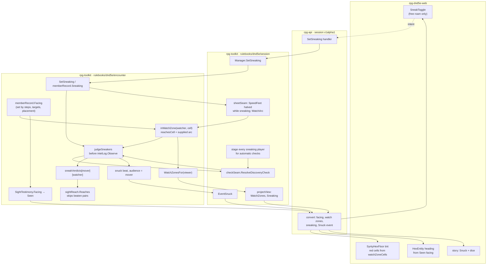

# Sneaking — walkthrough

Issue: [rpg-project#606](https://github.com/KirkDiggler/rpg-project/issues/606).
Law: [design.md](design.md). Plan: [plan.md](plan.md).

## What this is

A player declares sneaking in free roam, and from then on every watcher's
sight of them runs through one contest: their Stealth against that watcher's
passive Perception, rolled once when they enter that watcher's red zone. The
design reuses four things that already exist. The **sight test**
(`sightReach.reachesCell`) is the red zone. The **automatic check seam**
(`CheckResolver.ResolveDiscoveryCheck`, rolled by resolution on the shared
dice) is the roll. The **perception pass's fade path** turns a won roll into a
ghost. The **per-seat view read** (`ViewOutput`, fog of war's
`VisibleCells`) carries the red floor. It deliberately introduces **no second
visibility authority**: no client cone, no stealth modifier copied onto sheet
facts, no hidden flag that other code must remember to read, and no change to
how a member who is not sneaking is seen.

Facing arrives first because the cone needs it. Facing is a member fact the
engine sets as members move and turn, carried to every observer as part of
what they saw.

## Component shape

## Ownership and contracts

| Component | Owns | Input → output |
|---|---|---|
| `Encounter.SetSneaking` (encounter) | The mode | `SetSneakingInput{Member, Sneaking bool}` → `SetSneakingOutput{Sneaking bool}`; spends no time, then `refreshSight` over the roster; a no-op when the mode is already held; refuses a non-player, a member in a fight, a closed run, and an encounter without a `CheckResolver` |
| `memberRecord.Sneaking` (encounter) | Whether a member sneaks now | Set by `SetSneaking`; cleared by Attack, Cast, Speak by that member, by formation engaging them (before any turn budget reads speed), and by Exit; persisted on `EncounterData` |
| `memberRecord.Facing` (encounter) | Which way a member faces | Seeded from `MemberInput.Facing` / `JoinInput.Facing`; written by each `takeStep` and by a walk or attack that ends on a target; persisted |
| `sightReach.inWatchZone` (encounter) | One watcher's red zone this pass | `(watcher MemberID, cell)` → bool: `reachesCell(watcher, cell)` accepts the cell and, when the supplied `WatchArc` is non-zero, its bearing lies within `Facing ± WatchArc/2`, edge inclusive; the watcher's own cell is always in; a watcher with passive Perception 0 gets no cone (R29) |
| `judgeSneakers` (encounter) | When a pair is rolled and what is stored | For each sneaking mover × each watcher in the pass: a crossing from outside to inside an armed pair's zone → `CheckResolver.ResolveDiscoveryCheck`, a stored verdict and a `snuck` beat; a declaration in plain view → a lost verdict, no roll; `InZone` from the zone's own answer each pass; a mover the re-arm distance outside (and, for a lost pair, out of ordinary sight) → `Armed` |
| `sneakVerdicts` (encounter) | The verdict per (mover, watcher) | `map[MemberID]map[MemberID]SneakVerdictData{Beaten, Armed, InZone bool}`, discovery's attempt shape; persisted; dropped when the mover stops sneaking |
| `sightReach.Reaches` (encounter) | The sight pass's answer per pair | Unchanged geometry, plus, for a sneaking subject: false for a pair with a beaten verdict; ordinary geometry for a pair with a lost verdict; otherwise false outside the observer's zone; set on the reach before `appendMutablePresences` copies it |
| `WatchZonesFor` (encounter) | The red floor for one seat | `MemberID` → `[]WatchZone{Watcher, Cells}`: empty unless the viewer sneaks; one per watcher the viewer holds live; cells ∩ the viewer's known, unconcealed cells, sorted |
| `SightTestimony.Facing` (encounter) | Facing as observed | Snapshotted per pass into the one payload each subject is encoded into |
| `checkSeam` (session) | The roll | `ResolveCheckInput{Member: mover, Approaches: [{Ability: "stealth", DC: passive}]}` → `resolution.MakeCheck` on the shared dice → `ResolveCheckOutput{Beaten, Applied, Total, Calculation}` |
| `sheetSeam` (session) | Speed while sneaking; the watch terms | `SheetFacts.SpeedFeet` is half the sheet's speed for a member the encounter reports sneaking; pace rounds through `CellsFromFeet`. `SheetFacts.WatchArc` is a monster's `senses.watch_arc`, seeded 120 when unstated, and zero for a character; `SheetFacts.WatchResetCells` is the session's seed |
| `Manager.SetSneaking` (session) | The verb's write scope | `SetSneakingInput{Member}` → encounter verb, save, `SetSneakingOutput{Sneaking}` |
| `projectView` (session) | One seat's snapshot | `ViewOutput.WatchZones`, `ViewOutput.Sneaking` passed through unchanged |
| `EventSnuck` (session) | The stream body | `snuck` beat → `SnuckBody{Member, Watcher, DC, Total, Beaten, Calculation}`, recipient the mover |
| rpg-api handlers | Seat binding and conversion | Caller → `SetSneakingResponse`; `GetViewResponse.watch_zones`, `.sneaking`; `Seen.facing_degrees`; `Event.snuck` |
| `SneakToggle`, `watchZoneCells` → `SyntyHexFloor` tint, `HexEntity` heading (web) | Drawing and intent | View and events → a red tint on zone cells (`watchZoneCells.ts` unions the sent cells; `SyntyHexFloor` tints them over the fog colour), the toggle state; `HexEntity` seeds and requests the heading from `seen.facingDegrees` when present and passes the move-path heading only when absent |

**Refusals.** The encounter does not compare a Stealth total to a DC; the
check resolver decides and the encounter carries `Beaten`. The encounter does
not know that sneaking halves speed; the session's speed answer does. It
picks no arc and no re-arm distance; the session supplies both. The zone is never built from the watcher's known cells, because knowledge lags
sight. `judgeSneakers` rolls only on a crossing into an armed pair's zone,
so a six-step walk through one zone rolls once, and a declaration in plain
view never rolls. `Reaches` never suppresses a
subject who is not sneaking, so R2 holds by construction. `WatchZonesFor`
never returns a zone for a watcher the viewer does not hold live, and never a
cell the viewer does not know. The session never filters or recomputes a
zone. rpg-api never decides who is sneaking. The web never computes a zone,
a cone or a heading when the wire carries one.

## Walk one thing through

A rogue with Stealth +7 sneaks through the kitchen door toward the keep.
Knight `keep-1` paces the throne room's west side; its passive Perception is
10.

1. **Intent.** The web's toggle sends `SetSneaking{member: rogue}`. rpg-api
   binds the caller and calls `Manager.SetSneaking`. The encounter sets
   `memberRecord.Sneaking = true`, spends no time, and refreshes sight. The
   knight is behind a shut door and does not see the rogue, so no pair is
   judged lost. `GetView` now reports `sneaking: true`.
2. **Pace.** The rogue walks. Each step asks `Sheets` for speed; the session
   answers 15 ft for the rogue's 30, so a world-clock round buys three cells
   instead of six. The knight's patrol gets twice the time to walk.
3. **Facing.** Each step sets the rogue's facing to the step's bearing. The
   knight's patrol steps set its facing along its path. At a waypoint with a
   `wait`, the knight stands those rounds facing the waypoint's `facing`.
4. **Zone.** At the step that brings the rogue into the throne room doorway,
   the refresh builds the knight's zone from `reachesCell(keep-1, cell)` under
   its 24-cell sight range, narrowed by `inWatchZone` to the cells within 60°
   of the knight's facing under the session's seeded arc of 120. The rogue's
   last cell was outside it and this one is inside, and the pair is armed: a
   crossing. Had the rogue come in behind the knight's back, the cell would
   lie outside the wedge: no roll, and the knight would not see the rogue.
5. **Roll.** `judgeSneakers` asks `ResolveDiscoveryCheck{rogue, [{stealth,
   DC 10}]}`. The session's seam runs `resolution.MakeCheck` on the shared
   dice; the d20 shows 15, so the total is 22 and `Beaten` is true. The
   `Calculation` carries the face and the modifier's sources.
6. **Verdict.** `sneakVerdicts[rogue][keep-1] = {Beaten: true}`. One `snuck`
   beat goes to the rogue alone. The rogue sees the knight, so the beat names
   it.
7. **Suppression.** The same refresh's sight pass asks `Reaches(keep-1,
   rogue)`, which answers false. The knight's percept omits the rogue, so no
   first contact lands and no fight forms. The rogue's percept holds the
   knight, which classifies as the drop and is discarded, so the walk goes on.
8. **Floor.** The rogue's `GetView` carries one `WatchZone{watcher: keep-1}`
   whose cells are the knight's zone ∩ the rogue's known cells. The web's
   `watchZoneCells.ts` unions the sent cells into `Scene3D.watchZoneCells`, and
   `SyntyHexFloor` tints those tiles red over their fog colour.
9. **Leaving.** The rogue steps out of the knight's zone and on until they
   stand the re-arm distance outside it; the pair is armed again. If the
   knight's patrol then sweeps its zone over the rogue, that crossing rolls
   again.
10. **Plain view.** Had the rogue declared sneaking while the knight already
    saw them, the knight's pair would hold a lost verdict with no roll. The
    knight would keep seeing the rogue by ordinary sight, even behind its
    cone, until the rogue broke its line of sight and stood the re-arm
    distance outside its zone.

With a d20 of 2 the total is 9, `Beaten` is false, the knight's percept holds
the rogue, and today's contact law forms the fight with the existing surprise
label.

## Separations that look like one thing

| Query | Source of truth |
|---|---|
| Can this watcher see this cell now? | `sightReach.reachesCell`; its zone adds the arc in `inWatchZone` |
| What has this watcher seen? | The watcher's `known:cells` journal |
| Does the watcher see the sneaking mover? | The pass's `Reaches`: zone membership and the stored verdict |
| Does the viewer see the watcher? | The viewer's perception holding of it, `CurrentVia` non-empty |
| What does the viewer draw red? | `WatchZonesFor(viewer)` |
| What does the viewer draw lit? | `VisibleCellsFor(viewer)` |
| How far can a member see? | The `Sight` capability, per member, per pass |
| Which way does a member face? | `memberRecord.Facing`, observed through `SightTestimony.Facing` |

The **zone is not the watcher's knowledge.** An implementation that reuses
`VisibleCellsFor(watcher)` gets a zone that skips the corridor the knight has
never looked down, and the rogue walks unchallenged through the one place the
knight is looking at. The **red floor is not the viewer's lit floor.** The
red cells are a watcher's reach clipped to what the viewer knows, while the
lit cells are the viewer's own reach. **The arc is not sight.** An
implementation that puts the arc on the `Sight` answer narrows every
member's percepts and the fog-of-war lit set, which breaks R2 and draws the
wedge fog-of-war R5 forbids. The arc travels on `SheetFacts` and is read only
by `inWatchZone`. **Facing as drawn is testimony.** An observer
draws the facing it last saw, so a ghost keeps the heading it had when it
faded.

## Trade-offs

| Decision | Benefit | Cost / boundary | Not taken |
|---|---|---|---|
| The roll through `ResolveDiscoveryCheck` | Armour's Stealth disadvantage, expertise and every future Stealth rule arrive through resolution with no change here; the dice are the shared dice | The session must stage every sneaking player's record on every write verb, because another verb can move a watcher into them | A `Stealth int` on `SheetFacts` compared by the encounter |
| One roll per (mover, watcher) per entry, re-armed at a distance | A walk through one zone rolls once; a zone edge pacing over a still sneaker does not roll every step; the result reads as a check the player watches | A verdict is persisted state with discovery's armed shape; the session owns the re-arm seed | A stored Stealth total compared afresh each pass (rpg-toolkit#1020's lean); clearing on the first refresh outside |
| A declaration in plain view is a lost verdict | Nobody vanishes from a watcher that sees them | Sneaking past a watcher means starting out of its sight | Rolling to drop out of live sight |
| Judging before the sight pass | The pass that would form contact already knows the verdict | The judgement runs in every refresh that has a sneaker | Rolling inside the drop arm of `classify`, after percepts are built |
| The zone is the sight test | One geometry for the zone, the floor and the pass | The zone reveals the watcher's sight range to the sneaking player | The watcher's known cells; a client cone |
| Half speed while sneaking | The cost is time, which patrols spend | Pace on the world clock changes for the sneaker; the session owns the halving | No cost; a separate movement budget |
| No zones for a viewer who is not sneaking | The floor never teaches a rule that does not apply | A player declares sneaking to see the floor | Drawing every zone always |
| Facing as a bearing in degrees | Six step directions and any bearing toward a target fit one type; cones need it | Authored compass words convert at the dialect | The eight compass words on the member |
| The arc on the zone only, supplied by the session | R2 holds; fog-of-war's lit set stays a disc; tuning the arc is content, not Go | A sneaker's sight is unchanged by their own facing; a per-placement arc waits for a use case | An arc on the `Sight` answer; a default constant in the encounter |

## Edges

- **Free roam only.** `SetSneaking` refuses a member in a fight, and a fight
  engaging the sneaker ends the mode (R6, R7).
- **No monster sneaks.** Watchers are the non-player members (R16, O4).
- **No footfalls.** A sneaking walk is as silent as any walk, because no step
  makes a sound (R16).
- **Surprise is a label.** A failed roll forms the fight with today's surprise
  computation, which nothing consumes (R16, O5).
- **A won roll does not stop the walk.** The drop arm still classifies and
  discards (O3).
- **A civil watcher is a watcher.** A loss against the cook means the cook sees
  the rogue; no fight forms, because only hostile contact forms one, and the
  cook is a witness to whatever the rogue does next.
- **Another player is never a watcher.** The party does not roll against
  itself.

## Where a change lands

- **Pass without Trace, or a cloak of elvenkind.** A bonus on Stealth checks
  is resolution's: it rides `MakeCheck` and nothing in the encounter moves.
- **Darkvision and dim light.** A better `Sight` answer, which reshapes every
  zone through `reachesCell` with no zone code changing.
- **A monster that sneaks.** A decider intent and a monster Stealth answer
  (O4); `judgeSneakers` then iterates movers of any kind, and the check
  resolver grows a monster path.
- **Showing a civil zone in another colour.** The web, from the zone's
  watcher and its stance (O7).

## Source map

| Concern | Path |
|---|---|
| Sight capability and reach | `rpg-toolkit/rulebooks/dnd5e/encounter/sight.go`, `sightreach.go` |
| The sight pass | `rpg-toolkit/rulebooks/dnd5e/encounter/encounter.go` (`rebuildPercepts`, `refreshSight`) |
| Contact classification and the drop arm | `rpg-toolkit/rulebooks/dnd5e/encounter/trigger.go` (`classify`) |
| Automatic checks and their beat | `rpg-toolkit/rulebooks/dnd5e/encounter/conceal.go` (`CheckResolver`), `discovery.go` |
| Seen-now cells | `rpg-toolkit/rulebooks/dnd5e/encounter/visiblecells.go` |
| Sheet facts | `rpg-toolkit/rulebooks/dnd5e/encounter/sheets.go`; `rulebooks/dnd5e/session/sheets.go` |
| World-clock pace | `rpg-toolkit/rulebooks/dnd5e/encounter/worldtime.go` |
| The check seam | `rpg-toolkit/rulebooks/dnd5e/session/conceal.go` (`checkSeam`), `exploration.go` (staging) |
| Patrol waypoint wait and facing | `rpg-toolkit/mind/behavior/table.go` (`Selector.Waits`, `Selector.Facings`); `rpg-toolkit/rulebooks/dnd5e/encounter/dwell.go` |
| Authored creature facing | `rpg-toolkit/rulebooks/dnd5e/encounter/dungeonspec/single_room.go`, `compile.go` (`MonsterPlacement.Facing`) |
| Wire | `rpg-api-protos/dnd5e/api/session/v1alpha1/types.proto` (`Seen`), `service.proto` (`GetViewResponse`), `events.proto` (`DiscoveryChecked`, `Heard`); rpg-toolkit `docs/adr/0041-sighting-carries-typed-channel-knowledge.md` |
| Web heading | `rpg-dnd5e-web/src/components/hex-grid/HexEntity.tsx` (the gate), `useEntityFacing.ts`, `facingYaw.ts` |
| Monster senses | `rpg-toolkit/rulebooks/dnd5e/monster/data.go` (`SensesData`) |
