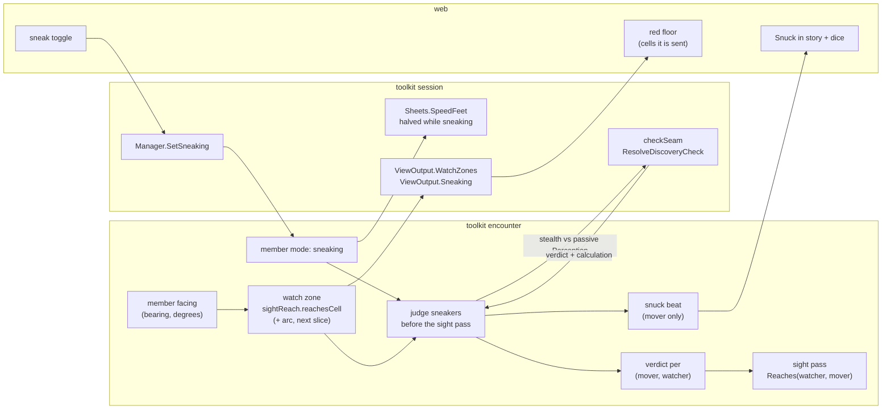

# Sneaking — a declared mode, a red zone per watcher, one roll per entry

Tracking: [rpg-project#606](https://github.com/KirkDiggler/rpg-project/issues/606).
Walkthrough: [README.md](README.md). Plan: [plan.md](plan.md).
Facing slice: [rpg-project#582](https://github.com/KirkDiggler/rpg-project/issues/582).
Stealth contest: [rpg-toolkit#1020](https://github.com/KirkDiggler/rpg-toolkit/issues/1020).

## Shape

A player declares sneaking in free roam. Every watcher has a red zone: the
cells its sight would reach from where it stands, facing the way it faces.
The first refresh that finds a sneaking mover inside a watcher's zone rolls
that mover's Stealth against that watcher's passive Perception, once. A win
keeps the mover out of that watcher's sight until the mover leaves the zone.
A loss lets the watcher see the mover, and today's contact law proceeds. The
engine owns every piece; the client draws the zones it is sent.

## Law

- **Sneaking is a mode a player declares (R1, R6).** `SetSneaking` sets or
  clears it on the member, on the world clock only, and spends no time. A
  monster never sneaks. The mode is encounter state and persists with the
  encounter.
- **Showing yourself ends it (R7).** Sneaking ends when the mover attacks,
  casts or speaks, when a formed fight engages the mover, when the mover
  declares it off, and when the mover exits. Ending clears every verdict the
  mover holds. A sound the mover makes does not end it; hearing is its own
  channel.
- **Sneaking costs pace (R8).** While a member sneaks, the session's sheet
  answer for that member's speed is half the sheet's speed, so a world-clock
  round buys half the cells. The encounter never knows the halving.
- **A watcher's red zone is its sight, not its knowledge (R9).** A watcher is
  any placed member that is not a player. Its zone is every cell
  `sightReach.reachesCell(watcher, cell)` answers true for in the current
  pass's geometry: the watcher's own `Sight` range, line of sight and sight
  areas, plus its arc once cones land (R14). Why: the watcher's known cells
  are what it has seen, and a zone built from them would hide a lit corridor
  it has never looked down.
- **Not sneaking, sight is unchanged (R2).** A mover who is not sneaking is
  seen exactly as today: zones, arcs and verdicts do not apply to them.
- **One roll per entry, per watcher (R3, R10).** A pair is judged at the first
  refresh in which a sneaking mover stands in the watcher's zone and the pair
  holds no verdict, whoever moved. The judgement runs before the sight pass
  and asks `CheckResolver.ResolveDiscoveryCheck` with one approach: ability
  `stealth`, DC the watcher's `SheetFacts.PassivePerception`. Resolution rolls
  it on the session's shared dice with the mover as the die's entity. The
  composition carries the verdict and never compares a total.
- **A verdict lasts while the mover stays in the zone (R10).** The verdict is
  stored per (mover, watcher) and persists with the encounter. The first
  refresh that finds the mover outside that watcher's zone clears it, so a
  re-entry rolls again. A different watcher's zone is a different pair and
  rolls on its own.
- **A win suppresses; nothing is erased (R11).** While a beaten verdict
  stands, `Reaches(watcher, mover)` answers false for that pair alone. The
  watcher's holding of the mover fades by the ordinary path to a ghost at the
  last position it saw. A lost verdict changes nothing: the watcher sees the
  mover and contact proceeds as today.
- **Outside the zone, a sneaker is unseen by that watcher (R9, R14).** For a
  sneaking mover, a watcher sees them only inside its zone, and only without a
  beaten verdict. Before cones, the zone equals today's sight, so this adds
  nothing; with cones, a sneaker behind a watcher is unseen by it.
- **The roll is the mover's to see, and only theirs (R5, R12).** Each judged
  pair writes one `snuck` beat with audience the mover alone: the mover, the
  DC, the total, whether it beat the DC, and the calculation. It names the
  watcher only when the mover holds that watcher live at the judging refresh.
  Why: a beat that names a creature the mover cannot see hands the client an
  identity its eyes never gave it.
- **Facing is member state the engine sets (R4, R13).** Every member carries a
  facing: a bearing in degrees, 0 is map north, clockwise. It is seeded from
  the authored placement facing, or the start facing for a player. Each step
  sets it to that step's direction. A walk that ends with a target turns the
  walker toward that target, and an attack turns the attacker toward its
  target. Facing persists with the encounter.
- **Facing is testimony (R13).** A sighting snapshots the subject's facing for
  each observer, as it does position. The web draws the facing the sighting
  carries and derives none when the wire carries one.
- **Cones narrow the zone, never sight (R14).** A watcher's zone keeps only
  the cells whose bearing from the watcher lies within half its arc of its
  facing, edge inclusive. The arc is a per-member data field, authored on the
  placement or its template; a monster with no authored arc watches 120
  degrees, a player 360. Fog-of-war's seen-now set and non-sneaking detection
  never read the arc.
- **The red floor is server-derived (R15).** `GetView` carries, for a sneaking
  viewer only, one zone per watcher the viewer holds live, each the
  watcher's zone intersected with the viewer's known, unconcealed cells. The
  session projects it unchanged. The client computes no zone, no line of
  sight and no cone (fog-of-war R5). A viewer who is not sneaking is sent no
  zones.
- **Hearing and surprise are untouched (R16).** No footfall sound exists, so a
  sneaking mover makes none, exactly like a walking one. Surprise stays a
  label on formation. A monster never sneaks. The drop arm still classifies
  and discards, so a won roll never stops a walk.

## Rulings

| ID | status | scope | ruled by | date |
|---|---|---|---|---|
| R1 | settled | Sneaking is something the player declares; for now it works only in free roam, open to change as the idea evolves | KirkDiggler | 2026-10-18 |
| R2 | settled | Not sneaking: today's room-level sight detection stands | KirkDiggler | 2026-10-18 |
| R3 | settled | Sneaking: entering a given monster's red zone makes a Stealth roll, per monster; server-side, always; the client draws what the server sends | KirkDiggler | 2026-10-18 |
| R4 | settled | Facing is step 1 (rpg-project#582): members carry a facing; patrols face their path; a monster that stops walking faces its target; cones come after | KirkDiggler | 2026-10-18 |
| R5 | settled | The roll reads like a sleight-of-hand check the player watches; the player sees the floor where they would be detected drawn red, as Baldur's Gate does | KirkDiggler | 2026-10-18 |
| R6 | open | The mode: one session verb `SetSneaking` on the world clock sets or clears `sneaking` on the encounter's member; forbids a turn-clock sneak, a client-held flag and a monster sneaking | design round | 2026-10-18 |
| R7 | open | What ends it: attack, cast, speak, a fight engaging the mover, declaring it off, exit; forbids a sound ending it | design round | 2026-10-18 |
| R8 | open | Cost: half speed while sneaking, answered by the session's speed fact; forbids a second free-roam movement budget and the encounter knowing the rule | design round | 2026-10-18 |
| R9 | open | The zone is the watcher's sight reach from where it stands, by the one sight test; forbids building it from the watcher's known cells and computing it anywhere but the engine | design round | 2026-10-18 |
| R10 | open | One check per (mover, watcher) per entry, through the check resolver against the watcher's passive Perception, verdict stored until the mover leaves the zone; forbids a roll per refresh, a Stealth number on sheet facts, the composition comparing totals, and one roll against the highest passive | design round | 2026-10-18 |
| R11 | open | A beaten verdict suppresses that one pair in the sight pass; forbids erasing a holding and suppressing any other watcher | design round | 2026-10-18 |
| R12 | open | The `snuck` beat goes to the mover alone and names only a watcher the mover sees; forbids a wider audience and naming an unseen watcher | design round | 2026-10-18 |
| R13 | open | Facing is a persisted bearing set by steps and targets and carried as testimony; forbids a client-derived heading when the wire has one and a live read of facing | design round | 2026-10-18 |
| R14 | open | Cones: an arc field per member narrows the zone only; default 120 for monsters, 360 for players; forbids an arc on fog-of-war sight or on non-sneaking detection | design round | 2026-10-18 |
| R15 | open | The red floor: per live watcher, zone ∩ the viewer's known unconcealed cells, on GetView, only while the viewer sneaks; forbids a client zone algorithm, zones of unseen watchers, and zones for a viewer who is not sneaking | design round | 2026-10-18 |
| R16 | open | Out of this design: footfall hearing, surprise costing anything, monster sneaking, the drop arm stopping a walk | design round | 2026-10-18 |

## Open

- **O1 — agreement on R6–R16.** These are this design's answers to the
  questions R1–R5 leave. Each becomes settled when the operator agrees on the
  design PR; a changed one returns only itself.
- **O2 — the roll against an unseen watcher.** R12 shows the roll and hides
  the watcher. Whether a player should see a roll at all when they see no
  watcher is a feel question for the first walk.
- **O3 — the drop stops the walk.** The drop arm's designed early stop
  (rpg-toolkit#1020, fork f) stays deferred; a walk continues through a won
  roll.
- **O4 — a monster that sneaks.** Needs a monster Stealth answer and a decider
  intent to hide; monster AI's to bring with its use case.
- **O5 — surprise that costs.** A surprised creature still acts on its first
  turn; that rule arrives with its own slice.
- **O6 — the default arc.** 120 degrees is a starting value; the walk on the
  castle tunes it.
- **O7 — zone colour by stance.** The wire names each zone's watcher, so the
  web can tint a civil watcher's zone differently from a hostile one; the
  choice is presentation.
