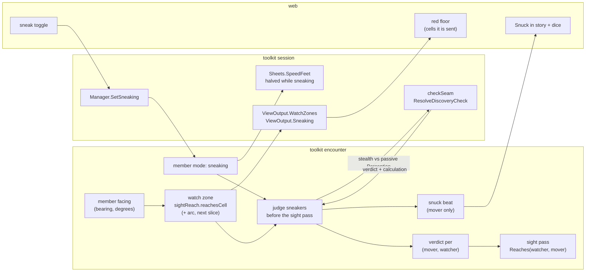

# Sneaking — a declared mode, a red zone per watcher, one roll per entry

Tracking: [rpg-project#606](https://github.com/KirkDiggler/rpg-project/issues/606).
Walkthrough: [README.md](README.md). Plan: [plan.md](plan.md).
Facing slice: [rpg-project#582](https://github.com/KirkDiggler/rpg-project/issues/582).
Stealth contest: [rpg-toolkit#1020](https://github.com/KirkDiggler/rpg-toolkit/issues/1020).

## Shape

A player declares sneaking in free roam. Every watcher has a red zone: the
cells its sight would reach from where it stands, facing the way it faces.
When a sneaking mover enters a watcher's zone from outside it, the mover's
Stealth is rolled against that watcher's passive Perception, once. A win
keeps the mover out of that watcher's sight until the pair re-arms. A loss
lets the watcher see the mover, and today's contact law proceeds. A watcher
that already sees the mover when sneaking begins keeps seeing them: nobody
vanishes in plain view. The
engine owns every piece; the client draws the zones it is sent.

## Law

- **Sneaking is a mode a player declares (R1, R6).** `SetSneaking` sets or
  clears it on the member, on the world clock only, and spends no time. It
  refreshes sight, so the declaration is judged at once. Declaring the mode
  the member is already in is a no-op: no roll, no re-arm, no sight refresh,
  no beat. A monster never
  sneaks. The mode is encounter state and persists with the encounter.
- **Showing yourself ends it (R7).** Sneaking ends when the mover attacks,
  casts or speaks, when a formed fight engages the mover, when the mover
  declares it off, and when the mover exits. Ending clears every verdict the
  mover holds. Formation clears the mode before any turn budget asks for the
  mover's speed, so a caught sneaker fights at full speed. A sound the mover
  makes does not end it; hearing is its own channel.
- **Sneaking costs pace (R8).** While a member sneaks, the session's sheet
  answer for that member's speed is half the sheet's speed, so a world-clock
  round buys half the cells. The encounter never knows the halving.
- **A watcher's red zone is its sight, not its knowledge (R9).** A watcher is
  any placed member that is not a player. Its zone is every cell
  `sightReach.reachesCell(watcher, cell)` answers true for in the current
  pass's geometry: the watcher's own `Sight` range, line of sight and sight
  areas, narrowed by its supplied arc (R14). Why: the watcher's known cells
  are what it has seen, and a zone built from them would hide a lit corridor
  it has never looked down.
- **Not sneaking, sight is unchanged (R2).** A mover who is not sneaking is
  seen exactly as today: zones, arcs and verdicts do not apply to them.
- **A roll happens on entering, and only on entering (R3, R10).** A pair is
  rolled when, between two refreshes, the sneaking mover's cell passes from
  outside the watcher's zone to inside it and the pair is armed; the
  sneaker's step, the watcher's walk and the watcher's turn all produce such
  a crossing. The roll asks `CheckResolver.ResolveDiscoveryCheck` with one
  approach: ability `stealth`, DC the watcher's
  `SheetFacts.PassivePerception`. Resolution rolls it on the session's shared
  dice with the mover as the die's entity. The composition carries the
  verdict and never compares a total.
- **Nobody begins to sneak in plain view (R10, amended 2026-11-02 by the-world-runs
  R11).** A sneak declaration is refused while any watcher holds the mover live
  (`CurrentVia` non-empty) or has the mover's cell in its zone: the verb returns
  `ErrSeen` naming the watchers, the mode does not change, no roll is made. A
  declaration that succeeds, and a declaration that clears the mode, writes a
  record-only `sneaking` beat (`{member, on}`) so a replay can rebuild what every
  creature could see; the beat folds into no act (the session's record-only
  table). Before the amendment the declaration was accepted with a lost verdict
  per watcher and no beat; that left the record unable to say when a sneak began
  (found by S5's replay, rpg-toolkit#2229). Why: a roll that could drop the mover
  out of a sight already on them is hiding from a creature that sees you, which R3
  does not grant; refusing says so to the player instead of silently losing.
- **A lost verdict is ordinary sight (R2, R10).** While a lost verdict
  stands, that watcher sees the mover by ordinary sight, not by its zone, so
  a mover behind a narrowed zone stays seen by a watcher that already sees
  them. Why: hiding needs a broken line of sight first.
- **A verdict holds until the pair re-arms (R10).** Verdicts are stored per
  (mover, watcher) as discovery's attempts are: the verdict, an `Armed` flag
  and `InZone`, the zone's own answer at the last judging pass, never a
  constant; all persist with the encounter. A beaten pair re-arms when the
  mover stands at least the watcher's supplied re-arm distance outside its
  zone. A lost pair re-arms only when the watcher's ordinary sight no longer
  reaches the mover and the mover stands that distance outside the zone. The
  next entry rolls again. A zero distance re-arms on the first refresh outside. A
  different watcher is a different pair and rolls on its own.
- **Judgement covers the pass's observers (R10).** The judgement runs inside
  `rebuildPercepts`, before the pass is built, for every pair whose watcher is
  an observer of that pass. A pair whose watcher is absent from the pass is
  left untouched, as the pass leaves that watcher's holdings untouched.
- **A win suppresses; nothing is erased (R11).** While a beaten verdict
  stands, `Reaches(watcher, mover)` answers false for that pair alone. The
  watcher's memory of the mover, if it has one, stays a ghost at the last
  position it saw. The suppression is set on the reach the pass is handed,
  before any copy of it is taken. A lost verdict changes nothing: the watcher
  sees the mover and contact proceeds as today.
- **Outside the zone, a sneaker is unseen by that watcher (R9, R14).** For a
  sneaking mover with no lost verdict against a watcher, that watcher sees
  them only inside its zone, and only without a beaten verdict. With no supplied arc the zone equals today's sight, so this
  adds nothing; with an arc, a sneaker behind a watcher is unseen by it.
- **The roll is the mover's to see, and only theirs (R5, R12).** Each judged
  pair writes one `snuck` beat with audience the mover alone: the mover, the
  DC, the total, whether it beat the DC, and the calculation. It names the
  watcher only when the mover holds that watcher live at the judging refresh.
  Why: a beat that names a creature the mover cannot see hands the client an
  identity its eyes never gave it.
- **Facing is member state the engine sets (R4, R13).** Every member carries a
  facing: a bearing in degrees, 0 is map north, clockwise. It is seeded from
  the authored placement facing, or the start facing for a player. An
  unauthored facing is a rules bearing of 180, south; it is no longer only a
  presentation default, because cones read it. Each step
  sets it to that step's direction. A walk that ends with a target turns the
  walker toward that target, and an attack turns the attacker toward its
  target. Facing persists with the encounter.
- **A patrol stands where it is told to (R31, R32).** A waypoint may state a
  `wait`, the world rounds the walker stands on it, and a `facing` it turns
  to while standing; a facing needs a wait. The member carries the dwell, not
  the route. A reaction pause spends no dwell round, and a row above the
  patrol's own still fires during a dwell.
- **Facing is testimony (R13).** The sight channel's `Seen` snapshots the
  subject's facing for each observer, beside position, standing and
  equipment, and a memory keeps the facing it last saw. The web draws the
  facing `Seen` carries and derives none when the wire carries one.
- **The arc is supplied, never picked (R14).** `SheetFacts.WatchArc` and
  `SheetFacts.WatchResetCells` arrive per member at use, as range does
  through `Sight`. The encounter's only built-in answer is no arc: zero
  means 360. The session answers a monster's arc from its stat block's
  `senses.watch_arc`, seeding 120 while content states none, and a
  character's as zero. Content-level arc grammar waits until content asks.
- **Cones narrow the zone, never sight (R14).** A watcher's zone keeps only
  the cells whose bearing from the watcher lies within half its arc of its
  facing, edge inclusive. Fog-of-war's seen-now set and non-sneaking
  detection never read the arc.
- **The red floor is server-derived (R15).** `GetView` carries, for a sneaking
  viewer only, one zone per watcher the viewer holds live, each the
  watcher's zone intersected with the viewer's known, unconcealed cells. The
  session projects it unchanged. The client computes no zone, no line of
  sight and no cone (fog-of-war R5). A viewer who is not sneaking is sent no
  zones.
- **Hearing and surprise are untouched (R16).** No footfall sound exists, so a
  sneaking mover makes none, exactly like a walking one. Surprise stays a
  label on formation. A monster never sneaks. The drop arm still classifies
  and discards, so a won roll never stops a walk.

## Rulings

| ID | status | scope | ruled by | date |
|---|---|---|---|---|
| R1 | settled | Sneaking is something the player declares; for now it works only in free roam, open to change as the idea evolves | KirkDiggler | 2026-10-18 |
| R2 | settled | Not sneaking: today's room-level sight detection stands | KirkDiggler | 2026-10-18 |
| R3 | settled | Sneaking: entering a given monster's red zone makes a Stealth roll, per monster; server-side, always; the client draws what the server sends | KirkDiggler | 2026-10-18 |
| R4 | settled | Facing is step 1 (rpg-project#582): members carry a facing; patrols face their path; a monster that stops walking faces its target; cones come after | KirkDiggler | 2026-10-18 |
| R5 | settled | The operator's first impression was a sleight-of-hand check, settled as a Stealth roll per watcher (R3), in the operator's own words on [#606](https://github.com/KirkDiggler/rpg-project/issues/606), posted 2026-10-18; the player sees the floor where they would be detected drawn red, as Baldur's Gate does (the operator's wave C direction on #606) | KirkDiggler | 2026-10-18 |
| R6 | settled | The mode: one session verb `SetSneaking` on the world clock sets or clears `sneaking` on the encounter's member and refreshes sight; declaring the mode already held is a no-op; forbids a turn-clock sneak, a repeated declaration that rolls, re-arms, refreshes or writes a beat, a client-held flag, a monster sneaking and a declaration judged only at some later verb | KirkDiggler | 2026-10-18 |
| R7 | settled | What ends it: attack, cast, speak, a fight engaging the mover (cleared before any turn budget reads speed), declaring it off, exit; forbids a sound ending it and a caught sneaker's first turn at half speed | KirkDiggler | 2026-10-18 |
| R8 | settled | Cost: half speed while sneaking, answered by the session's speed fact; forbids a second free-roam movement budget and the encounter knowing the rule | KirkDiggler | 2026-10-18 |
| R10 (amended) | settled | A sneak declaration is refused while any watcher sees the mover (`ErrSeen`); a successful declaration or clear writes a record-only `sneaking` beat. Kirk, 2026-11-02 (the-world-runs R11): "if anyone can see you you cannot go into sneaking" | KirkDiggler | 2026-11-02 |
| R9 | settled | The zone is the watcher's sight reach from where it stands, by the one sight test; forbids building it from the watcher's known cells and computing it anywhere but the engine | KirkDiggler | 2026-10-18 |
| R10 | settled | A roll only on entering a watcher's zone from outside, with either party moving (a watcher's walk or turn, or a door opening, can produce the entry), through the check resolver against the watcher's passive Perception; a watcher already seeing the mover, or already holding the mover's cell in its zone, when sneaking begins gets a lost verdict with no roll; a lost verdict is seen by ordinary sight and re-arms only once ordinary sight breaks and the mover is the re-arm distance outside the zone; verdicts re-arm as discovery's attempts do, at a supplied distance; forbids vanishing from a watcher that sees you, a roll per refresh, a Stealth number on sheet facts, the composition comparing totals, and one roll against the highest passive | KirkDiggler | 2026-10-18 |
| R11 | settled | A beaten verdict suppresses that one pair in the sight pass; forbids erasing a holding and suppressing any other watcher | KirkDiggler | 2026-10-18 |
| R12 | settled | The `snuck` beat goes to the mover alone and names only a watcher the mover sees; forbids a wider audience and naming an unseen watcher | KirkDiggler | 2026-10-18 |
| R13 | settled | Facing is a persisted bearing set by steps and targets, unauthored = 180 as a rule, carried as testimony on `Seen` (rpg-toolkit ADR-0041); forbids a client-derived heading when the wire has one, a live read of facing, and facing as a loose field on `Sighting` | KirkDiggler | 2026-10-18 |
| R14 | settled | Cones: an arc supplied per member at use narrows the zone only; the encounter's only built-in answer is 360; the session supplies a monster's from `senses.watch_arc`, seeding 120; forbids an arc constant in encounter Go, an arc on fog-of-war sight or on non-sneaking detection | KirkDiggler | 2026-10-18 |
| R15 | settled | The red floor: per live watcher, zone ∩ the viewer's known unconcealed cells, on GetView, only while the viewer sneaks; forbids a client zone algorithm, zones of unseen watchers, and zones for a viewer who is not sneaking | KirkDiggler | 2026-10-18 |
| R16 | settled | Out of this design: footfall hearing, surprise costing anything, monster sneaking, the drop arm stopping a walk | KirkDiggler | 2026-10-18 |
| R17 | settled at F1, operator may veto | Facing is set only by the creature's own steps and intents; a forced move (push, pull or rout through `Direct`) keeps its facing; forbids a forced move turning the mover | lead | 2026-10-18 |
| R18 | settled at F1, operator may veto | A walk paused for a reaction keeps its walk-end target (`turn.face`); forbids a resumed walk forgetting its target | lead | 2026-10-18 |
| R19 | settled at F1, operator may veto | One source for where a creature turns: the cell it holds for its target (`faceHeld`), used at walk ends, the driven attack and `RecordTrain`; no holding means no turn; forbids any turn toward a live cell and any turn without a holding | lead | 2026-10-18 |
| R20 | settled at F1, operator may veto | A Routed walk is the walker's own legs, so it sets facing; forbids treating a Routed walk as imposed | lead | 2026-10-18 |
| R21 | settled on the F-walk, operator may veto | A train that closes the encounter leaves every watcher's last testimony as it stood; the striker's own facing still turns; no sight refresh and no beat after `ended`; forbids a refresh or any beat appended after the ended beat | lead | 2026-10-18 |
| R22 | settled at S1, operator may veto | A watcher with PassivePerception 0 (unsupplied) judges no sneak: no roll, no verdict, ordinary sight; the DC is the supplied passive, with no minimum; forbids rolling against an unsupplied passive and a floor on the DC | lead | 2026-10-18 |
| R23 | settled at S1, operator may veto | Suppression is one answer to every seer question: a beaten watcher witnesses nothing the sneaker does (`subjectSeers` and `SeesWithin` seeded from the standing verdicts); forbids any seer question answered around the verdicts | lead | 2026-10-18 |
| R24 | settled at S2, operator may veto | Half pace is the sneaker's own walking only; an imposed move (a cast push, a flee) uses full speed; forbids halving a move the sneaker did not choose | lead | 2026-10-18 |
| R25 | settled at S1–S2, operator may veto | The `SetSneaking` verb reports Saved and Delivery, and in the encounter IntelDeltas and Formed: declaring off inside a hostile zone can form a fight in the same call; forbids a declaration whose consequences land on a later verb | lead | 2026-10-18 |
| R26 | settled at S1, operator may veto | A deed's witnesses are the one sight answer: a sight-obscuring area (a Fog Cloud) screens a deed (a rest, an equip, a spoken line) from a member inside it exactly as it screens a sighting, sneaking or not; found when S1's `audienceOf` moved onto the sight reach (session test `TestAnAreaClosesAfterTheRestIsTold` now reads the order off the rester's own stream); forbids a witness list built from distance and line of sight alone | lead | 2026-10-18 |
| R27 | settled at Z2, operator may veto | The session owns the view's shape: `encounter.WatchZone` never crosses the boundary; `ViewOutput.WatchZones` is the session's own `WatchZone{Watcher, Cells}`, a field-for-field copy (`TestNoInnerTypeCrossesTheBoundary` refused the inner type); forbids admitting a runtime read type to the boundary allow-list | lead | 2026-10-18 |
| R28 | settled at K1, operator may veto | Under an arc, a sneaker that a watcher's ordinary sight reaches outside its wedge is unseen: the judgement writes an armed, un-rolled pair (`Armed`, not `InZone`) that suppression honours, only when the watcher does not already hold the mover live; a held mover at declaration gets R10's lost verdict with no roll; without arcs a no-op; forbids hiding from a watcher that holds you by stepping out of its wedge | lead | 2026-10-19 |
| R29 | settled at K1, operator may veto | A watcher with PassivePerception 0 gets no cone: its zone is its ordinary sight, so the red floor never shows less than what sees you (R22); forbids narrowing a non-judging watcher's floor | lead | 2026-10-19 |
| R30 | settled | Closes O8: being seen costs no re-arm distance; only a lost Stealth roll does; reacting to the ghost is the answer table's job; forbids a re-arm distance owed by a mover the watcher only held live | KirkDiggler | 2026-10-19 |
| R31 | settled | A patrol waypoint may state `wait: N`, the world rounds the walker stands there, and a `facing` it takes while standing; walking keeps facing the step (R17–R20 unchanged); a reaction pause (R18) consumes no dwell round; a higher table row (`heard`, `enemy: seen`) still fires during a dwell, which holds only the patrol's own row (rpg-project#624); forbids a waypoint facing applied while walking | KirkDiggler | 2026-10-19 |
| R32 | settled at P2, operator may veto | A waypoint `facing` requires a `wait`: the dialect refuses `facing` without `wait` ("a facing is taken while standing; give the waypoint a wait"); the walk-end glance is not a mechanic; forbids a facing on a waypoint the walker passes through | lead | 2026-10-19 |

## Open

- **O2 — the roll against an unseen watcher.** R12 shows the roll and hides
  the watcher. Whether a player should see a roll at all when they see no
  watcher is a feel question for the first walk.
- **O3 — the drop stops the walk.** The drop arm's designed early stop
  (rpg-toolkit#1020, fork f) stays deferred; a walk continues through a won
  roll.
- **O4 — a monster that sneaks.** Needs a monster Stealth answer and a decider
  intent to hide; monster AI's to bring with its use case.
- **O5 — surprise that costs.** A surprised creature still acts on its first
  turn; that rule arrives with its own slice.
- **O6 — the seeded arc and re-arm distance.** The session seeds 120 degrees
  and a re-arm distance until content states them; the walk on the castle
  tunes the seeds, and a per-placement arc waits for a use case. The K-walk
  kept the arc seed at 120: it reads right on the hall patrol
  (`monsterWatchArc = 120` in the session's `sheets.go`).
- **O7 — zone colour by stance.** The wire names each zone's watcher, so the
  web can tint a civil watcher's zone differently from a hostile one; the
  choice is presentation.
- **O8 — re-arm after a held-live mover.** Closed by R30 (operator,
  2026-10-19): being seen costs no re-arm distance; only a lost Stealth roll
  does.
