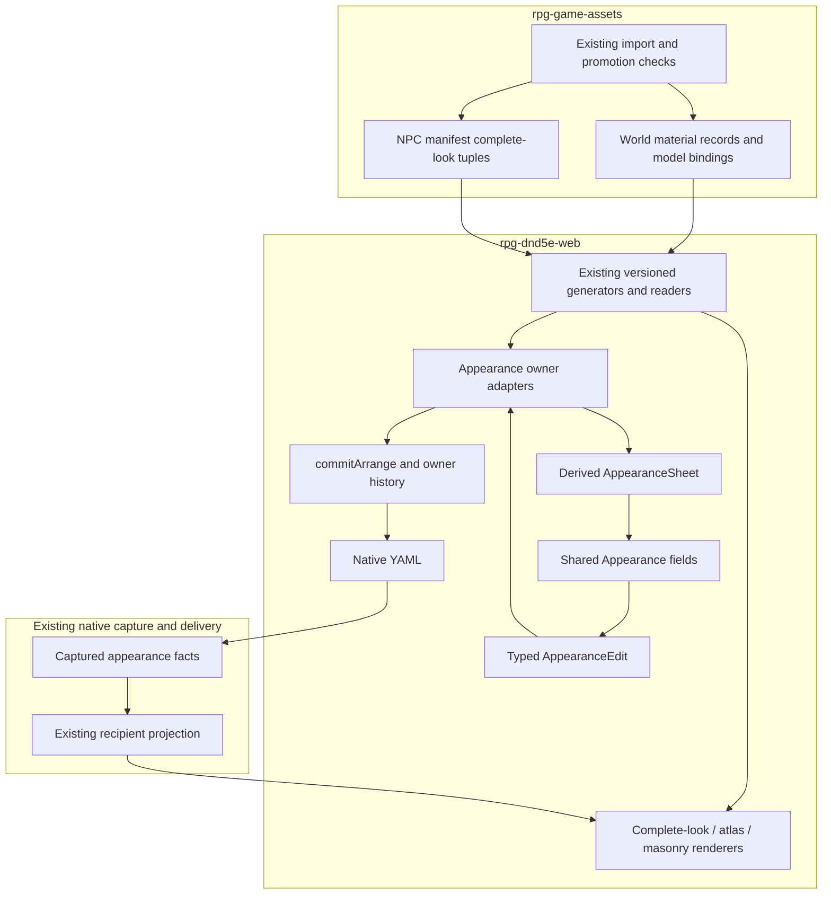

# One appearance editor, provider-owned choices

## What this is

[Web #1402](https://github.com/KirkDiggler/rpg-dnd5e-web/issues/1402) gives walls, NPCs and props one recognizable appearance-editing experience. The [design](design.md) keeps compatibility in Assets and persistence with the selected owner. It reuses the existing catalogs, Arrange transaction, native document and renderer adapters; it does not introduce a second material library or a universal object-property language.

**The manifest tells the editor what is valid. It does not tell every renderer to perform the same operation.** A complete NPC look can select a different verified model pair; a wall/prop atlas can replace one declared material's color image; a masonry finish can supply coordinated color and normal maps on a physical wall-face chart.

## Component shape

## Ownership and contracts

`AppearanceSheet` and `AppearanceEdit` below are editor boundary types, not a new serialized schema. Their concrete contracts and the versioned provider/wire changes are specified in [plan.md](plan.md).

| Component                        | Owns                                                                                               | Input → output                                                                                               |
| -------------------------------- | -------------------------------------------------------------------------------------------------- | ------------------------------------------------------------------------------------------------------------ |
| Assets material publication      | Verified images, roles, compatible mapping/layout facts, defaults and exact model/surface bindings | Source recipes + promoted bytes → shared material catalog and binding declarations                           |
| Assets NPC publication           | Complete standing/downed look identity and valid family/style/skin tuples                          | Existing NPC promotion metadata → `npcs/manifest.json` look entries                                          |
| Existing Web generators/readers  | Strict provider-version and resource/model identity checks                                         | Pinned provider metadata → `WorldMaterialCatalog` / `GeneratedNpcAppearance`                                 |
| Appearance adapters              | Join the selected owner and provider facts; expose valid operations for that owner                 | Owner selection + catalogs → derived `AppearanceSheet`; typed `AppearanceEdit` → existing Arrange intent     |
| Shared Appearance panel          | Consistent selection, channel state, unavailable explanations and controls                         | Typed sheet → typed edit; no domain interpretation                                                           |
| Existing owner transaction       | Atomic validation, document update, Undo/Redo and capture revision                                 | Arrange intent → updated `RoomDraft` or an explicit refusal                                                  |
| Existing native codec            | Preserve stable authored identities and unrelated/unknown fields                                   | `RoomDraft` ↔ native YAML                                                                                    |
| Capture and recipient projection | Immutable appearance facts associated with permitted walls/props/NPCs                              | Native authored state → captured model → recipient snapshot/reveal/sighting                                  |
| Binding-specific renderer        | Apply the declared visual mechanism with instance-owned mutable state                              | Permitted captured choice + pinned resource metadata → rendered appearance before memory/lighting treatments |

The provider does not own NPC statistics, document history or client-specific Apply buttons. The panel does not resolve file paths, guess surface compatibility, mutate a global model cache or write YAML. An adapter does not introduce another saved property store. The renderer does not reconstruct undisclosed rooms to align a texture. A manifest's resource capability is not proof that an older client or capture format supports its editing operation.

### A data sheet without a general form engine

The derived sheet describes named visual targets, their current choices, selectable options, channel states and refusals. The common fields cover asset/look selection, a material pack, and color/normal/emissive roles. They do not accept arbitrary executable expressions, YAML paths or `Record<string, unknown>` patches.

Each option carries a stable published identity and a label. An unresolved authored identity stays present as an unavailable selected option. A channel distinguishes a map supplied by the selected pack, embedded/fixed content, no map, and an independently editable capability. **An absent map is not the same as an explicit Off override.** Off or independent selection is offered only when both provider and owner/runtime contracts support it (R4–R5).

Technical choices come from provider declarations. Recommendations may order them, but cannot silently exclude another technically compatible choice (R3). NPC style/skin options are derived from actual published tuples under the selected family, not a fabricated Cartesian product. A new imported family using an existing supported mechanism changes metadata and its consumer pin, not another asset-specific picker implementation.

### One appearance transaction

Appearance controls stage their changes against the selected owner's current revision. Apply uses the existing owner commit and produces one history entry; Cancel discards staged appearance edits. Validation failure keeps the draft and explains the refusal. A stale selection/revision must not apply to the newly selected object. Save/Play publishes committed document state, not hidden uncommitted field values (R6).

The existing immediate-picker policy for facing, faction and other non-appearance fields is not redesigned. The appearance adapter coordinates with that form rather than making its own store. Preview, where offered, is transient owner-provided presentation; it cannot publish or mutate another placement.

## Walk one thing through

Consider a Castle Wall Fit 01 face and the published Brick material.

1. **Provider input.** World-asset surface declarations bind the exact wall GLB's named face to the masonry family. The shared material catalog supplies Brick's color and normal images, repeat scale and material parameters. Both maps are real resources, not optional slots invented by the UI.
2. **Consumer projection.** Existing readers verify the model/resource identities. The wall adapter joins the actual face binding to compatible masonry materials and exposes Brick as a pack choice. The normal role says that its map comes from Brick; an independent normal override is not offered without a supporting contract.
3. **Author intent.** The shared control emits a pack selection for that face. The wall adapter creates the owner's existing staged edit; Apply changes that placement only. Original/inherit uses the wall owner's real default semantics rather than a universal empty-string interpretation (R5–R6).
4. **Native state.** The native document retains the selected material identity and the mapping information needed to reconstruct the authored result. Existing wall-finish state is `scene.wallFinishes`; region defaults and pattern starts live in `scene.regionPresentation`. These are different from authored-UV `appearance.materialOverrides`.
5. **Play boundary — R9.** Capture `WallFaceFinish { side, materialRef }` for each explicit selected face on the permitted wall. `side` is `positive-z` or `negative-z` in the wall's local frame. Existing wall endpoints and elevation carry the mapping anchor; the shared renderer derives the wall-local chart (phase zero, direction +1/-1, repeat from the material). No region geometry or asset-resource lookup enters the backend. The current listed-cell regions have no wall-face binding, so their unapplied regional finish metadata remains unapplied rather than becoming inferred ownership.
6. **Rendering.** The existing masonry renderer applies color and normal together using its validated basis. Per-instance material state remains isolated, and the existing memory/lighting treatment follows appearance composition (R8).

The same panel can expose `04_C` on a House Wall 05 or chair through `MaterialOverride { surfaceId, materialRef }`. An NPC style/skin choice instead resolves through `chooseNpcAppearance` to a complete `appearanceRef`, including its standing and downed models. Those identities are not converted into masonry charts to make the UI look uniform.

## Separations that look like one thing

| Query                                        | Source of truth                                                            |
| -------------------------------------------- | -------------------------------------------------------------------------- |
| Which image/look can fit this exact target?  | Assets resource/layout/binding declarations                                |
| Which valid look is suggested?               | Provider recommendations, not an exhaustive compatibility list             |
| Can this build edit and play this selection? | Consumer reader, owner persistence/capture and renderer capabilities       |
| Which value does this placement use?         | Native owner state and, during play, its captured recipient-projected copy |
| What does Original or default mean here?     | Owner default/inheritance semantics                                        |
| What is the NPC mechanically?                | Existing creature/rules identity, not its complete-look ref                |
| Does a wall section open a passage?          | Authored wall/opening and door state, not its visible mesh or material     |
| Does emissive light the room?                | Separate lighting authority; not inferred from an emissive texture         |

Treating these as one registry would let a visual selection change mechanics, a recommendation masquerade as technical permission, or a catalog entry masquerade as implemented play support.

## Trade-offs

| Decision                                  | Benefit                                                           | Cost / boundary                                                                 | Not taken                                            |
| ----------------------------------------- | ----------------------------------------------------------------- | ------------------------------------------------------------------------------- | ---------------------------------------------------- |
| Shared panel over typed adapters          | Familiar controls without erasing real rendering differences      | Web maintains small explicit adapters                                           | One universal texture algorithm                      |
| Extend existing provider authorities      | Import-time facts remain authoritative and reviewable             | Versioned readers/pins must evolve with declarations                            | A second editor-options registry                     |
| Preserve existing owner representation    | No unrelated actor/prop/wall document migration                   | Adapters translate shared edits into distinct intent types                      | One untyped persisted appearance bag                 |
| Validated complete NPC looks              | Retains verified rig, downed appearance and palette identity      | Independently editable NPC channels require a later real resource contract      | Pretending every NPC variant is a runtime image swap |
| Pack-first channel support                | Retains paired normals without offering broken channel operations | Authors cannot independently override a fixed channel until the contract exists | Decorative or misleading dropdowns                   |
| Capture explicit face choices on the wall | Studio masonry agrees with play using existing wall-local mapping | A typed face-choice list crosses capture, SDK and wire boundaries               | New room charts or hidden-region reconstruction      |

## Edges

- R9 includes existing per-wall masonry choices in the first delivery. Region finishes with no declared wall-face binding remain unapplied; this work does not restore retired automatic room inference or claim broader room-chart support.
- Common controls do not publish new presets, ingest assets from the browser or grant asset-curation permissions.
- New normal/emissive support requires verified layout, sampling and renderer-basis facts. A manifest does not make an unsupported renderer operation safe.
- Supported wall side scopes remain distinct. No fake A/B controls appear on a whole-atlas target; broader independent-side editing stays with the richer-material step.
- Door fitting/sections and additional courtyard asset selection remain separate work. The tree-containing document is not needed for this shared-component design.

## Where a change lands

- **Another courtyard prop with the same atlas mechanism:** provider binding/compatibility metadata and ordinary pinned adoption; shared panel and transaction mechanism remain unchanged.
- **Another complete NPC palette variant:** NPC promotion metadata and generator validation; the complete-look adapter derives its valid combinations.
- **An independently editable normal or emissive channel:** provider capability/resources plus the owning saved/captured type and renderer adapter must support it. The shared channel field can then enable the declared operation; this is not only a UI change.

## Source map

| Concern                           | Path                                                                                                                     |
| --------------------------------- | ------------------------------------------------------------------------------------------------------------------------ |
| Material resource authority       | Assets `scripts/world_material_catalog.py`, `build_world_material_catalog_v2.py`, `publish_world_materials.py`           |
| Exact world target declarations   | Assets world-asset catalog; Web `src/generated/worldAssetCatalog.ts` surface metadata                                    |
| NPC palette publication           | Assets `scripts/configs/npc-palettes/`; `harness/models/synty/npcs/manifest.json`                                        |
| Strict NPC projection             | Web `scripts/generate-npc-appearance-catalog.mjs`                                                                        |
| Material reader and binding join  | Web `src/rendering/worldMaterialCatalog.ts`, `worldAtlasCatalogSchema.mjs`                                               |
| Current forms/owner translation   | Web `src/concepts/encounter-studio/StudioArrangePanel.tsx`, `StudioArrangeFields.tsx`                                    |
| Current pack/finish fields        | Web `StudioTexturePackControls.tsx`, `StudioWallFinishes.tsx` in the same directory                                      |
| NPC look adapter                  | Web `src/npc-appearances/npcAppearanceChoices.ts`                                                                        |
| Owner/history/native state        | Web `src/concepts/world-building/studioArrange.ts`, `singleRoomDungeon.ts`, `wallFinishTypes.ts`                         |
| Physical mapping/chart projection | Web `roomWallFinishes.ts`, `wallFinishProjection.ts` in the same directory                                               |
| Shared wall rendering             | Web `src/concepts/world-building/StructuralWallSurfaces.tsx`                                                             |
| Material treatment                | Web `src/rendering/worldAtlasMaterials.ts`, `worldSurfaceMaterials.ts`                                                   |
| Captured presentation adapters    | Web `src/components/session/structuralLayout.ts`, `propPresentations.ts`                                                 |
| Existing native material capture  | Toolkit encounter `dungeonspec/single_room_material_overrides.go`, `single_room_walls.go`, `single_room_presentation.go` |
