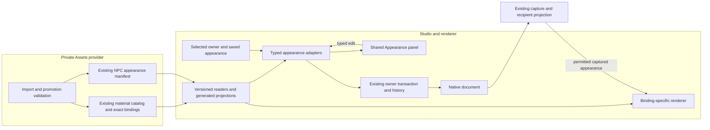

# Manifest-driven Studio appearance

## Shape

Resource compatibility belongs to Assets. The common panel edits a typed view of the selected owner's capabilities; it is not another catalog or saved property bag. The walkthrough is [README.md](README.md); delivery and pending decisions live on [Web #1402](https://github.com/KirkDiggler/rpg-dnd5e-web/issues/1402), linked from [Project #867](https://github.com/KirkDiggler/rpg-project/issues/867).

## Law

- **Provider-owned choices (R1).** Import/promotion metadata declares verified visual targets, supported channels, compatible resources or complete looks, and defaults. Consumers derive lists from those facts, not filenames, owner-specific hard-coded palettes or a second registry.
- **One existing authority per resource (R1).** World material images and bindings remain in the shared material catalog and existing world-asset declarations; NPC complete looks remain in the NPC manifest. Schema3 atlas targets declare nonempty unique `compatibleFamilies`; recommendations remain separate. The editor projection joins authorities without republishing their facts.
- **Same controls, distinct mechanisms (R2).** Complete NPC looks, authored-UV atlases and chart-mapped masonry have typed adapters. Shared presentation does not permit transferring one mechanism's choices, mapping or default semantics into another.
- **Compatibility is not recommendation (R3).** Exact binding, image-layout, sampling and normal-basis validity are mandatory. Suggested collections can prioritize choices but do not become an exhaustive artistic allow-list.
- **Three channel roles (R4).** The common model represents color, normal and emissive. A pack includes its verified coordinated channels; existing paired normals remain part of the material. Absence, embedded/fixed content and independently editable content are distinct capabilities. Unsupported maps or operations are not invented to fill controls.
- **Explicit intent (R5).** Original, inherited/pack-default, explicitly off and explicitly selected are distinct where supported. A control offers only intents its owner and renderer can preserve. A missing explicit selection remains visible and is not rewritten to Original.
- **Placement-owned transactions (R6).** Shared appearance edits use the existing owner transaction/history and native save boundary. The common panel has no parallel document store. Appearance edits use consistent Apply/Cancel semantics; a committed edit is one undoable transaction. Other non-appearance picker behavior is outside this change.
- **No implied authority (R7).** Appearance does not change NPC rules identity, behavior, wall blocking, openings, door state or gameplay lighting. Emissive material appearance does not create illumination authority.
- **Captured play (R8).** A choice advertised as playable follows the existing native capture and recipient-disclosure path. The client neither fetches the authoring source nor infers hidden room structure to reconstruct appearance. Source edits do not repaint an already captured run.
- **Owned rendering (R8).** Shared immutable resources stay shared; per-instance treatments preserve unselected channels and source geometry, own their mutable clones, and restore/dispose without changing other placements. Appearance composition precedes existing memory and lighting treatments.
- **Masonry reaches play (R9).** The first delivery includes captured play support for existing normal-bearing wall-face finishes. Each captured face choice names `positive-z` or `negative-z` and an opaque material ref. Mapping follows the supplied wall's local start/elevation and the provider's repeat/basis facts, with no inferred regional chart. Native save/reopen, capture/reload and recipient rendering preserve the result; unapplied regional metadata stays unapplied.
- **Bounded work (R10).** Common appearance controls precede mixed wall/door sections and then richer independent material editing. The tree-containing castle document is required only to edit that composition. No universal rules-form engine, new asset browser/store or new ingestion/publication pipeline is introduced.

## Rulings

| ID  | status  | scope                                                                                          | ruled by                                | date       |
| --- | ------- | ---------------------------------------------------------------------------------------------- | --------------------------------------- | ---------- |
| R1  | settled | Assets import/promotion metadata supplies valid visual choices; extend existing authorities    | KirkDiggler                             | 2026-11-10 |
| R2  | settled | Shared interaction with typed owner/renderer adapters, not one texture algorithm               | KirkDiggler                             | 2026-11-10 |
| R3  | settled | Technical compatibility remains distinct from suggested collections                            | KirkDiggler; existing atlas-provider A3 | 2026-11-10 |
| R4  | settled | Color, normal and emissive capability model; existing paired wall normals retained             | KirkDiggler                             | 2026-11-10 |
| R5  | settled | Original/default, off and selected meanings stay distinct where supported                      | KirkDiggler                             | 2026-11-10 |
| R6  | settled | Consistent appearance Apply/Cancel, Undo/Redo and owner persistence                            | KirkDiggler                             | 2026-11-10 |
| R7  | settled | Appearance changes no mechanics or gameplay illumination                                       | KirkDiggler                             | 2026-11-10 |
| R8  | settled | Native save/play, captured disclosure and instance isolation remain requirements               | KirkDiggler                             | 2026-11-10 |
| R9  | settled | Include existing chart-mapped wall finishes in the first delivery's captured play support      | KirkDiggler                             | 2026-11-10 |
| R10 | settled | Common controls → wall/door sections → richer editing; tree YAML not a capability prerequisite | KirkDiggler                             | 2026-11-10 |

## Open

- **Independent channel editing.** Selectable channel overrides need an accepted resource/mapping contract and saved intent. A color-only atlas or pre-baked NPC look does not gain editable normal/emissive channels from sharing this panel. Those additional capabilities belong to the richer-material step unless the first-delivery scope is explicitly expanded.
