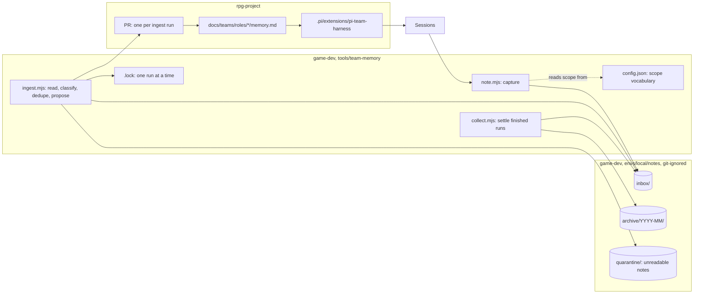

# Team memory — walkthrough

Law: [design.md](design.md). Issue: rpg-project#676. Press release:
[press-release.md](press-release.md).

## What this is

A capture-and-ingest pipeline with **one writer of record**. Sessions
drop one-line JSON notes into a local inbox; a single on-command ingest
reads the batch and proposes curated edits to each role's `memory.md` as
one reviewed PR. It reuses two things the workspace already trusts —
git-ignored local state (`envs/local/`, the home of loose per-machine
things) and the PR as the review gate — and it deliberately introduces
**no database, no vector store, and no second authority** over what the
team believes. Curated memory is markdown next to each role's charter;
raw history is the archive directory; the case file stays in issues and
PRs, as it does everywhere else.

## Component shape



## Ownership and contracts

| Component | Owns | Input → output |
|---|---|---|
| `note.mjs` | The note's identity and physical safety | `note "<content>" [--type lesson\|friction\|question] [--scope <tag>]` → one file `inbox/<utc>-<rand>.json`, created with `O_EXCL`; the path printed |
| `inbox/` | Nothing; it is a directory | presence of a file = unprocessed |
| `ingest.mjs` | Classification, dedupe, and the single PR | the whole inbox + current `memory.md` files → a branch in rpg-project editing only `memory.md` files, and one PR listing every note id it carries (R3, R5) |
| `config.json` | The scope vocabulary | scope tag → `docs/teams/roles/<role>/memory.md`; no other meaning attaches to a scope (R8) |
| `collect.mjs` | Settling finished runs | the open ingest PRs → merged runs' note files moved to `archive/YYYY-MM/`; declined runs' files returned to `inbox/` |
| `.lock` | Serialization | acquire-or-refuse; a second concurrent run exits with the first run's pid |
| `memory.md` | What a role currently believes, in staging | `## Lessons`, `## Friction`, `## Open`; one line each, dated, linked (law 7) |
| the harness | Consumption | role resolution → charter bytes + `memory.md` bytes; absence of the file is empty sections (law 10) |
| `active.md` | The operator's in-flight and parked stories | hand edits only (R1) |

The refusals, one per boundary:

- **The note tool never interprets content.** It stamps and stores; it
  does not classify, route, or judge — that is ingest's job, done with
  the whole batch in view.
- **Ingest never edits anything but `memory.md` files.** Charters,
  CLAUDE.md, and design law absorb graduated lessons through their own
  PRs (law 8), never through a memory run.
- **Ingest never adjudicates a contradiction.** Both entries are named
  under `## Friction`; settling it is the operator's review, not the
  run's (R4).
- **Sessions never write `memory.md`.** A lesson typed straight into the
  file bypasses review and recreates the many-writers failure this
  design exists to kill (R3).
- **The archive never feeds back into memory.** It is evidence for the
  archaeology tier (R10) and for audits; the curated files are the only
  load path.
- **The harness never writes.** It reads two files at resolution and
  holds no memory of its own — the harness resolves policy, it does not
  store it.
- **`active.md` never receives appends from agents or tools** (R1).

## Walk one thing through

A session working the mad king castle learns the workspace's rule for
creature action lists: layers augment; they do not replace. The author
says it in constraint form and moves on:

```
game-dev note --type lesson --scope team:platform \
  "given a creature whose actions come from layered sources, augment the action list, because read-back must render the merged set and name each layer it kept"
```

1. **Capture.** `note.mjs` writes
   `inbox/2026-10-22T215811Z-k3f9.json`:
   `{ id: "2026-10-22T215811Z-k3f9", ts: …, type: "lesson",
   scope: "team:platform", source: { runtime: "pi", session: "…",
   repo: "rpg-toolkit" }, content: "given a creature …" }`.
   **The content survives verbatim; the hop adds identity and provenance.**
2. **Ingest.** `ingest.mjs` takes the lock, reads the whole inbox, maps
   `team:platform` through `config.json` to
   `docs/teams/roles/platform/memory.md`, and proposes one line under
   `## Lessons`, dated, suffixed with the note id. The same batch holds a
   note that conflicts with an existing line about wholesale layer
   replacement; that note is added to `## Friction` naming both, not
   reconciled. One branch, one PR, both edits in it.
3. **Review.** The PR's diff is the knowledge: two lines added, nothing
   else touched. The operator merges.
4. **Settle.** `collect.mjs` sees the merge and moves the two note files
   to `archive/2026-10/`. The inbox returns to empty.
5. **Consumption.** Next session resolves the platform role; the harness
   loads charter plus `memory.md`, and the augment-lesson is present
   **before anyone re-teaches it**.

## Separations that look like one thing

| Query | Source of truth |
|---|---|
| What the operator is doing, or parked | `active.md` |
| Raw learnings not yet processed | a file's presence in `inbox/` |
| What a role currently believes | its `memory.md` (staging) |
| What the workspace holds durably | charters, CLAUDE.md, design law (destination) |
| Everything that was ever captured | `archive/` |
| The pain that should reopen a rule | the `## Friction` section that names it |

**The hazard is treating staging as destination.** Let `memory.md` grow
as the permanent home and it becomes the junk drawer that forty flat
memory notes already demonstrated: everything retrieved means nothing
found. The graduation move in law 8 is what keeps the file loadable. The
mirror hazard is letting `active.md` absorb dumps again, which trades the
operator's one glanceable register for noise.

## Trade-offs

| Decision | Benefit | Cost / boundary | Not taken |
|---|---|---|---|
| One JSON file per note (R2) | watermark is a filesystem move; crash-safe, idempotent, no offset state | thousands of small files over time; the archive pays in directory sprawl, bounded by month | one append-only JSONL ledger |
| Ingest is the sole writer, via PR (R3) | knowledge arrives reviewed and conflict-free | learning lands a command-and-a-merge later; urgent context belongs in the issue or `active.md`, not memory | sessions append to memory files |
| On command, no scheduler (R5) | the command is the stable interface; nothing runs unattended | the operator or a janitor role must run it; forgetting shows as a fat inbox, which is visible | cron from day one |
| Plugin stores excluded from this tier (R7) | memory is diffable, reviewable, harness-neutral | semantic recall waits for the archaeology tier (R10) | pi-hermes-memory or pi-ltm as the store |
| Plain markdown per role, given/because form | loadable whole, reviewable line by line, conditions self-name for review | no structure finer than the line; querying means grep | schema-typed lesson records in a store |
| Scope vocabulary in config (R8) | team renames don't touch law | the vocabulary drifts unless the team-map design finishes | scopes fixed in the design doc |

## Edges

- **A hand-written note with malformed JSON** fails validation at
  ingest, moves to `quarantine/` with the parse error printed, and never
  blocks the batch behind it.
- **A duplicate id** (clock skew plus an unlucky suffix) is refused at
  capture by `O_EXCL`; the writer retries, not the file.
- **A scope with no config entry** routes to
  `docs/teams/roles/cross-team/memory.md`, and ingest prints the miss so
  the vocabulary gets fixed.
- **A declined ingest PR** loses nothing: `collect` returns its notes to
  the inbox and the next run re-proposes under a fresh branch.
- **A note whose lesson already exists, reworded** is dedupe's judgment
  call; when uncertain, ingest prefers a friction line over silently
  dropping or duplicating.
- **Notes on a machine with several checkouts** all land in the root
  game-dev checkout's inbox — the same rule as every workspace-level
  tool, so worktrees never hold hot state.

## Where a change lands

- **A scheduled run** (R9) adds a systemd timer or cron line that calls
  the command; `ingest.mjs`, the lock, and the PR contract are
  untouched — the command being the interface is what the deferral
  bought.
- **The team-umbrella consolidation** edits `config.json` and the role
  directories; notes carry scope tags, so the rename reaches old notes
  through the vocabulary, not through rewriting the archive.
- **The session-archaeology tier** (R10) adds a tool that reads
  `archive/`; nothing here changes, because the archive is read-only
  evidence by refusal.
- **A new note type** extends the `type` enum, the ingest prompt, and
  nothing else — routing is already by scope, not by type.

## Source map

| Concern | Path |
|---|---|
| Capture, ingest, settle, vocabulary | game-dev `tools/team-memory/{note.mjs,ingest.mjs,collect.mjs,config.json}` |
| Hot state | game-dev `envs/local/notes/{inbox,archive,quarantine}` (git-ignored) |
| Run serialization | game-dev `envs/local/notes/.lock` |
| Curated memory | rpg-project `docs/teams/roles/*/memory.md` |
| Consumption | game-dev `.pi/extensions/pi-team-harness` (charter resolution gains the memory read) |
| Operator register | rpg-project `active.md` (git-ignored) |
| Bootloader law narrows | game-dev `AGENTS.md`, "Make the call" step 2 |
