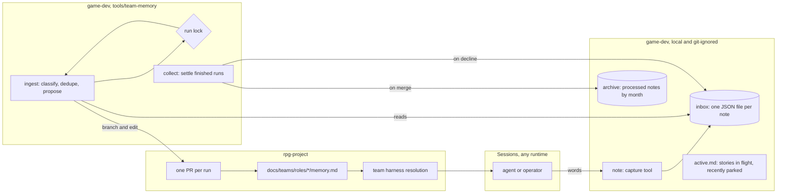

# Team memory — design

Walkthrough: [README.md](README.md). Press release: [press-release.md](press-release.md). Issue: rpg-project#676.

**How to read the standing rules.** They are working agreements, each with a
measure that can prove it wrong, until the measures in [Measures](#measures)
have run for real. A rule that the numbers contradict is amended in daylight,
not defended. Rulings R1–R11 stand as settled; R12–R14 extend them and are the
first to be measured.

## Shape

## Standing Rules

1. A **note** is one JSON file, `{ id, ts, type, scope, source, content }`.
   `type` is `lesson`, `friction`, or `question`. Guidance content carries
   the *given-conditions / because-reason* form, so the condition itself
   names when the note is due for review.
2. Unprocessed notes live in a local, git-ignored **inbox**
   (`envs/local/notes/inbox/`); processed notes live in
   `archive/YYYY-MM/`. The move is the watermark — bookkeeping that can
   drift will drift, so there is none. A second capture path exists for
   anyone without the workspace tooling (R13): a **run record** committed
   on the work PR, under the `knowledge/runs/` of the level the PR's
   changes bind, with four sections — shipped, decided, found, mistaken —
   each line linked to its PR, issue or commit. Ingest reads both paths;
   a run record's watermark is the `processed:` line ingest adds to it in
   the knowledge PR.
3. Capture runs through `game-dev note`, which stamps `id`
   (`<utc>-<random>`), `ts`, and `source` (runtime, session ref, repo).
   The schema is the tool's job, never the writer's; a hand-written note
   file is legal, because every runtime and no runtime must be able to
   participate.
4. **Ingest is the only writer of `docs/teams/roles/*/memory.md`.**
   Sessions never edit memory files; knowledge reaches git through a
   reviewed PR, never through a feature branch.
5. Ingest runs **on command** (`game-dev team-memory ingest`), serialized
   by a lock. Each run reads the whole inbox, classifies each note to its
   scope's file, dedupes against existing entries, and proposes all edits
   as **one PR**. `collect` moves a merged run's notes to the archive and
   leaves a declined run's notes in the inbox.
6. A note that **contradicts an existing memory entry** is appended to
   that file's `## Friction`, naming both entries; ingest never
   adjudicates. Contradiction is the review loop's signal, not an
   overwrite.
7. A `memory.md` carries exactly three sections: `## Lessons`,
   `## Friction`, `## Open`. Every entry is one line, dated, and linked to
   its evidence (issue, PR, or note id). Status and narration live in the
   case file, never here.
8. `memory.md` is **staging, not destination**. A settled lesson graduates
   into the owning charter, CLAUDE.md, or a design doc's standing rules;
   the grooming PR
   removes what it promotes, so the file stays small enough to load.
9. **Scopes are vocabulary in config** (`tools/team-memory/config.json`),
   mapping tags to role files. Renaming a team or folding a role is a
   config change, not a change to these rules.
10. At role resolution the team harness loads the charter **and its
    `memory.md`**; a missing file means empty sections, not an error.
    Other runtimes read the same two files by convention.
11. `active.md` is the operator's register of **stories in flight and
    recently parked**: human-written, never a learnings dump. The
    preserve-when-operator-differs rule stands. This narrows AGENTS.md
    "Make the call", whose append-flavored uses move to the inbox.
12. Session-transcript archaeology is a separate tier and out of this
    design. Memory plugins may be trialed for it without touching anything
    here (R10).
13. Knowledge lives **in the repository with the code it binds**, in a
    `knowledge/` directory at the **lowest directory that contains
    everything the entry binds** (R12). A rule about one module lives in
    that module. A rule binding `play/clock` and `play/intel` lives in
    `play/knowledge/`. A rule binding encounter, resolution and session
    lives in `rulebooks/dnd5e/knowledge/`. Only layer rules reach a repo
    root. Craft that binds no code — how a Team reviews, walks, dispatches
    — binds nothing below rpg-project, so it lives at
    `docs/teams/roles/<role>/memory.md` as before. The feature family of
    the earlier rule 13 is retired: a feature's design doc stays in
    `ideas/<topic>/`, and the standing rules it produces are routed to the
    code they bind. Each `knowledge/` carries `decisions.md` (one line per
    ruling: date, the words, the options, the link, and **upheld**: the
    later PRs, reviews or rulings that reached for the old way and were
    stopped), `findings/` (case files, present tense, evidence linked) and
    `runs/` (rule 2). A decision with no upheld link is made, not yet
    proven; one that has held under pressure is foundation, and a proposal
    that crosses it names it and the evidence it rests on (R15). A
    directory is created by the first entry that needs it, never ahead of
    one.
14. A lesson lives at the **lowest level that can hold it** and migrates
    outward only as it proves general: module → seam level → repo root →
    charter or rpg-project standing rules, each move proposed in a PR that
    names the origin it elevates from. Module specifics never take
    residence at a seam level; a general lesson never stays trapped in one
    module's directory.
15. Every level that has a `knowledge/` also carries the **architecture
    map for that level** (R14): one seam document and one diagram showing
    exactly the things directly beneath it, what flows across each seam
    and what must not, in both directions. A repo root's diagram composes
    its levels' diagrams; it never redraws them. The diagram's nodes are
    checked against the module tree (`go.mod` files, package directories)
    by a script in CI, so a module added or retired without its map is a
    red check, not a two-month-old picture. The map is the index the
    knowledge directories hang from; the two are one slice.

## Rulings

| ID | status | scope | ruled by | date |
|---|---|---|---|---|
| R1 | settled | active.md narrows to the in-flight / recently-parked register; learnings move to the inbox | KirkDiggler | 2026-10-22 |
| R2 | settled | hot tier is per-entry JSON files; watermark is the physical inbox→archive move | KirkDiggler | 2026-10-22 |
| R3 | settled | memory.md files have exactly one writer: ingest, via PR | KirkDiggler | 2026-10-22 |
| R4 | settled | contradiction routes to Friction; never silently overwritten | session, adopted by KirkDiggler | 2026-10-22 |
| R5 | settled | ingest runs on command; no scheduler in this design | KirkDiggler | 2026-10-22 |
| R6 | settled | capture metadata is stamped by the tool; hand-authored notes remain legal | session, adopted by KirkDiggler | 2026-10-22 |
| R7 | settled | curated memory lives in git; plugin memory stores are excluded from this tier | KirkDiggler | 2026-10-22 |
| R8 | settled | scope vocabulary lives in config, not in these standing rules | session, adopted by KirkDiggler | 2026-10-22 |
| R9 | deferred-until-needed | scheduled ingest (cron/systemd) | KirkDiggler | 2026-10-22 |
| R10 | deferred-until-needed | plugin-backed session-archaeology tier (e.g. pi-hermes-memory, pi-blackhole) | KirkDiggler | 2026-10-22 |
| R11 | amended by R12 | scopes have two families, team and feature; feature memory lives beside the feature's docs; elevation migrates outward with origin named | KirkDiggler | 2026-10-22 |
| R12 | settled, under measurement | knowledge lives in the repo with the code it binds, in `knowledge/` at the lowest directory containing everything it binds, organized as the architecture layers; role files keep craft that binds no code; the feature family is retired | KirkDiggler | 2026-10-27 |
| R13 | settled, under measurement | a run record committed on the work PR (shipped / decided / found / mistaken, each line linked) is a second legal capture path; ingest reads the inbox and committed runs | KirkDiggler | 2026-10-27 |
| R14 | settled, under measurement | every level with a `knowledge/` carries its seam document and diagram of what sits directly beneath it; a root composes, never redraws; a CI script diffs the diagram's nodes against the module tree | KirkDiggler | 2026-10-27 |
| R15 | settled, under measurement | a decision line carries where it was upheld; decisions made and upheld are the foundation each area is seeded with; a proposal that crosses one names it and its evidence, since big changes stay possible when they make us better and never for no reason | KirkDiggler | 2026-10-27 |

## Measures

What the first ingests count, so the agreements above can be proved wrong:

- **Landed per ingest.** Entries proposed, entries merged, entries declined,
  per knowledge PR. A declined share that stays high says the routing or
  the line form is wrong.
- **Re-taught.** Lines added to any `## Friction` section, and lessons the
  operator restates in conversation that already exist in a knowledge file.
  The second number is the one this whole design exists to drive to zero.
- **Drift.** Red runs of the map check (rule 15): a module whose level has
  no map, or a map naming a module that is gone.
- **Reach.** Knowledge directories that exist, by repo and level, and the
  share of merged work PRs that carried a run record.
- **Upheld.** Decision lines with at least one upheld link, against the
  total. The share that rises is the foundation hardening; a line that
  stays at zero for long is either untested or not really a decision.

The numbers are posted on rpg-project#676 after each ingest. No target is
set until three ingests have run.

## Open

- **Team-umbrella consolidation.** Platform, UI programming, UI/UX, QA,
  and perf/testing umbrellas, with the existing roles folded beneath
  them, is its own design item. Scope vocabulary absorbs the rename via
  rule 9, so this design does not wait on it.
- **Rotating parked stories out of active.md.** Manual today; an
  automation asks for a use case, not anticipation.
