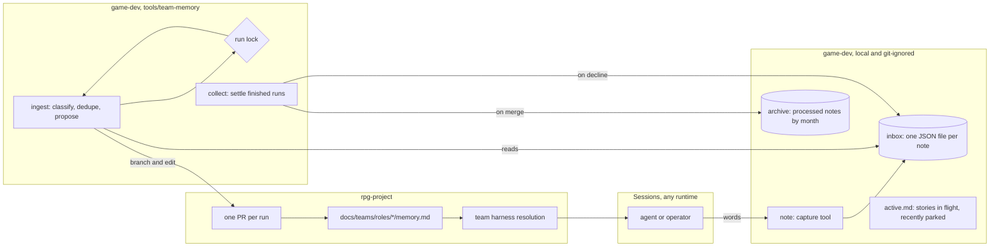

# Team memory — design

Walkthrough: [README.md](README.md). Press release: [press-release.md](press-release.md). Issue: rpg-project#676.

## Shape

## Standing Rules

1. A **note** is one JSON file, `{ id, ts, type, scope, source, content }`.
   `type` is `lesson`, `friction`, or `question`. Guidance content carries
   the *given-conditions / because-reason* form, so the condition itself
   names when the note is due for review.
2. Unprocessed notes live in a local, git-ignored **inbox**
   (`envs/local/notes/inbox/`); processed notes live in
   `archive/YYYY-MM/`. The move is the watermark — bookkeeping that can
   drift will drift, so there is none.
3. Capture runs through `game-dev note`, which stamps `id`
   (`<utc>-<random>`), `ts`, and `source` (runtime, session ref, repo).
   The schema is the tool's job, never the writer's; a hand-written note
   file is legal, because every runtime and no runtime must be able to
   participate.
4. **Ingest is the only writer of `docs/teams/roles/*/memory.md`.**
   Sessions never edit memory files; knowledge reaches git through a
   reviewed PR, never through a feature branch.
5. Ingest runs **on command** (`game-dev team-memory ingest`), serialized
   by a lock. Each run reads the whole inbox, classifies each note to its
   scope's file, dedupes against existing entries, and proposes all edits
   as **one PR**. `collect` moves a merged run's notes to the archive and
   leaves a declined run's notes in the inbox.
6. A note that **contradicts an existing memory entry** is appended to
   that file's `## Friction`, naming both entries; ingest never
   adjudicates. Contradiction is the review loop's signal, not an
   overwrite.
7. A `memory.md` carries exactly three sections: `## Lessons`,
   `## Friction`, `## Open`. Every entry is one line, dated, and linked to
   its evidence (issue, PR, or note id). Status and narration live in the
   case file, never here.
8. `memory.md` is **staging, not destination**. A settled lesson graduates
   into the owning charter, CLAUDE.md, or a design doc's standing rules;
   the grooming PR
   removes what it promotes, so the file stays small enough to load.
9. **Scopes are vocabulary in config** (`tools/team-memory/config.json`),
   mapping tags to role files. Renaming a team or folding a role is a
   config change, not a change to these rules.
10. At role resolution the team harness loads the charter **and its
    `memory.md`**; a missing file means empty sections, not an error.
    Other runtimes read the same two files by convention.
11. `active.md` is the operator's register of **stories in flight and
    recently parked**: human-written, never a learnings dump. The
    preserve-when-operator-differs rule stands. This narrows AGENTS.md
    "Make the call", whose append-flavored uses move to the inbox.
12. Session-transcript archaeology is a separate tier and out of this
    design. Memory plugins may be trialed for it without touching anything
    here (R10).
13. A scope names one of two families: `team:<role>`, whose file lives at
    `docs/teams/roles/<role>/memory.md`, or `feature:<topic>`, whose file
    lives beside the feature's own docs (`ideas/<topic>/memory.md`, in the
    repo that owns the feature's design). Both carry the three sections of
    rule 7 under the same rules.
14. A lesson lives at the **narrowest scope that can hold it** and
    migrates outward as it proves general: feature → team → charter or
    standing rules, each move proposed in a PR that names the origin it elevates
    from. Feature specifics never take residence in a team file; a general
    lesson never stays trapped in a feature's.

## Rulings

| ID | status | scope | ruled by | date |
|---|---|---|---|---|
| R1 | settled | active.md narrows to the in-flight / recently-parked register; learnings move to the inbox | KirkDiggler | 2026-10-22 |
| R2 | settled | hot tier is per-entry JSON files; watermark is the physical inbox→archive move | KirkDiggler | 2026-10-22 |
| R3 | settled | memory.md files have exactly one writer: ingest, via PR | KirkDiggler | 2026-10-22 |
| R4 | settled | contradiction routes to Friction; never silently overwritten | session, adopted by KirkDiggler | 2026-10-22 |
| R5 | settled | ingest runs on command; no scheduler in this design | KirkDiggler | 2026-10-22 |
| R6 | settled | capture metadata is stamped by the tool; hand-authored notes remain legal | session, adopted by KirkDiggler | 2026-10-22 |
| R7 | settled | curated memory lives in git; plugin memory stores are excluded from this tier | KirkDiggler | 2026-10-22 |
| R8 | settled | scope vocabulary lives in config, not in these standing rules | session, adopted by KirkDiggler | 2026-10-22 |
| R9 | deferred-until-needed | scheduled ingest (cron/systemd) | KirkDiggler | 2026-10-22 |
| R10 | deferred-until-needed | plugin-backed session-archaeology tier (e.g. pi-hermes-memory, pi-blackhole) | KirkDiggler | 2026-10-22 |
| R11 | settled | scopes have two families, team and feature; feature memory lives beside the feature's docs; elevation migrates outward with origin named | KirkDiggler | 2026-10-22 |

## Open

- **Team-umbrella consolidation.** Platform, UI programming, UI/UX, QA,
  and perf/testing umbrellas, with the existing roles folded beneath
  them, is its own design item. Scope vocabulary absorbs the rename via
  rule 9, so this design does not wait on it.
- **Rotating parked stories out of active.md.** Manual today; an
  automation asks for a use case, not anticipation.
