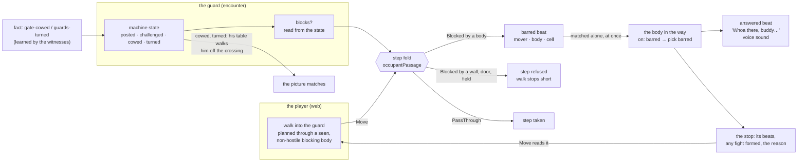

# The guard holds the gate — a posted body blocks

**Kirk, 2026-11-03 (#835):** "yeah i think A makes sense. we will want to
trigger a say i think if we try moving past the guards 'who there buddy, can
I help you?'"

Players walk past the castle's gate guards today. The gate door is shut and
OpenDoor opens it; the guards are neutral, so their cells are pass-through;
none of their posts is on the gate's one crossing; and the won stand-aside
teaches `gate-cowed`, which nothing reads. Blocking is not a new mechanism.
The step fold already answers Blocked, PassThrough or Standable from world
state, and a walk already stops short with a public reason. This story puts
that state on the right thing.

## Shape

## The seams, read not guessed

Read at the baseline pinned in plan.md. Toolkit paths are under
`rulebooks/dnd5e/`.

| fact | where |
|---|---|
| A cell answers one of three passages: Blocked, PassThrough (cross, never stop), Standable. | `encounter/cellfacts.go:12-27` |
| The fold is derived on every call and never stored; its creature rows are the 2014 rules: a nonhostile space is pass-through. | `encounter/cellfacts.go:115-135` |
| A member's cell is Blocked when it blocks or is hostile; a downed monster is Standable; anyone else is PassThrough. | `encounter/cellfacts.go:528-540` (`occupantPassage`) |
| The member contributor asks the canvas entity's `BlocksMovement()`. | `encounter/cellfacts.go:303-330` |
| That flag is a plain field set once at creation from `MemberInput.BlocksMovement` and carried on the record. | `encounter/encounter.go:3048-3050`, `:992`, `:1015`, `:1261`, `:2601-2632`; `encounter/board.go:167` |
| Spatial's placement check reads the same entity flag. | `tools/spatial/room.go:452` (`CanPlaceEntity`) |
| An observer's route reads the blocking it holds, not the live flag. | `encounter/observedpassage.go:43` |
| Every monster with a table runs a machine: its authored recipe, else the default. | `encounter/machine.go:339-350` (`programFor`) |
| The authored recipe is stored on the member and on a reserve. | `encounter/data.go:2166` (`MemberData.Recipe`), `:525` (`ReserveData.Recipe`) |
| A step reads the crossing first, then the masquerade, then the destination: Blocked is refused; PassThrough is refused only on the walk's last step. | `encounter/step.go:218-410`, `:334-336` |
| A refused step returns no output, only the error. | `encounter/step.go:138-141` |
| A body-blocked destination wraps `ErrBadPlacement`, so its public reason is "movement stopped at an obstruction"; the private sentence names the body. | `encounter/step.go:347-352`; `encounter/walkend.go:35-48`; `encounter/cellfacts.go:478-503` |
| The session reads only the obstruction's public reason and returns `stopped`. | `session/move.go:455-461` |
| The session checks movement before a step and pays only after it succeeds. | `session/move.go:446`, `:473` |
| A driven walk swallows the same refusals and stops silently. | `encounter/step.go:440-452` |
| A route and a step read the same fold, so a route never plans through a Blocked cell. | `encounter/route_search.go:58-110`; `encounter/clocks.go:2545-2588` (`walkerEdge`) |
| The web plans around a Blocked occupant and a shut door edge, and sends nothing when no path exists. | rpg-dnd5e-web `src/components/session/occupantPassages.ts:14`, `src/components/session/atlasPath.ts:171-174`, `:177-187` |
| A door is state on the wall: open, closed, locked; a creature's own walk opens a shut one and never a locked one; no key or fact opens a lock. | `encounter/door.go:14-70`, `:83-93`, `:148-198`; `encounter/clocks.go:1609`, `:1632-1640`; `encounter/walkdoor.go:13-60`; `encounter/doorverbs.go:363-485` |
| A player's walk refuses a shut door by name. | `encounter/step.go:281-286`, `:377-400` |
| A fact is known per member; dialogue `requires` reads the speaker's own facts. | `encounter/world.go:480-487`; `encounter/option.go:236-262` |
| A fact an answer teaches lands on the witnesses of the line. | `encounter/option.go:396-398` |
| A machine reads `fact:<id>` as "this creature holds it"; `fact` lands on the member who learned it. | `encounter/machine.go:735-739`; `encounter/wakebeats.go:211-217` |
| The machine vocabulary: `time`, scoped `heard`/`deed`/`seen`, unscoped `fact` and `clock:*`, open words `deed:<word>`, `clock:<name>`, `fact:<id>`. | `encounter/machine.go:85-135`, `:700-735` |
| A recipe state carries only its transitions; the primitive knows no rule. | `mind/machine/recipe.go:39-42` |
| The authored dialect compiles `states:` to a recipe inside the encounter module. | `encounter/dungeonspec/states.go:19-80` |
| Landed beats wait for the next raise: time has not passed, so nobody acts on them yet. A reaction pick spends nothing. | `encounter/wakebeats.go:34-50` |
| A targeted beat is matched on the one member it names; a broadcast beat on every listener in scope, the doer excepted. | `encounter/wakebeats.go:318-352` (`matchOne`) |
| A pick's answer reaches its voice after the pick beat: `runIntents`, then `answerTime`. | `encounter/clocks.go:588`, `:628-638`; `encounter/answer.go:254` |
| Every line said on an answer row is a voice: its hearers are the hearers of that sound. | `encounter/doc.go:142-149`; `encounter/answer.go:239-275` |
| The session decodes an `answered` beat into a table answer, and the wire and the web already carry it. | `session/act_family.go:725-765`; `session/act_bodies.go:394-415`; rpg-api-protos `act.proto:104`; rpg-dnd5e-web `describeAct.ts:478` |
| No condition stops a walk today; prone leaves movement out. | `conditions/prone.go:49-52` |
| Resolution's `Prevented` is unset by anything; it is reserved for Sentinel. | `resolution/movement.go:114-119`, `:545-548` |

The castle (rpg-api `content/the-mad-king.yaml`, mirrored byte for byte in
the toolkit's `encounter/dungeonspec/testdata/world-builder-v4-castle.yaml`,
which the castle tests read, `encounter/castletest/castle_king_test.go:42`):

| fact | where |
|---|---|
| The stand-aside line is the captain's: Intimidation DC 14; a win (weight 3) answers "…go on, then. I saw nothing." and teaches `gate-cowed`; a win (weight 1) and a loss teach `party-recognized`. | `:1723-1737` |
| The turn is Persuasion DC 15 and teaches `guards-turned`. | `:1738-1747` |
| The garrison is neutral to the party until `guards-turned` (allied) or `party-recognized` (hostile). | `:524-531` |
| `gate-1` (-7,10), `gate-2` (-3,10), the captain (-4,8); only `gate-1` has states (`posted`, `alert`). | `:1544-1565`, `:1681-1707` |
| The gate patrols' loops, and their `guards-turned` march. | `:272-327` |
| The reserves are told to stay off the gate's one crossing. | `:474-478` |
| The gate door is shut and teaches `gate-opened` when opened. | `:2012-2015` |
| The crossing is the cell beneath the gate (where a party stands to open it) and the courtyard cell past it; the patrol posts flank it. | `encounter/castletest/castle_king_script_test.go:53-98` |

## Law

**Block by state on the world, never by an invisible permit.** A thing the
player may not do is a thing they can see and act on: a shut door, a body in
the way, a shout. The one permit-shaped thing stays where it is: `requires`
on a dialogue line. Resolution's `Prevented` stays reserved for Sentinel.

**Seeing and blocking are two axes.** Sneaking answers the seeing axis:
an unseen mover is not noticed, and that is all. The body axis is answered
only by emptying the cell, and the levers that do it already exist: a
`heard` row with `toward: sound` or `search` draws him off when his table
says so; `gate-cowed` cows him; a displaced move pushes him; a fact relieves
him; a downed body is not in the way. A posted body never leaves by time:
his `time` pick while posted stands the post, and only a beat (a sound, a
fact, a push, a fall) empties the cell. An unseen mover who walks into a
posted body is stopped like anyone else.

**A body blocks by its state.** A creature whose states mark one or more
states `blocks` blocks exactly while its current state is one of them. A
creature with no such mark blocks as its creation said (`BlocksMovement`),
as today, whether it runs an authored recipe, the default one, or none. The
answer is read from the state on every fold and by every reader (the fold,
the canvas's placement check, the board, what observers hold), never stored
beside the state, so a state change opens or closes the cell in the beat it
happens. The marked states are stored with the recipe they name. The fold is
unchanged: blocking or hostile is Blocked; a downed monster is Standable;
any other body is PassThrough.

**A posted body departs from the 2014 rule on purpose.** A nonhostile
creature's space is pass-through unless the creature is posted to hold it.
RAW is not the authority here.

**The gesture is walking into him.** The web prefers the way round: it
plans around a seen body whose passage is Blocked, as today. It plans
through a seen, non-hostile one, as if it were pass-through, only when he
is the goal cell or no route round exists, and sends the walk. The server owns the step and stops it at the body's cell.
The web never second-guesses that answer: it stops the walk where the
server says. A hostile body stays unplannable, as today.

**A barred step names the body.** A step refused by a body says who stands
in the way, as a shut door says it is shut. A body the mover does not
observe is "someone". A wall, a door and a field keep their own sentences.

**The bump is a beat the body hears.** A player's step refused by a body
writes a `barred` beat (mover, the body in the way, the cell), on every
bump. The body in the way is its addressee: the beat is targeted on him and
matched on him alone, at once, in the Move that bumped. That is the one
exception to "landed beats wait for the next raise": a bump is a touch on
one creature now, not time passing for the world. Every other landed beat
still waits. His machine may answer on `barred` with a table key, and that
key's row speaks as any row speaks: an `answered` beat, the voice's sound,
the record. Whoever else reacts hears that voice through `heard`, when time
next passes. A driven walk routes around a body and never writes `barred`.

**A bump is a stop, not a refusal.** In S1 a body stop is an obstruction
like a shut door. Once the bump writes, the step answers it with output,
not an error: the beats it wrote, the intel they changed, any fight formed
or ending reached, and the stop's reason. The session folds that output
like any step's and reports the walk stopped.

**A bump spends nothing.** On the world clock nothing is spent. On the turn
clock the refused step is not a step, so no movement is paid; the steps
already taken stay.

**Standing aside is both state and walk.** A fact that ends the post moves
the creature to a state that does not block, in the beat the fact lands, so
a cowed or turned guard never blocks. His table walks him off the crossing
on his next beat so the picture matches. The engine guarantees the state;
the step aside is content.

**Hostility still blocks.** A hostile body is Blocked whatever its state.
Downed bodies, allies and pass-through bodies are unchanged.

## Rulings

| # | question | options | ruled | scope | date |
|---|---|---|---|---|---|
| R1 | What holds the gate? | A a posted guard blocks the crossing; `blocksMovement` becomes machine state; `gate-cowed` and `guards-turned` turn it off; the door stays as it is. B the door is barred by the garrison and a fact unbars it (rejected: it gates the door, not the guard; the guards stay decorative, and a locked gate tells "nobody is home" where the story is "a man who says no"). C both, as two slices (rejected: the door half has no use case yet, and a slice without one is not cut). | A (Kirk: "yeah i think A makes sense. we will want to trigger a say i think if we try moving past the guards 'who there buddy, can I help you?'") | a member's blocking; the castle gate | 2026-11-03 |
| R2 | How does the bump speak? | A the bump is something the guard hears: a `barred` beat, scoped like `heard`; his `on: barred` row says his line on his own machine. B the stop reason carries a string (rejected: no voice, no wake, no record; a tooltip, not a guard). C the session plays Speak at the barrier (rejected: it inverts who speaks first). | A (Kirk: "A sounds great") | the machine vocabulary; the Move answer; the wire | 2026-11-03 |
| R3 | What is standing aside? | A state only (rejected: bodies overlap for a step). B walk only (rejected: a delayed walk still bars). C both: the state flips at once and his table walks him off the crossing. | C (Kirk: "oh yeah both sound good. I was having a hard time picking") | a posted member's states; castle content | 2026-11-03 |
| R4 | The gate sneak against the post. | Today (wave C, #606 piece 4) the gate is a sneak: both gate guards walk a loop, and two world rounds of every four both stand at their beat posts with their backs to the gate (the loop's blind beat, `the-mad-king.yaml:296-301`); nobody stands in the crossing. A the post holds the crossing continuously while `posted`: one held body (`gate-1` in the crossing) and one wandering eye (`gate-2` keeps the loop); `posted` never leaves by time; the gate is talked, cowed or turned through, or sneaked through as a harder route: the posted body is emptied first (drawn off by a noise if his table says so, cowed, pushed, downed), then the crossing is taken on `gate-2`'s blind beat; piece 4's sneak test is re-aimed to exactly that (cost: the sneak needs two moves, not one window). B the crossing is one post of `gate-1`'s loop (rejected: the gate is held some rounds of four, a civil party that waits walks through, and "a man who says no" becomes a matter of timing). C a sneaker slips past a posted body on a check (rejected for now: it answers the body axis with a seeing roll; deferred as a verb of its own). Recommended A; the lane's wording for the sneak: draw `gate-1` off, cross on `gate-2`'s blind beat. | A (Kirk: "i like it") | `gate-1`'s post, `gate-2`'s loop; the castle's sneak and open-the-gate steps | 2026-11-03 |

## Assumptions, not ruled (open to veto on the design PR)

- **A repeated bump is the guard's states' business.** The engine writes
  `barred` every time; content moves `posted` to `challenged` for a few
  rounds with a shorter row, as `posted` moves to `alert` today.
- **The barrier is the addressee; bystanders hear his voice.** A bump is a
  touch, not a sound; the guard's shout is the sound, and it already reaches
  bystanders. The rejected cut is a broadcast `deed:barred`: it needs a word
  in `mind/behavior`'s deed vocabulary (another module, and a wider table
  `when:` vocabulary); a deed's subject is the actor, so the barrier's
  identity is lost; and it would make the touch a sound.
- **The gate holds one body and one eye (R4 A).** `gate-1` holds the
  cell beneath the gate, in front of the shut door, continuously while
  `posted`; `gate-2` keeps the loop. The stand-aside line stays on the
  captain; whether the barring guard carries it too is a walk finding.

## Findings, not ruled

- **A body's refusal is generic today.** A body-blocked step wraps
  `ErrBadPlacement` and its public reason is "movement stopped at an
  obstruction" (`encounter/walkend.go:41-43`). S1 gives a body its own
  sentinel and sentence, checked first; the driven walk's silent list
  (`encounter/step.go:447`) takes the new sentinel.
- **Observers hold blocking, and the web plans from it.** A route planned
  from observation reads the blocking it holds
  (`encounter/observedpassage.go:43`), and the web plans from the same
  passage. A state change refreshes what its observers hold.
- **The canvas holds a plain flag.** `memberEntity` keeps a bool spatial
  reads for placement. It reads through the encounter instead, so the
  canvas and the fold cannot disagree.
- **The state binding lives in the encounter.** `mind/machine` stays
  rulebook-agnostic (its `State` has transitions only), so `blocks` is the
  encounter's word: the dialect's `blocks: true` on a state compiles into
  the member's set of blocking states, stored beside its recipe. A bag key
  set by acts was the other cut; it can drift from the state when one
  transition forgets to set it.
- **`gate-cowed` lands on the witnesses.** The barring guard steps aside on
  `fact:gate-cowed` only when he saw the captain cowed. A guard who did not
  see it holds the gate; that is the story, and a test proves it.
- **The post moves two castle steps.** The sneak dash ends on the cell
  beneath the gate (`TestMadKingScriptASneakWindowAtTheDoor`), and opening
  the gate stands there too (`TestMadKingScriptOpeningTheGateBringsTheFarRoom`);
  the walk skill's castle steps 2 and 5 say the same. Under R4 both are
  re-aimed in the slice that posts the guard.
- **The captain does not react to the voice.** He has no states and no
  `heard` row; turning him toward the gate is not in this story.

## What we are not building

- A barred, locked or fact-unbarred gate door (R1 B).
- A permit on movement, a `requires` on a cell, or `Prevented` set by
  anything but a future Sentinel.
- Grapple, restrained, difficult terrain or any other condition that stops
  a walk.
- A bump that costs anything, or an opportunity attack for one.
- The session auto-playing a dialogue line (R2 C).
- A size-difference exception to pass-through.
- The captain's reaction to the guard's voice.
- A slip-past check (R4 C). If it comes, it is a verb of its own with its
  own cost, never a rule of sneaking.

## Open

- **The barring guard's own stand-aside line.** A walk finding.

— cross-team agent, on behalf of KirkDiggler
