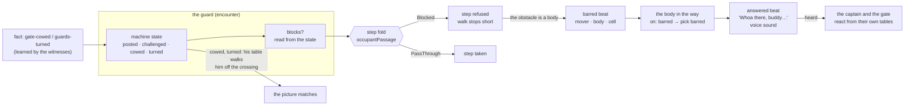

# The guard holds the gate — a posted body blocks

**Kirk, 2026-11-03 (#835):** "yeah i think A makes sense. we will want to
trigger a say i think if we try moving past the guards 'who there buddy, can
I help you?'"

Players walk past the castle's gate guards today. The gate door is shut and
OpenDoor opens it; the guards are neutral, so their cells are pass-through;
none of their posts is on the gate's one crossing; and the won stand-aside
teaches `gate-cowed`, which nothing reads. Blocking is not a new mechanism.
The step fold already answers Blocked, PassThrough or Standable from world
state, and a walk already stops short with a public reason. This story puts
that state on the right thing.

## Shape

## The seams, read not guessed

Read at the baseline pinned in plan.md. Toolkit paths are under
`rulebooks/dnd5e/`.

| fact | where |
|---|---|
| A cell answers one of three passages: Blocked, PassThrough (cross, never stop), Standable. | `encounter/cellfacts.go:12-27` |
| The fold is derived on every call and never stored; its creature rows are the 2014 rules: a nonhostile space is pass-through. | `encounter/cellfacts.go:115-135` |
| A member's cell is Blocked when it blocks or is hostile; a downed monster is Standable; anyone else is PassThrough. | `encounter/cellfacts.go:528-540` (`occupantPassage`) |
| The member contributor asks the canvas entity's `BlocksMovement()`. | `encounter/cellfacts.go:303-330` |
| That flag is a field set once at creation from `MemberInput.BlocksMovement` and carried on the record. | `encounter/encounter.go:3048-3050`, `:992`, `:1015`, `:1261`, `:2601-2632`; `encounter/board.go:167` |
| An observer's route reads the blocking it holds, not the live flag. | `encounter/observedpassage.go:43` |
| A step reads the crossing first, then the masquerade, then the destination: Blocked is refused; PassThrough is refused only on the walk's last step. | `encounter/step.go:218-410`, `:334-336` |
| A body-blocked destination wraps `ErrBadPlacement`, so its public reason is "movement stopped at an obstruction"; the private sentence names the body. | `encounter/step.go:347-352`; `encounter/walkend.go:35-48`; `encounter/cellfacts.go:478-503` |
| The session turns an obstruction into `stopped` with `stop_reason`; the sentinels map to their own errors. | `session/move.go:455-461`; `session/read.go:740-756` |
| A driven walk swallows the same refusals and stops silently. | `encounter/step.go:440-452` |
| A route and a step read the same fold, so a route never plans through a Blocked cell. | `encounter/route_search.go:58-110`; `encounter/clocks.go:2545-2588` (`walkerEdge`) |
| A door is state on the wall: open, closed, locked; a creature's own walk opens a shut one and never a locked one; no key or fact opens a lock. | `encounter/door.go:14-70`, `:83-93`, `:148-198`; `encounter/clocks.go:1609`, `:1632-1640`; `encounter/walkdoor.go:13-60`; `encounter/doorverbs.go:363-485` |
| A player's walk refuses a shut door by name. | `encounter/step.go:281-286`, `:377-400` |
| A fact is known per member; dialogue `requires` reads the speaker's own facts. | `encounter/world.go:480-487`; `encounter/option.go:236-262` |
| A fact an answer teaches lands on the witnesses of the line. | `encounter/option.go:396-398` |
| A machine reads `fact:<id>` as "this creature holds it"; `fact` lands on the member who learned it. | `encounter/machine.go:735-739`; `encounter/wakebeats.go:211-217` |
| The machine vocabulary: `time`, scoped `heard`/`deed`/`seen`, unscoped `fact` and `clock:*`, open words `deed:<word>`, `clock:<name>`, `fact:<id>`. | `encounter/machine.go:85-135`, `:700-735` |
| A recipe state carries only its transitions; the primitive knows no rule. | `mind/machine/recipe.go:39-42` |
| The authored dialect compiles `states:` to a recipe inside the encounter module. | `encounter/dungeonspec/states.go:19-80` |
| Landed beats wait for the next raise; a pass that raised nothing still matches what landed and asks nobody the time. A reaction pick spends nothing. | `encounter/wakebeats.go:34-50`; `encounter/worldtime.go:405-420` |
| A table row's `say` is carried onto its `answered` beat; a say row on `time` is a Pass. | `encounter/option.go:67-69`; `encounter/tablebeat.go:152`; `encounter/tabledriver.go:146-153` |
| Every line said on an answer row is a voice: its hearers are the hearers of that sound. | `encounter/doc.go:142-149`; `encounter/answer.go:239-250` |
| The session decodes an `answered` beat into a table answer, and the wire and the web already carry it. | `session/act_family.go:725-765`; `session/act_bodies.go:394-415`; rpg-api-protos `act.proto:104`; rpg-dnd5e-web `describeAct.ts:478` |
| No condition stops a walk today; prone leaves movement out. | `conditions/prone.go:49-52` |
| Resolution's `Prevented` is unset by anything; it is reserved for Sentinel. | `resolution/movement.go:114-119`, `:545-548` |

The castle (rpg-api `content/the-mad-king.yaml`):

| fact | where |
|---|---|
| The stand-aside line is the captain's: Intimidation DC 14; a win (weight 3) answers "…go on, then. I saw nothing." and teaches `gate-cowed`; a win (weight 1) and a loss teach `party-recognized`. | `:1723-1737` |
| The garrison is neutral to the party until `guards-turned` (allied) or `party-recognized` (hostile). | `:524-531` |
| `gate-1` (-7,10), `gate-2` (-3,10), the captain (-4,8); only `gate-1` has states (`posted`, `alert`). | `:1544-1565`, `:1681-1701` |
| The gate patrols' loops, and their `guards-turned` march. | `:272-327` |
| The reserves are told to stay off the gate's one crossing. | `:474-478` |
| The gate door is shut and teaches `gate-opened` when opened. | `:2012-2015` |
| The crossing is the cell beneath the gate and the courtyard cell past it; the patrol posts flank it. | `encounter/castletest/castle_king_script_test.go:53-98` |

## Law

**Block by state on the world, never by an invisible permit.** A thing the
player may not do is a thing they can see and act on: a shut door, a body in
the way, a shout. The one permit-shaped thing stays where it is: `requires`
on a dialogue line. Resolution's `Prevented` stays reserved for Sentinel.

**A body blocks by its state.** A creature with authored states blocks
exactly while its current state says `blocks`. A creature without states
blocks as its creation said (`BlocksMovement`), as today. The answer is read
from the state on every fold and never stored beside it, so a state change
opens or closes the cell in the beat it happens. The fold is unchanged:
blocking or hostile is Blocked; a downed monster is Standable; any other
body is PassThrough.

**A posted body departs from the 2014 rule on purpose.** A nonhostile
creature's space is pass-through unless the creature is posted to hold it.
RAW is not the authority here.

**A barred step names the body.** A step refused by a body says who stands
in the way, as a shut door says it is shut. A body the mover does not
observe is "someone". A wall, a door and a field keep their own sentences.

**The bump is a deed the body hears.** A step refused by a body writes a
`barred` beat (mover, the body in the way, the cell) before the walk stops,
on every bump. The body in the way is its addressee. Its machine may answer
on `barred` with a table key, and that key's row speaks as any row speaks:
an `answered` beat, the voice's sound, the record. Who else reacts hears that
voice through `heard`. The answer runs in the Move that bumped, as a
reaction: it spends nothing and asks nobody the time.

**A bump spends nothing.** On the world clock nothing is spent. On the turn
clock the refused step is not a step, so no movement is paid; the steps
already taken stay.

**Standing aside is both state and walk.** A fact that ends the post moves
the creature to a state that does not block, in the beat the fact lands, so
a cowed or turned guard never blocks. His table walks him off the crossing
on his next beat so the picture matches. The engine guarantees the state;
the step aside is content.

**Hostility still blocks.** A hostile body is Blocked whatever its state.
Downed bodies, allies and pass-through bodies are unchanged.

## Rulings

| # | question | options | ruled | scope | date |
|---|---|---|---|---|---|
| R1 | What holds the gate? | A a posted guard blocks the crossing; `blocksMovement` becomes machine state; `gate-cowed` and `guards-turned` turn it off; the door stays as it is. B the door is barred by the garrison and a fact unbars it (rejected: it gates the door, not the guard; the guards stay decorative, and a locked gate tells "nobody is home" where the story is "a man who says no"). C both, as two slices. | A (Kirk: "yeah i think A makes sense. we will want to trigger a say i think if we try moving past the guards 'who there buddy, can I help you?'") | a member's blocking; the castle gate | 2026-11-03 |
| R2 | How does the bump speak? | A the bump is a deed the guard hears: a `barred` beat, scoped like `heard`; his `on: barred` row says his line on his own machine. B the stop reason carries a string (rejected: no voice, no wake, no record; a tooltip, not a guard). C the session plays Speak at the barrier (rejected: it inverts who speaks first). | A (Kirk: "A sounds great") | the machine vocabulary; the Move answer; the wire | 2026-11-03 |
| R3 | What is standing aside? | A state only (rejected: bodies overlap for a step). B walk only (rejected: a delayed walk still bars). C both: the state flips at once and his table walks him off the crossing. | C (Kirk: "oh yeah both sound good. I was having a hard time picking") | a posted member's states; castle content | 2026-11-03 |

## Assumptions, not ruled (open to veto on the design PR)

- **A repeated bump is the guard's states' business.** The engine writes
  `barred` every time; content moves `posted` to `challenged` for a few
  rounds with a shorter row, as `posted` moves to `alert` today.
- **The barrier is the addressee; bystanders hear his voice.** "Scoped like
  `heard`" is read as: `barred` lands on the body in the way, and the
  captain and the gate learn of the bump by the line the guard speaks (a
  real sound through `heard`). A bump nobody voices is heard by nobody.
  The other reading (the bump itself lands on every listener in earshot)
  needs a second rule to tell an addressee from a bystander; it is not built
  unless asked.
- **The body in the way keeps its post.** `gate-1` holds the cell beneath
  the gate while `posted`. The stand-aside line stays on the captain; whether
  the barring guard carries it too is a walk finding.

## Findings, not ruled

- **A body's refusal is generic today.** A body-blocked step wraps
  `ErrBadPlacement` and its public reason is "movement stopped at an
  obstruction" (`encounter/walkend.go:41-43`). S1 gives a body its own
  sentinel and sentence, and the driven walk's silent list
  (`encounter/step.go:447`) takes the new sentinel.
- **Observers hold blocking.** A route planned from what a creature observes
  reads the blocking it holds (`encounter/observedpassage.go:43`). A state
  change refreshes what its observers hold, or a route plans through a
  closed cell or around an open one.
- **The state binding lives in the encounter.** `mind/machine` stays
  rulebook-agnostic (its `State` has transitions only), so `blocks` is the
  encounter's word: the dialect's `blocks: true` on a state compiles into
  the member's set of blocking states, validated against the recipe. A bag
  key set by acts was the other cut; it can drift from the state when one
  transition forgets to set it.
- **`gate-cowed` lands on the witnesses.** The barring guard steps aside on
  `fact:gate-cowed` only when he saw the captain cowed. A guard who did not
  see it holds the gate; that is the story, and the walk proves it.
- **Landed beats wait for a raise.** A bump short of a pace raises nothing.
  S2 matches `barred` in its own Move with the pass that raises nothing
  (`encounter/worldtime.go:405-420`).
- **The sneak window crosses the post.** The castle's sneak dash ends on the
  cell beneath the gate (`TestMadKingScriptASneakWindowAtTheDoor`,
  `encounter/castletest/castle_king_script_test.go:453`). A guard who holds
  that cell while posted closes the sneak; see Open.

## What we are not building

- A barred, locked or fact-unbarred gate door (R1 B).
- A permit on movement, a `requires` on a cell, or `Prevented` set by
  anything but a future Sentinel.
- Grapple, restrained, difficult terrain or any other condition that stops
  a walk.
- A bump that costs anything, or an opportunity attack for one.
- The session auto-playing a dialogue line (R2 C).
- A size-difference exception to pass-through.

## Open

- **The sneak.** Either the crossing is one post of `gate-1`'s loop (he
  stands it some rounds of every loop, and the window survives), or the
  sneak at the gate is retired and the gate is talked, cowed or turned
  through. Recommendation: one post of the loop, decided on the S1 content
  PR and walked.
- **Bystanders and the bump.** Whether the bump itself, not the guard's
  answer, lands on listeners in earshot (Assumptions above).
- **The barring guard's own stand-aside line.** A walk finding.

— cross-team agent, on behalf of KirkDiggler
