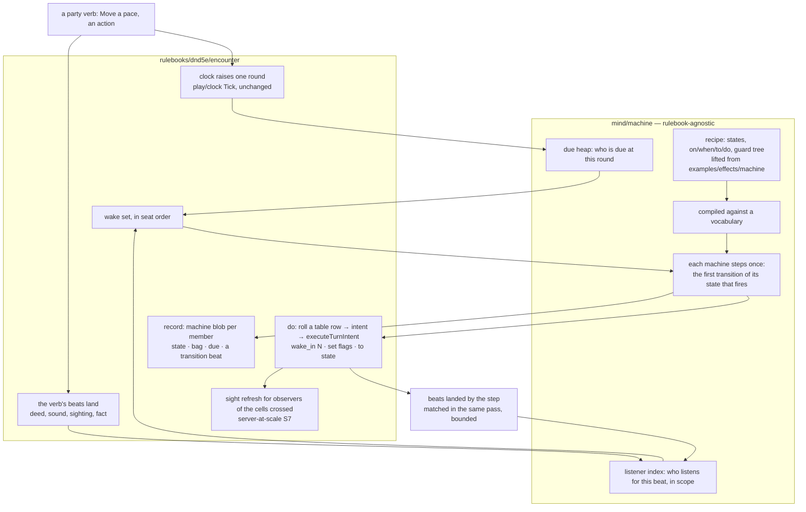

# The world runs — a creature is a machine that listens

Story rpg-project#766. Walkthrough: [README.md](README.md). Plan:
[plan.md](plan.md). Rulings R1–R8 are ruled on the lane issue (#768). Measured against rpg-toolkit `ea629b31` <!-- case-file -->
(encounter v0.160.0, session v0.151.0), the heads the server-at-scale story
left (rpg-project#753).

## Shape



## Law

**A creature is a machine.** Its mind is a current state and, for that state,
the list of what it listens to and what it does when that fires. The list is
data: `on` a beat, `when` a guard holds, `do` acts, `to` a state. A state
with no `time` transition is never asked what it does with time.

**The raise wakes who is due or addressed.** The engine never walks the
roster when the clock moves. A due heap answers "who acts at this round"; a
listener index answers "who listens for this beat, within its scope". Both
are derived from the machines' current states and rebuilt at load, the way
the field indexes its placements (server-at-scale law: the field indexes its
placements, no stored derived data).

**One deterministic pass.** The machines that woke step in seat order inside
the call that raised the clock. No goroutines, no timers (encounter C5
stands). A beat a step lands is matched in the same pass, bounded the way a
turn's intents are bounded today. Async processing is the recorded escape
hatch, not the design.

**A creature's clock is content** (ruled on rpg-project#690, 2026-10-27, and
R5 here). Clocks are plural and named; `world` is the default. An area can
declare its own free-roam clock, raised by the paces and actions of the
members in it; a creature listens to the clock it is seated on; a portal or
a stair is a transfer between clocks. Fights are plural the same way: a
fight is a clock, two fights form when two contacts happen out of each
other's reach, and contact between them (a door opening with a fight on
either side) merges them. One fight per encounter is today's policy, never
this design's assumption. The due heap, the `time` beat and every stamp on
the record carry the clock's name, so "within N rounds" ages on the
creature's own clock.

**The roll is seen, and it replays.** Every pick is still a roll shown on its
beat (creature-table R7), and the temper deal at the door is one too. The
dice stay as random as they can be (the host's crypto roller, the only
production roller). Reproducibility comes from the record, not a seed: a
replay reads the record's own rolls back in order. No seeded roller (R6,
"we do not have a use case for seeding yet").

**No row gets worse.** Every shipped `time` table is a one-state machine
whose `time` transition rolls it. The castle plays the same.

## What is true today, read not guessed

The world clock already moves only because the party acts
(`rulebooks/dnd5e/encounter/worldtime.go`: `spendWorldPace` :210 one round
per pace, `spendWorldAction` :169 one per action, `spendRound` :258 per fight
round when a fighter leads). Standing still is free. That law stands
(creature-table R1, R2).

What a raise costs (`worldThinks` :308):

1. `worldThinkers` :381 walks every world-clock member, filters monsters with
   a table and budget, and calls `bubbleFor` (`clocks.go:147`, a loop over
   all bubbles) for each. O(members × bubbles) per raise, before anyone acts.
2. `thinkFor` :424 gives each thinker one turn per unit of budget: `sheetOf`,
   `runIntents` (`clocks.go:587`), which builds a `MonsterView`
   (`clocks.go:2082`: intel, holdings, distance and paths per seen subject),
   rolls the `time` table through `TableDriver.Act` (`tabledriver.go:~90`,
   `behavior.Pick` `mind/behavior/table.go:1646`), and executes.
3. A driven walk ends in `settleWalk` (`clocks.go:2014`) → `refreshSight`
   over `audienceFor`, which is the whole roster for a non-table beat
   (`encounter.go:1403`).
4. One more `refreshSight(rosterIDs())` closes the pass (:366). Every player
   step does another (`step.go:143,173`).

A creature has no state. Its mode is wherever it is derived from: the clock
that holds it, its holdings (sightings, deeds, sounds) read by `when`
conditions at its next pick, `Dwell` (`dwell.go`, the one persisted patrol
state), and its dealt `Temper`. A sound lands on hearers at once
(holdings) but is acted on only at the next raise, by whoever is asked.
`memberRecord` (`field.go:1531`) carries `Table`, `Temper`, `Dwell`,
`PaceCells`, `Faction`, `Facing`, `TableHash`.

The recipe shape exists. `examples/effects/machine/recipe.go:20-110`:
`Recipe{Ref, Initial, Bag, Trackers, States}`,
`State{Outputs, Transitions, Terminal}`,
`Transition{On Beat, About Selector, When *Guard, To, Do []Act, Reason}`,
`Guard` as an all/any/not tree over leaves. `Recipe.Compile(Vocabulary)`
(`validate.go:43`) returns a `Program`; `machine.New` (`machine.go:54`) makes
an instance over `Blob{State, Bag}` (`blob.go:17`); `onBeat` (:193) runs the
current state's transitions in order, first that fires wins; `enter` (:218)
fires `OnTransition` listeners, which is how a transition kicks an action
(`composed.go:261` swaps a condition's outputs). It is bus-bound (`Apply`
subscribes per beat, `vocabulary.go:51`) and imported by nothing outside the
example. Encounter imports no bus and session has a test that it never will
(`session/no_bus_lives_here_test.go`).

Dice: `dice.Roller{Roll, RollN}` (`dice/roller.go:17`), one production
implementation (`CryptoRoller`), injected by struct field
(`session.Config.Dice` `session.go:105` → encounter `roller`
`encounter.go:166`, `TableDriver.Roller`). No seeded roller exists outside
tests (`mind/behavior/table_test.go:82`) and `examples/world/scripted`.

Persistence: every call loads the whole `EncounterData`, mutates, saves it
whole (`session/read.go:603`, `write.go:1252`; api
`redis_repos.go` key `session-enc:v1alpha1:<id>`). `EncounterRepository`'s
doc (`repositories.go:65`) already permits "an encounter held in memory on a
live server and checkpointed periodically"; nothing implements it.

Rulings this design rests on: creature-table R1–R8 (`../creature-table/design.md`,
the table is the surface, the world clock moves on verbs); rpg-project#690
(a creature's clock is content, today's world clock is the default);
server-at-scale laws (`../server-at-scale/design.md`: indexes over walks,
knowledge as the oracle, S7 observer-bounded refresh); ADR-0043 (every
monster turn has a driver); the living-world brainstorm's postponement of the
world clock "until a real need forces it" (`../living-world/brainstorm.md`),
which the keep now does.

## Approaches

| | A. filter the census | B. machines + wake index | C. actors, async |
|---|---|---|---|
| what | keep `worldThinks`; skip creatures whose holdings did not change and whose table has only `hold` | a creature is a data-declared machine; a due heap and a listener index decide who steps; one pass in seat order | one goroutine or actor per creature; beats on channels; a reconciler orders the record |
| raise cost | still O(members): the filter is the walk | O(due + matched) | O(awake), in parallel |
| state | none; mode stays derived | a state per creature, authored | a state per creature |
| determinism | yes | yes; replay from the seed | no, unless every step is serialised again, which is B |
| encounter stays bus-free | yes | yes (bus-free `Step`) | no |
| what it unlocks | nothing new | listen/ignore by state, clocks as content, timers, authored moods | throughput past what 100 machines need |
| size | small | medium: one primitive module, one encounter rewrite of the raise, content default | large; a new runtime and a new record law |

**Recommendation: B.** A is the band-aid: it makes today's loop cheaper
without giving an author a state to put a trigger on, and the count stays
O(N). C buys throughput the keep does not need (a hundred machines stepping
in memory is microseconds; the measured cost on the keep is recomputation
and blob size, not CPU) and pays for it with the seed and the replay bar.
B is the same move the field just made: index what you have, visit what
is addressed.

## The walkthrough

### 1. The primitive: `mind/machine`

A new toolkit module beside `mind/behavior`, rulebook-agnostic (primitives
law), written fresh (R3: "a fresh take with no baggage"). Its shape is the
one `examples/effects/machine` proved: the recipe, the guard tree,
compile-against-a-vocabulary and the blob. Nothing is moved out of the
example, and one thing is different from it: **the instance has no bus.**

```go
// Program is a compiled recipe. Step runs the current state's transitions on
// beat in recipe order; the first whose guard holds runs its acts and, if it
// names a state, enters it. Step never publishes: it returns what happened.
func (p *Program) Step(m *Blob, beat Beat, ev any, env Env) (Stepped, error)

type Stepped struct {
    Fired  bool
    Acts   []Act          // for the host to execute: pick, wake_in, set, clear
    From   string         // "" when the state did not change
    To     string
    Reason string
}

// Listens answers what the blob's current state listens for: the beats and
// their scope guards, so a host can index it.
func (p *Program) Listens(m *Blob) []Listen   // {Beat, Scope}
// DueAt answers the next round the blob's state wants, if any.
func (p *Program) DueAt(m *Blob) (round uint64, ok bool)
```

The same module carries the two indexes as plain data structures with no
knowledge of what a member or a cell is:

```go
type Due[K comparable] struct{ ... }   // heap of (round, K), stable by K order
func (d *Due[K]) Arm(k K, at uint64); func (d *Due[K]) Pop(upTo uint64) []K
type Listeners[K comparable] struct{ ... }  // beat → []K in insertion order
func (l *Listeners[K]) Set(k K, beats []Beat); func (l *Listeners[K]) For(beat Beat) []K
```

The example and its bus binding (`Apply`, `Subscribe`, `OnTransition`)
stay as they are; the conditions story (rpg-project#703) decides whether it
ever adopts `mind/machine`. The vocabulary (`Vocabulary{Facts, Beats}`) loses
`Subscribe` and keeps the fact readers and the beat's `About` selector.

**Refusals.** Compile refuses an unknown beat, an unknown fact, a transition
`to` a state the recipe lacks, a cyclic `do` (a transition whose acts fire
the beat it is on). A recipe with no `time` transition in its initial state
compiles; that is the point.

### 2. The encounter: the raise wakes who is due

`memberRecord` gains `Machine *machineBlob` (`machine.Blob` plus the
program's ref) and loses nothing: `Table`, `Temper`, `Dwell` stay, read by
the default recipe (§4). `Dwell` becomes a `wake_in` timer the first time a
patrol stands at a waypoint; the field stays for one release for the reload
of a record written before, then goes (protos deprecate, don't break).

`worldThinks`, `worldThinkers` and `thinkFor` are replaced by one `wake`:

```
wake(raise):
  at := clock high-water after the raise
  woke := due.Pop(at)                          // in seat order
  for each beat landed since the last wake:    // the verb's own beats
      woke ∪= listeners.For(beat.kind) ∩ scope(beat)   // scope via the field's index
  for member in seat order of woke:
      if not on world clock: skip             // a fight took it
      stepped := program.Step(blob, beat-or-time, ev, env)
      run acts: pick k → behavior.Pick → TurnIntent → executeTurnIntent (today's unit)
                wake_in n → due.Arm(member, at+n)
                set/clear → bag
      if stepped.To != "": append a transition beat; listeners.Set(member, Listens(blob)); due per DueAt
      beats this step landed → matched in this pass, bounded by the turn's intent bound
  refreshSight(observers of the cells anyone crossed)   // S7's bound, never rosterIDs()
```

Budget catch-up is preserved by the heap: a creature due at round 10 whose
world reached 12 pops at 10, acts, re-arms at 11, pops again, acts, re-arms
at 12, acts. Three turns, as `thinkFor` gives it today. A creature in a
bubble is never on the heap (Transfer disarms it; dissolve re-arms it at the
world's now, as `seatOnWorldClock` seats it today).

The indexes are not persisted. `LoadEncounter` rebuilds them from every
member's blob (`Listens`, `DueAt`): O(members) once at load, the same
moment the field builds its placement index.

**Refusals.** A `pick` act on a key the creature's table lacks is a hold
with a reason beat, as an absent row is today. A `wake_in 0` is refused at
compile. A step that lands more beats than the bound is cut at the bound
with a beat saying so, the anti-spin bound a fight turn has.

### 3. Triggers, and clocks as content

The beats a state may listen for are the ones the record already writes,
named in the vocabulary the encounter supplies: `time` (a round of the clock
the creature is seated on, the default), `heard` with `within` hexes or
regions, `deed` with `within` and the deed word (`attacked`, `fled`, `door
opened`), `seen` (a sighting of an enemy band), `fact` (learned, the `until`
grain), and `clock` with a name: `world` (every raise of the default clock),
`fight` (every round of the fight the creature's faction is engaged in,
rpg-project#690's reserves case, rpg-project#661), `bell:<ref>` (an authored
prop's deed), or an area clock's name. A `clock` name is a beat kind like
any other.

**Clocks are plural (R5).** `play/clock` already keeps progress per driver
in one `Tick` and transfers members between a `Tick` and a `Turn`; the
encounter holds one `Tick` today by policy. Under R5 the encounter holds a
named `Tick` per clock: `world` always, plus one per area that declares its
own time (a tomb, an underground), created when the first member enters and
seated with the creatures placed in its regions. A member raises the clock
it stands on; a party split across two areas runs two clocks that never
hear each other. A portal or stair is a `Transfer` between two `Tick`s, the
move the fight bubble already makes. Fights are the same shape: the
one-bubble policy in `form` (`clocks.go` "ONE bubble per encounter") lifts
in its own slice, with the Merge the code's comments reserve for contact
between two running fights, and a fight addressed through one of its
members. Every key the engine holds (the due heap, a listener's `time`, a
stamp on the record, `PaceCells`) names its clock from the first slice, so
the lift is content and a transfer, never a rewrite.

Scope is evaluated at match time against the beat's cell through the field's
placement index, so "who heard this" costs the listeners for `heard` filtered
by distance, not the roster. Today's `when: heard within N` rows keep working
in the default recipe; the difference is that under a state with
`on: heard`, the creature wakes in the raise the sound landed rather than
the next one.

### 4. The default recipe, and authored ones

Every creature with a table and no authored recipe runs this:

```yaml
initial: watch
states:
  watch:
    transitions:
      - on: time
        do: [{pick: time}]
```

Which is `thinkFor` exactly: due every round, roll `time`, execute. Castle
content plays byte-for-byte the same, and the castle's harness is the test.

An authored recipe layers like a table (creature-table R4: rulebook default
→ faction → placement, nearest wins wholesale) and is written in the
studio's words:

```yaml
initial: posted
states:
  posted:
    transitions:
      - { on: time, do: [{pick: time}] }
      - { on: heard, when: { within: 6 }, to: alert, reason: "heard something" }
  alert:
    transitions:
      - { on: time, do: [{pick: alert}] }        # a second table key, authored
      - { on: rounds, when: { since_anchor: { op: ">=", n: 3 } }, to: posted }
  asleep:
    transitions:
      - { on: heard, when: { within: 2 }, to: posted }
      - { on: clock, when: { word: "bell:alarm" }, to: alert }
```

A state's `pick` names a table key, so the author's existing vocabulary
(rows, `when`, weights, temper) is the body of every state and the machine
is only the skeleton that says which key applies now. Nothing in
`mind/behavior` changes.

### 5. Reproducible, not seeded

No seeded roller. The dice stay the host's crypto roller, as random as they
can be. What makes a run reproducible is that every world roll is already on
the record: a pick is a roll shown with its arithmetic (creature-table R7),
a temper deal at the door is a beat (`dealTemperFor`,
`worldtime.go:544`), a driven attack is an attack beat. A replay is a
roller that reads those rolls back in order (the shape of
`examples/world/scripted.Roller`, a test double today) under the same
record from round 0; the test compares the beats it lands to the record's.
Any world roll that is not on the record is a defect this test finds, which
is the "roll is seen" law made checkable. Session's `diceSeam` and the
config's injection are unchanged. A seed is a mechanism a use case has not
brought (R6).

### 6. Sight

This story does not change how sight is computed. It depends on
server-at-scale S7 (rpg-project#762): a driven move refreshes the observers
of the cells crossed, never the roster. Until S7 lands, `wake` calls the
refresh the way `settleWalk` does today, and the numbers say so.

### 7. Persistence is another story

How the encounter is saved is out of this story (R7). The record's shapes
by how fast they change (the site, the roster, the clocks, per-observer
knowledge, the append-only log) have their own space, rpg-project#770,
because segmenting the data deserves its own thinking. This story adds to
the record a machine blob and a clock name per member and a transition
beat, and assumes nothing about how any of it is stored. The memory-speed
instance the direction mentioned sits where async does: an escape hatch
behind `EncounterRepository`'s existing permission, reopened only by a
number.

### 8. The studio and the panel

The studio authors a recipe per placement or faction the way it authors a
table today, in the same YAML (`dungeonspec`). The panel reads a transition
beat as a state change in the author's words. Protos: one new beat kind,
additive. Neither is in the first slices.

## Costs, before and after

| | today | after |
|---|---|---|
| census per raise | every world-clock member × every bubble | none; pop the heap, look up the beat |
| who is asked | every monster with a table and budget | who is due or addressed |
| a sleeping creature | rolls `hold` every raise | never visited |
| reaction to a sound | next raise, by whoever is asked | this raise, by who listens |
| sight per driven walk | whole roster | observers of the cells crossed (S7) |
| a raise with 100 creatures, 20 on routes, nothing heard | 100 views + 100 picks + 21 roster refreshes | 20 views + 20 picks + 20 bounded refreshes |
| load | rebuild the field's placement index | plus rebuild due and listeners, O(members) |
| record | `Table`, `Temper`, `Dwell` per member | plus `state`, `bag`, `due` and the clock's name per member |

## Non-goals

An async engine. Wall-clock time or time of day. NPC schedules beyond what
a `clock` trigger and a `wake_in` express. Reconciling two clocks' stamps
against each other (a `within` window is read on its own clock; a merge
seats the joined fight at the leading clock's now, as a join does today). A "mind"
object: the machine is the skeleton, the table is still the surface
(creature-table R3). Changing how sight is computed (S7 does that).

## Rulings

Recorded on the lane issue as they land; each row carries its words.

| # | ruling | recommendation |
|---|---|---|
| R1 | **The shape.** A creature on the world clock is a machine whose current state declares what it listens to; the raise wakes only who is due or addressed; the roster is never walked when the clock moves. Creature-table §5 "when time passes, the world thinks" is amended to "the world wakes who is due". | yes |
| R2 | **One deterministic pass.** Machines step in seat order inside the raising call; no goroutines (C5 stands); async is the recorded escape hatch, reopened only by a measured number. | yes |
| R3 | **The primitive.** A fresh, rulebook-agnostic `mind/machine` with the shape `examples/effects/machine` proved (recipe, guard tree, compile, blob) and a bus-free `Step`, plus `Due` and `Listeners` as plain data structures; nothing moves out of the example; the encounter supplies the vocabulary. | ruled: fresh take, no baggage |
| R4 | **The default recipe.** A creature with a table and no recipe runs `watch: on time → pick time`; every shipped castle row plays the same; recipes layer like tables (creature-table R4). | yes |
| R5 | **Clocks are plural, named content, as triggers.** `world` is the default; an area can declare its own free-roam clock, raised by the members in it; a creature listens to the clock it is seated on; a portal is a transfer. Fights are plural the same way, two forming out of each other's reach and merging on contact; one fight per encounter is policy, never this design's assumption. Every engine key names its clock from the first slice. | ruled: "that matches what's in my head" |
| R6 | **Reproducible, not seeded.** No seeded roller; the dice stay as random as they can be; every world roll is on the record and a replay reads them back; the replay test is the "roll is seen" law made checkable. | ruled: "as random as we can… also reproducible… no use case for seeding yet" |
| R7 | **Persistence is out of this story.** The record saved in shapes by change rate is its own story (rpg-project#770); this story assumes nothing about storage; the memory-speed instance is an escape hatch. | ruled: "how we segment the data deserves its own space for thoughts" |
| R8 | **Finish line.** On the keep with a hundred-creature garrison (twenty on routes): a Move that wakes nobody costs what an empty keep's Move costs (S7's bar, 100 ms); a raise's cost grows with how many woke, never with the roster; a replay reproduces the picks; the castle's harness is unchanged. Numbers on the story. | yes |

## Build order, once ruled

One deliverable per slice; sub-issues when the plan is written (story skill).

1. **S1 Probe: the driven garrison.** `keepgen` gains a garrison option
   (minds and routes on a share of placements); the bench harness measures
   a raise today with 100 creatures and 20 routes. Benchmark keep O1
   answered. Numbers only.
2. **S2 `mind/machine`.** The primitive (§1), one toolkit PR, one module.
3. **S3 The encounter wakes who is due.** `Machine` on the member, `wake`
   replaces `worldThinks`, the default recipe (§4), `Dwell` as a timer, the
   transition beat, indexes rebuilt at load. Castle harness green; garrison
   numbers before and after.
4. **S4 Triggers with scope and clocks as content.** `heard`, `deed`,
   `seen`, `fact`, `clock` as wake beats (§3); the reserves' fight-round
   trigger (rpg-project#661) as the first authored recipe; `dungeonspec`
   words.
5. **S5 Replay from the record.** The read-back roller and the replay test on
   the garrison (§5); every world roll it finds missing from the record is
   a finding fixed in the slice. Encounter only.
6. **S6 Author and read.** Studio recipe authoring, panel state change,
   the additive beat proto. Visible; walked.
7. **S7 Area clocks.** A named `Tick` per area that declares its own time,
   seated at entry, transfer at a portal or stair; the tomb's monsters tick
   on the tomb's clock (R5).
8. **S8 Plural fights.** The one-bubble policy lifts: two fights form out
   of each other's reach, a fight is addressed through a member, and
   contact between two fights merges them (the door opening). Sized large
   by rpg-project#690's reading.

## Done when

- The garrison keep's raise cost is independent of roster size (R8 rows on
  the story).
- A sleeping barracks is never visited; a dropped shield wakes the gate in
  the same raise.
- The castle plays as it does today on the default recipe.
- The same record replays to the same picks from its own recorded rolls,
  with no seed anywhere.
- rpg-project#690's reserves case runs as an authored `clock: fight`
  recipe with no engine special case.
- A tomb's garrison ticks on the tomb's clock while the overworld stands
  still, and two fights separated by a door merge when it opens (S7, S8).
