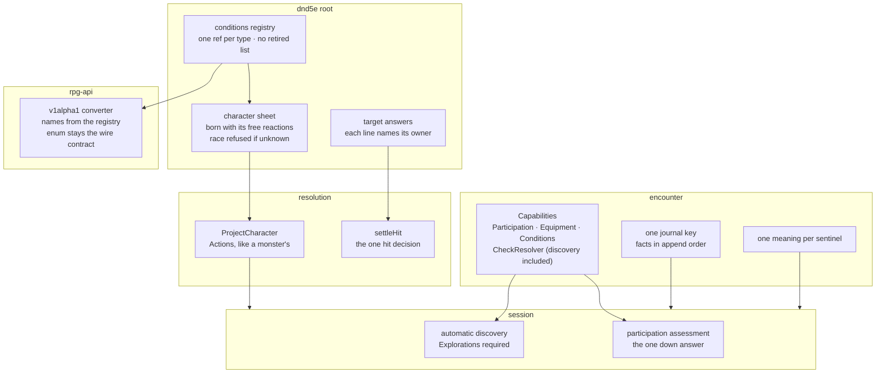

# Tier 3 close-out — walkthrough

The last cut of the composable encounter review
([rpg-toolkit#1965](https://github.com/KirkDiggler/rpg-toolkit/issues/1965)),
plus items 2–4 of
[rpg-toolkit#2018](https://github.com/KirkDiggler/rpg-toolkit/issues/2018).
Law: [design.md](design.md). Slices: [slices.md](slices.md).

## What this is

Tiers 1 and 2 built the primitives: sheet facts asked at use time, the target
answering its own damage, session verbs, one capabilities value, one pause
envelope, one condition descriptor. Each left behind the thing it replaced:
a binary standing question beside the participation answer, a retired search
verb beside automatic discovery, a condition's type string beside its ref, a
journal split in two to keep old bytes, refusals that reuse one sentinel for
three meanings. Closure deletes those. **It adds no capability.** Where a
deletion forces a behaviour choice, the choice is a ruling (R1–R9) the
operator answers before the slice runs.

The test for "closed" is four questions, asked of every module the review
touched: is there a default that answers when the truth is unknown, a second
name for one fact, code the review named that nothing calls, or a reader of a
stored shape no build writes? After the five slices, each answer is no.

## Component shape

What each seam answers from after closure. Every arrow is the one path left
for that fact.

## Ownership and contracts

| Component | Owns | Input → output |
|---|---|---|
| `conditions` registry | every condition type, by its full ref | a stored blob → a behaviour, or `ErrUnknownCondition` (R7) |
| `character` | the sheet, including its stored free reactions (R2) | `Data` → `*Character`, refusing an unknown race (R4) |
| target answerers (immunity, vulnerability, Raging, Blade Ward) | their own answer on `IncomingDamageChain` | the incoming fold → a multiplier or reduction whose `Source.SourceID` is the holder |
| `encounter.Capabilities` | which host answers each question the world asks | `Participation`, `Equipment`, `Conditions`, `CheckResolver`, … → refused at the door when absent |
| `encounter` journal | knowledge and holdings facts | facts in append order → one `Journal` key |
| `resolution` strike | the hit | a d20 and its fold → `Hit`, `Critical` from `settleHit` alone |
| `resolution.ProjectCharacter` | a character's projected facts | a record → `Actions []Definition` (R3) |
| `session` | which host sentinel a world refusal becomes | encounter sentinel → one session sentinel each (R6) |
| rpg-api v1alpha1 converter | the wire enum for a condition | a stored blob → enum by the existing mapping, name by `DisplayFor` |

Refusals, the seams' teeth:

- The registry does not keep a list of old refs to skip. A ref it does not
  hold is an error, wherever the blob came from (R7).
- A sheet does not gain a free reaction at attach. What it holds is what it
  stored (R2).
- `HeldAddresses` does not add what the stored list omits.
- Encounter does not ask "who is down" as its own question. Down is a field
  of the participation answer.
- Encounter does not pick a discovery mode by inspecting a resolver's type,
  and session does not read a nil repository as "no discovery" (R1).
- Resolution does not decide a hit anywhere but `settleHit`.
- Session does not map two encounter sentinels to one of its own.
- rpg-api does not hold a display name for a condition.

## Walk one thing through

A raging barbarian is struck for 7 piercing.

1. Resolution's target step publishes the incoming fold with the dealt
   components; the attacker's die carries the attacker's id as `SourceID`.
2. `RagingCondition` answers with a `DamageMultiplier`, factor 0.5, `Source`
   = Raging's ref and name, `SourceID` = the barbarian's id.
   `DamageMultiplier.Validate` refuses the answer if `SourceID` is empty.
3. `combat.SettleDamage` decides the factor per type and names the multiplier
   that decided it.
4. `receivedTrace` builds the `resisted` line from that multiplier's source.
   The line now says whose rule it is: the barbarian's.
5. Encounter records the beat; session projects it; the client renders the
   line beside the attacker's die, each naming its own owner.

Identity survives untouched from the answerer to the screen; nothing between
them fills in an owner.

## Separations that look like one thing

| Query | Source of truth |
|---|---|
| An empty member id | `ErrNoMember` |
| An id naming nobody here | `ErrNotMember` |
| A member already present | `ErrDuplicateMember` (R6) |
| An authored member the world cannot seat | `ErrBadMember` (R6) |
| A sheet the rulebook cannot compile | `ShortfallUnreadable`, `ErrBadAttack` |
| A player who owes a pick between two offers | `ShortfallUnavailable`, `ErrConflictingOffers` (R5) |
| A v2 prop (one cell) | `PropInput` (R8) |
| A placed footprint | `PlacedPropInput` |

Hazard: merging the first four tells a host "no such member" for a duplicate
join, which sends a player to look for someone who is there. Merging the next
two tells a monk with Shillelagh their sheet is broken when it is a choice
nobody can make yet.

## Trade-offs

| Decision | Benefit | Cost / boundary | Not taken |
|---|---|---|---|
| Delete old-shape readers; reset stored data | one reader per shape; no branch for a blob no build writes | one more reset, including the deployed store, which the operator runs | translate old blobs at load |
| Free reactions stored from birth (R2) | what a member holds has one answer, stored or loaded | two creation paths write it; hand-built fixtures change | keep merging at read time |
| Discovery required (R1) | no host can silently play without finding secrets | every session test wires an exploration fake | optional automatic mode |
| Conflicting offers as a precondition (R5) | the right words to the player, no wire change | a sentinel in three modules | a new shortfall enum value |
| v2 map format stays (R8) | the builder keeps authoring | two prop shapes live on | retire v2 inside closure |
| Count pins converted only where a slice edits | closure stays a deletion wave | the remaining pins wait for their own sweep | sweep every pin now |

## Edges

- Closure changes no wire contract. The deprecated `Search` RPC stays a
  tombstone in the protos.
- Rage still ends on dropped-to-zero by damage. A damage-less go-down (Sleep)
  brings the life-state primitive.
- Sanctuary is still modelled as concentration; correcting that is a
  behaviour change with its own ruling.
- A ward-on-attempt primitive waits for a second ward.
- Lenient `character.LoadFromData` still drops what it cannot read; it is not
  on the review's list.
- The count-pin sweep beyond the files each slice edits is a separate job.

## Where a change lands

- **A new reaction every combatant has.** Add it to `conditions.FreeReactions`;
  Finalize and the monster mint write it at creation. Nothing at read time
  changes.
- **A new target answer to damage.** A condition answering on
  `IncomingDamageChain`, setting its holder as `SourceID`; the validator
  refuses it otherwise.
- **A new refusal in encounter.** A sentinel with one meaning and the
  `encounter:` prefix, and one arm in session's translate.

## Source map

| Concern | Path |
|---|---|
| Condition registry, held addresses | `rpg-toolkit/rulebooks/dnd5e/conditions/registry.go`, `holds.go`, `loader.go` |
| Sheet load and creation | `rpg-toolkit/rulebooks/dnd5e/character/load.go`, `draft.go` |
| Target answers | `rpg-toolkit/rulebooks/dnd5e/events/incoming_damage.go`, `conditions/raging.go`, `trait_immunity.go`, `trait_vulnerability.go`, `blade_ward.go` |
| Capabilities, participation, discovery | `rpg-toolkit/rulebooks/dnd5e/encounter/capabilities.go`, `participation.go`, `discovery.go` |
| Journal persistence | `rpg-toolkit/rulebooks/dnd5e/encounter/data.go` |
| Refusal sentinels | `rpg-toolkit/rulebooks/dnd5e/encounter/errors.go`, `session/errors.go`, `session/read.go` |
| Strike, projection, trace | `rpg-toolkit/rulebooks/dnd5e/resolution/strike.go`, `projection.go`, `target_step.go` |
| Session discovery and down | `rpg-toolkit/rulebooks/dnd5e/session/exploration.go`, `standing.go` |
| Wire conversion | `rpg-api/internal/handlers/dnd5e/v1alpha1/character/converters.go`, `internal/handlers/dnd5e/sdkerr/errors.go` |
