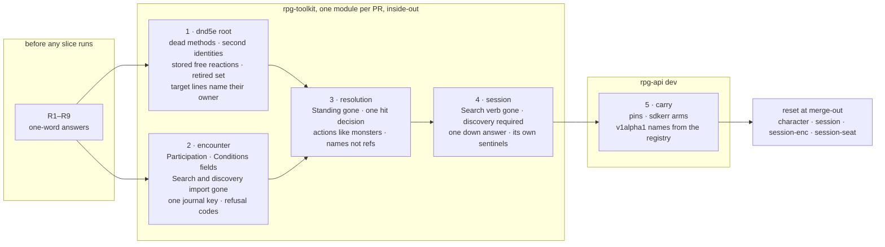

# Tier 3 close-out — the composable encounter review, finished

Tracking: [rpg-toolkit#1965](https://github.com/KirkDiggler/rpg-toolkit/issues/1965)
tier 3, and items 2–4 of
[rpg-toolkit#2018](https://github.com/KirkDiggler/rpg-toolkit/issues/2018).
Walkthrough: [README.md](README.md). Slices: [slices.md](slices.md).

## Shape

Closure is a deletion wave. Every line of the review's tier 3, every tier 3
item its comments added, and items 2–4 of rpg-toolkit#2018 gets exactly one
disposition below. Nothing here adds a capability; where a deletion forces a
behaviour choice, the choice is a ruling the operator answers before any slice
runs.

## Law

### What closure means

- **Closure leaves no fail-silent default, no second identity for one fact,
  no dead code the review named, and no reader of a stored shape no build
  writes.** Each of the four is a place a future change lands in the wrong
  copy.
- Pre-release data resets rather than migrates (A6). A reader whose only job
  is an old stored shape is deleted, and the reset at merge-out removes the
  data it read.
- A deletion that changes what a player can observe carries one walk box. A
  deletion of dead code carries none; its proof is the build and the tests.
- A count pin in a test file a slice already edits becomes a membership or
  identity assertion. A count is never bumped.

### The audit

Dispositions: **gone** (already deleted, naming the module tag that did it),
**delete** (pure deletion or mechanical cleanup, no behaviour choice),
**ruling** (a behaviour choice; see Rulings), **out** (not closure work).
Toolkit paths are relative to `rulebooks/dnd5e/` at rpg-toolkit `origin/main`
dnd5e v0.211.0 · encounter v0.125.0 · resolution v0.70.0 · session v0.130.0;
rpg-api paths at `dev`. Line numbers anchor a symbol; the symbol wins when they
drift.

| # | Item | Disposition | Where |
|---|---|---|---|
| 1 | Binary `Standing` (encounter interface, resolution entry, `ErrNoParticipation`, session helper) | delete | `encounter/standing.go:15-25`, `participation.go:70-76`, `errors.go:318-325`, `standins.go:57-59`, `capabilities.go:29`; `resolution/standing.go:1-73`; `session/standing.go:117-129,251`, `rosterlookup.go:55-65` |
| 2 | Deprecated `Search` verb and `ErrSearchRetired`, `ErrElsewhere` | delete | `encounter/search.go:11-114`, `errors.go:380-390`; `session/search.go:20-125`, `errors.go:524-533`, `read.go:817-823`; rpg-api `sdkerr/errors.go:53,234` |
| 3 | Discovery mode chosen by type assertion and a nil `Explorations` | ruling R1 | `encounter/discovery.go:16-22,244`; `session/exploration.go:33,94,149,197-203` |
| 4 | Exploration memory stored twice: the session copy is gone (session v0.121.0); the encounter's explicit import survives | delete | `encounter/discovery.go:40-80,126-154`, `field.go:867-870,1612-1614`, `encounter.go:888,2059,2184`, `discovery_policy.go:8-17,35-38`, `data.go:3226-3232`, `dungeonspec/single_room.go:625`; rpg-api `content/reference-discovery-checks.yaml:13,17` |
| 5 | `TurnDriver` alias | gone (encounter v0.120.0) | — |
| 6 | `Equipment` capability field that also carries `Conditions` | delete | `encounter/conditions.go:55-68`, `capabilities.go:49`, `standins.go:14`; `session/conditions_seen.go:30`, `capabilities.go` |
| 7 | `Character.MakeSavingThrow` and its input | delete | `character/character.go:381-442` |
| 8 | `Character.SpendHitDice` | gone (dnd5e v0.206.0) | — |
| 9 | `Character.ShortRest` | out: live, `resolution/short_rest.go:220` calls it | — |
| 10 | `Character.Cleanup` | delete | `character/character.go:1873-1911`; test teardown in `integration/` |
| 11 | `StructurallyPermanentConditionRefs` | gone (dnd5e v0.210.0) | — |
| 12 | `monstertraits.AllTraitRefs` | gone (dnd5e v0.210.0) | — |
| 13 | `conditions/types.go` | gone (dnd5e v0.210.0) | — |
| 14 | `ConditionAppliedEvent.Type` and the `ConditionType` constants | delete | `events/events.go:21-108,670`; publishers `character/draft.go:759`, `combatabilities/{hide,disengage,help,dodge}.go`, `features/{step_of_the_wind,reckless_attack,bardic_inspiration,rage}.go`, `resolution/contest.go:566`, `resolution/action.go:650` |
| 15 | `loadedEffect` and the routed-ref use of `peekEffectRef` | delete | `character/load.go:47-56,601-605`, `character.go:120`, `advance.go:644-680` |
| 16 | `HeldAddresses` free-reaction merge | ruling R2 | `conditions/holds.go:115-168`; `character/load.go:729-738`; `monstertraits/loader.go:162,352` |
| 17 | `Data.ClassResources` | gone (dnd5e v0.206.0) | — |
| 18 | `DecodeSightPayload` and the `SightPayload` type | delete | `encounter/testimony.go:394-401`, `encounter.go:20-28` |
| 19 | `events.ChildRef` alias | delete | `events/damage_taken.go:24-26`; users `resolution/contest.go:1391`, `damagetaken.go:58`, tests in `character`, `session` |
| 20 | `resolution.AttackFacts`: characters project one main-hand attack, monsters every definition | ruling R3 | `resolution/projection.go:48,84-111,285-322`; `session/write.go:619-631` |
| 21 | Strike decides the hit twice | delete | `resolution/strike.go:594-601` (then `settleHit` at :602) |
| 22 | Empty `afterDamage` step (and its pass-through `afterNotify`) | delete | `resolution/strike.go:956-990`, callers :717, :808 |
| 23 | Unknown Unarmored Defense variant defaults to barbarian | gone (dnd5e v0.210.0) | — |
| 24 | `GetSpeed` answers 30 for an unknown race | ruling R4 | `character/character.go:269-275` |
| 25 | `NobodyPerceives` installed beside a real `Sight` on the read path | delete | `session/capabilities.go:85`; `encounter/standins.go:111-128` |
| 26 | `CompileOnlySetup` passes where `CompileOnlyLoad` refuses | gone (encounter v0.120.0) | — |
| 27 | Two attack offers surface as `ShortfallUnreadable` / `ErrBadAttack` | ruling R5 | `character/attack_definition.go:98-101`; `session/offers.go:375-392`; `resolution/projection.go:296-301` |
| 28 | "No side" encoded two ways | gone (encounter v0.117.0) | residual reader: row 58 |
| 29 | One journal saved under two keys, losing interleaving | delete | `encounter/data.go:63-98,826-846,1930-1972,2814-2835` |
| 30 | Refusal codes: `ErrNoMember` for non-empty ids, duplicates and authored defects; missing `encounter:` prefixes; sentinel-less roll-trace errors; session maps both member sentinels to one | ruling R6 | `encounter/errors.go:33`, `field.go:1084-1091`, `board.go:154`, `clocks.go:2292`, `data.go:2434`, `encounter.go:620,1983`, `reserve.go:164-172`, `roll_trace.go:123-415`; `session/read.go:775` |
| 31 | `ErrOutOfRange` vs `ErrOutOfReach` for one refusal | gone (encounter v0.117.0) | — |
| 32 | `Len(…, N)` count pins across resolution, encounter, session, character | out: a separate mechanical sweep; slices convert pins only in files they already edit | — |
| 33 | `ConditionAddress` prose calls an empty `SourceID` "legacy unqualified" | delete | `events/damage_taken.go:11-13`, `events/events.go:162-164,691`, `conditions/concentrating.go:138,197`, `character/character.go:1675` |
| 34 | resolution AGENTS.md says a runtime area belongs to nobody | gone (resolution v0.65.0) | — |
| 35 | dnd5e CLAUDE.md cites `character.HasCondition` | delete | `CLAUDE.md:63` |
| 36 | Stale root prose | delete | `CHARACTER_CLEANUP_ANALYSIS.md`, `CHARACTER_CLEANUP_ANALYSIS_DETAILED.md`, `HANDOFF.md`, `MIGRATION_ISSUE.md`, `REFS_PACKAGE_HANDOFF.md` |
| 37 | Case-file narration in the display catalog | gone (dnd5e v0.210.0) | — |
| 38 | Case-file narration in the compelled driver's doc | delete | `session/compelled.go:168-173` |
| 39 | Guiding Bolt loader error says "sanctuary immune" | gone (dnd5e v0.210.0) | — |
| 40 | Q1: is a monster trait a condition | gone (A2, dnd5e v0.210.0) | — |
| 41 | Q2: a condition that never subscribes | gone (A3, dnd5e v0.210.0) | — |
| 42 | Q3: who owns the stored AC | gone (dnd5e v0.204.0) | — |
| 43 | Q4: a ward-on-attempt primitive | out: one ward exists; a second ward brings the mechanism | — |
| 44 | Q5: untagged sight testimony read as known; `PerceptionSubjects == 0` upgraded in place | delete | `encounter/testimony.go:244-250,306-319`, `observation_subject.go:113-140`, `data.go:48-50` |
| 45 | Q5: room-local dialect refused loudly | out: a required field refusing its absence is validation, not a reader | — |
| 46 | Q6: Shield | gone (dnd5e v0.210.0) | — |
| 47 | Q7: `PausedTurn` / `HeldDirective` as one sum type | gone (encounter v0.121.0) | — |
| 48 | Q7: the v2 map format and its "legacy" `PropInput` | ruling R8 | `encounter/dungeonspec/compile.go:301-330`; `encounter/placed_props.go`, `field.go:578` |
| 49 | Q7: monk Unarmored Defense while holding a shield | ruling R9 | `conditions/unarmored_defense.go:45,171-174` |
| 50 | Q7: a saving-throw frame kind with no producer | gone (resolution v0.63.0: `contestDamageFrame` produces it) | — |
| 51 | Q7: which rolls carry a presentation id | out: decided per verb by the client that renders it; a use case brings the rule | — |
| 52 | `combat` exports the effective damage multiplier | gone (dnd5e v0.205.0: `SettleDamage`) | — |
| 53 | A target-answer trace line carries `sourceId: ""` | delete | `conditions/trait_immunity.go:152`, `trait_vulnerability.go:152`, `raging.go:504`, `blade_ward.go:206`; `events/incoming_damage.go:59,91` |
| 54 | Session `Arrival` and `ArrivesAt*` / `ArrivesOn*` | delete | `session/reserve.go:37-78` |
| 55 | `UnconsciousCondition` compatibility shell | delete | `conditions/unconscious.go:1-187` |
| 56 | Rage converges on a life-state condition | out: nothing goes down without damage; Sleep brings the primitive | — |
| 57 | Sanctuary modelled as concentration | out: a behaviour change with its own ruling, not a deletion | — |
| 58 | `gamectx.Cast.StanceBetween` has no reader | delete | `gamectx/cast.go:105-117`; `resolution/cast.go:153` |
| 59 | Two Launch refusals flatten their inner sentinel | delete | `session/launch.go:384`, `entities.go:210-214` |
| 60 | #2018-2: resolution prints a full ref where a reader wants the name | delete | `resolution/contest.go:512,1394`, `movement.go:461` |
| 61 | #2018-3: rpg-api v1alpha1 keeps its own condition display names | delete (the enum mapping stays: it is a wire contract) | rpg-api `internal/handlers/dnd5e/v1alpha1/character/converters.go:1446-1447,3580-3614` |
| 62 | The retired condition set (a reader of old blobs, from tier 2 A) | ruling R7 | `conditions/loader.go:16-57`, `holds.go:149-151`, `character/load.go:584-586` |
| 63 | Lenient `character.LoadFromData` drops what it cannot read | out: not on the review's list; filed as a follow-up | `character/data.go:223-241`; rpg-api `orchestrators/character/orchestrator.go:760` |

#2018 item 4 is rows 14, 15 and 16.

Counts: 20 gone, 26 delete, 9 ruling, 8 out.

### Per-module deletion plans

**dnd5e root.** Rows 7, 10, 14, 15, 19, 33, 35, 36, 53, 55, 58, plus R2, R4,
R5's sentinel, R7 and R9 as ruled. `refs.Conditions.Unconscious` goes with
the shell when no toolkit or rpg-api reader remains. `refs.Conditions.InFog`
stays: Fog Cloud's area membership names it. The `ConditionType` constants go
with the field: nothing else reads them.

**encounter.** Rows 1, 2, 4, 6, 18, 29, 44, the encounter half of row 25, plus
R1, R6 and R8 as ruled. `Capabilities.Standing` becomes
`Capabilities.Participation` typed `Participation`; `Capabilities.Equipment`
is typed `Equipment` beside a new required `Capabilities.Conditions`.
`NobodyPerceives` becomes unexported and serves only `RefusingCapabilities`; a
new `RefusingWitness` serves a host that reads and never refreshes sight.

**resolution.** Rows 1, 19, 20 as ruled, 21, 22, 58, 60, plus R5's sentinel.
The hazard prose on `afterDamage` (publishing `DamageReceivedEvent` applies
damage twice to a monster) moves to `doc.go`, where it already stands.

**session.** Rows 1, 2, 25, 38, 54, 59, plus R1, R3, R5 and R6 as ruled.
Session keeps its own sentinels and maps each encounter sentinel to one.

**rpg-api.** Row 61, the sdkerr arms rows 2, R5 and R6 move, the reference
content of row 4, and the pins.

**rpg-api-protos.** None. The deprecated `Search` RPC stays a tombstone;
R5 needs no enum value.

## Rulings

| ID | status | scope | ruled by | date |
|---|---|---|---|---|
| A6 | settled | Pre-release character data is reset, not translated. Applied here to every stored shape the deletions stop reading. | KirkDiggler | 2026-10-11 |
| R1 | open | With `Search` deleted, automatic discovery is the only mode: `session.Config.Explorations` is required (`ErrIncompleteConfig` at construction) and `DiscoveryCheckResolver` folds into `CheckResolver`. Recommended: yes. | — | — |
| R2 | open | A new sheet carries its free reactions in its stored conditions from creation (Finalize and the monster mint write them; Attach applies what is stored and adds nothing), so `HeldAddresses` stops merging. Recommended: yes. | — | — |
| R3 | open | `ProjectCharacter` answers every attack definition the character can make, projected by the one function monsters use; `MainHand` and `AttackFacts` go. Recommended: yes. | — | — |
| R4 | open | Loading a sheet refuses a race id the catalogue does not hold, so `GetSpeed` has no default. Recommended: yes. | — | — |
| R5 | open | Two attack-assembly offers for one swing reach the host as `ShortfallUnavailable` with sentinel `ErrConflictingOffers` (FailedPrecondition), never as unreadable or `ErrBadAttack`. Recommended: yes. | — | — |
| R6 | open | One meaning per refusal code: `ErrNoMember` only for an empty id, `ErrNotMember` only for an id naming nobody, `ErrDuplicateMember` for a member already present, `ErrBadMember` for an authored member the encounter cannot seat; every encounter sentinel's text starts `encounter:`; roll-trace refusals wrap `ErrInvalidData`; session maps each to its own sentinel. Recommended: yes. | — | — |
| R7 | open | The retired condition set is deleted; a blob of a removed type is `ErrUnknownCondition` like any unregistered ref. Amends the condition descriptor's error posture. Recommended: yes. | — | — |
| R8 | open | The v2 map format stays: it is what the web builder authors and what five rpg-api reference dungeons use. `PropInput` loses the word "legacy" in its docs. Recommended: stays. | — | — |
| R9 | open | A monk holding a shield loses Unarmored Defense; a barbarian keeps it. Recommended: yes. | — | — |

What each recommended answer makes true here:

- **R1.** Row 3 is a deletion: no type assertion picks the mode and no nil
  repository means "no discovery". Cost: every session test `Config` wires an
  exploration fake, and a host without one cannot start.
- **R2.** Row 16 is a deletion. Cost: two creation paths write the reaction;
  test fixtures that hand-build a sheet without it read it absent. It holds
  only after the reset.
- **R3.** One projection of actions for both sheet kinds. Cost: resolution's
  output field changes shape; a dual-wielder's driven reach reads both hands.
- **R4.** Row 24 is a deletion. Cost: fixtures with an empty race id fail to
  load.
- **R5.** The player owing a pick is told so. Cost: one sentinel each in root,
  resolution and session, and one rpg-api arm. The alternative, a new
  shortfall enum value, is an additive proto.
- **R6.** Cost: about twenty call sites, rpg-api arms, and tests that pinned
  `ErrNoMember` on those paths.
- **R7.** Cost: the reset at merge-out runs again on every store, including
  the deployed one, which the operator runs or approves.
- **R8.** Cost: none now. Retiring v2 is a content and builder wave.
- **R9.** Cost: one branch on `HasShield`, one test, one walk box.

## Open

- R1–R9 await the operator. A slice whose rows name an open ruling does not
  start; the other rows of that slice may.
