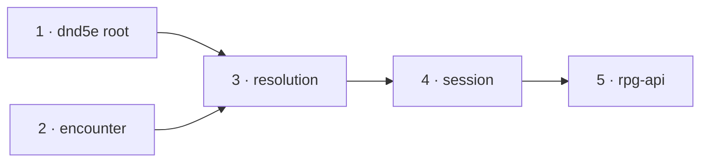

# Tier 3 close-out — slices

A working document beside [design.md](design.md): slice order, the task list a
worker executes per module, what done means, and what is deleted. Every
`file:line` is at rpg-toolkit `origin/main` `336beae2` (dnd5e v0.211.0 ·
encounter v0.125.0 · resolution v0.70.0 · session v0.130.0) and rpg-api `dev`
`a5c5838c`. Toolkit paths are relative to `rulebooks/dnd5e/`. Line numbers
drift as a slice edits a file; the symbol beside each line is the anchor.
"Row N" is a row of the audit table in [design.md](design.md).

Develop outside-in, merge inside-out. One nearest-`go.mod` module per toolkit
PR. Each dependent builds on its provider's gate-approved branch head and
re-pins to the provider's tag at merge-out; toolkit CI cannot resolve a branch
pseudo-version, so every dependent PR stays a draft until that re-pin. The
squash title's prefix picks the tag bump: `refactor!` where a public symbol
goes (a minor bump on v0.x), `refactor` otherwise. Every command runs with
`GOTOOLCHAIN=go1.24.5` from the module directory. Commit with every pre-commit
check running; a "(cached)" result ran nothing.

**No slice starts its ruled rows before the operator answers R1–R9.** A
slice's unruled rows may start at once. Where a ruling is answered against the
recommendation, the rows it names are dropped from the slice, not rewritten
here.

## Order

| # | Module | PR title |
|---|---|---|
| 1 | `rulebooks/dnd5e` | `refactor!(dnd5e): tier 3 close-out — dead methods, one identity per fact, target lines name their owner (toolkit#1965)` |
| 2 | `rulebooks/dnd5e/encounter` | `refactor!(encounter): tier 3 close-out — Participation and Conditions fields, Search and discovery import gone, one journal key, one meaning per refusal (toolkit#1965)` |
| 3 | `rulebooks/dnd5e/resolution` | `refactor!(resolution): tier 3 close-out — Standing gone, one hit decision, actions like monsters, names not refs (toolkit#1965, #2018)` |
| 4 | `rulebooks/dnd5e/session` | `refactor!(session): tier 3 close-out — Search verb gone, discovery required, one down answer (toolkit#1965)` |
| 5 | rpg-api `dev` | `refactor: tier 3 close-out carry — pins, sdkerr arms, v1alpha1 condition names from the registry (toolkit#1965, #2018)` |

Encounter does not import dnd5e, so slices 1 and 2 are independent. No protos
or web slice exists: the deprecated `Search` RPC stays a tombstone, R5 adds no
enum value, and no rendered string changes shape.

## 1. dnd5e root

**Deletions.**

1. `Character.MakeSavingThrow` and `MakeSavingThrowInput`
   (`character/character.go:381-442`). Row 7.
2. `Character.Cleanup` (`character/character.go:1873-1911`) and the
   keeper-less unsubscribe branch it carries. Row 10.
3. `ConditionAppliedEvent.Type` (`events/events.go:670`) and the
   `ConditionType` type with its constants (`events/events.go:21-108`). Row 14.
4. `loadedEffect` (`character/load.go:47-56`). The pending list becomes
   `[]dnd5eEvents.ConditionBehavior`; attribution reads `behavior.Ref()`.
   `peekEffectRef` keeps only its warning use for a blob that did not load
   (`load.go:596`). Row 15.
5. `events.ChildRef` (`events/damage_taken.go:24-26`). Row 19.
6. `UnconsciousCondition`, `UnconsciousData`, its descriptor entry and
   `conditions/unconscious.go`; `refs.Conditions.Unconscious` when a grep of
   toolkit and rpg-api finds no other reader. Row 55.
7. `gamectx.Cast.StanceBetween` (`gamectx/cast.go:105-117`). Row 58.
8. Prose: "legacy unqualified" in `events/damage_taken.go:11-13`,
   `events/events.go:162-164,691`, `conditions/concentrating.go:138,197`,
   `character/character.go:1675` now says an empty `SourceID` names a
   condition that has no source qualifier (Prone, Dodging, Hidden, Raging).
   `CLAUDE.md:63` drops `character.HasCondition` and names
   `conditions.HoldsRef`. Rows 33, 35.
9. `CHARACTER_CLEANUP_ANALYSIS.md`, `CHARACTER_CLEANUP_ANALYSIS_DETAILED.md`,
   `HANDOFF.md`, `MIGRATION_ISSUE.md`, `REFS_PACKAGE_HANDOFF.md`. Row 36.
10. **R2.** The free-reaction merge in `HeldAddresses`
    (`conditions/holds.go:160-167`) and its doc paragraph (`:119-128`);
    `freeReactionsToCarry` and the carried-join loop in character attach
    (`character/load.go:180-188,214-225,729-748`); `carryingFreeReactions` in
    monster attach (`monstertraits/loader.go:162,352`). `Draft.Finalize`
    writes `conditions.FreeReactions(id)` into the new sheet's stored
    conditions. The monster mint writes the same before its first save
    (`session/entities.go`, slice 4, is the one place a monster sheet is
    minted; slice 1 exports nothing new for it — `FreeReactions` exists).
11. **R4.** `GetSpeed`'s default (`character/character.go:269-275`). Strict
    `Load` and lenient `LoadFromData` refuse a `RaceID` that `races.GetData`
    does not hold, with `CodeInvalidArgument` naming the id.
12. **R5.** `character.ErrConflictingOffers`, wrapped by the two-offer refusal
    in `weaponAttackOverride` (`character/attack_definition.go:98-101`) with
    its existing `CodeConflictingState`.
13. **R7.** `retiredConditions`, `isRetiredRef`, `IsRetired`,
    `ErrRetiredCondition` (`conditions/loader.go:16-57`) and every caller's
    retired skip (`conditions/holds.go:151`, `conditions/target_held.go:220`,
    `character/load.go:583`, `monster/load.go:122,137`,
    `monstertraits/loader.go:59`). `refs.Conditions.InFog` and
    `refs.Conditions.UnarmoredMovement` stay: Fog Cloud's area membership and
    rpg-api's wire enum name them.
14. **R9.** `UnarmoredDefenseCondition.onACChain` returns unchanged for a
    monk when `event.HasShield` (`conditions/unarmored_defense.go:171-174`);
    the doc at `:45` says which variant allows a shield.

**Cleanups, no deletion.**

- Row 53: `immunityCondition`, `vulnerabilityCondition`, `RagingCondition`
  and `BladeWardCondition` set `Source.SourceID` to their holder on every
  answer (`conditions/trait_immunity.go:152`, `trait_vulnerability.go:152`,
  `raging.go:504`, `blade_ward.go:206`). `DamageReduction.Validate` and
  `DamageMultiplier.Validate` (`events/incoming_damage.go:59,91`) refuse an
  empty `Source.SourceID` with `ErrMalformedTargetAnswer`.

**Callers to move.** The eleven `Type:` lines on `ConditionAppliedEvent`
literals: `character/draft.go:759`, `combatabilities/hide.go:128`,
`disengage.go:119`, `help.go:96`, `dodge.go:110`, and the four in `features/`.
Resolution's two move in slice 3.

**Tests.** Delete `character_test.go`'s `MakeSavingThrow` cases,
`conditions/unconscious_test.go`, the retired-blob tests
(`TestARetiredBlobIsNotHeldAndDoesNotFail` and its kin) in favour of one test
that a removed type's blob fails `LoadJSON` and `HeldAddresses` with
`ErrUnknownCondition`. Replace `integration/*_encounter_test.go` `Cleanup`
teardown with nothing (each test builds its own bus). Tests that assert
`event.Type` assert `event.Condition.Ref()`. Fixtures that build `Data` with
an empty `RaceID` name a race. Count pins in every test file this slice
edits become membership assertions.

**Acceptance.**

- A finalized character's stored conditions name the opportunity attack;
  `HeldAddresses` on that stored list returns it once, and on a list without
  it returns no opportunity attack.
- `Load` of a sheet with race `"nope"` fails `CodeInvalidArgument`.
- A monk with a shield folds AC without Unarmored Defense; a barbarian with a
  shield folds it with.
- A struck raging barbarian's `resisted` line carries the barbarian's id as
  `SourceID`; a multiplier with an empty `SourceID` fails the fold.
- `go build ./... && go test ./...` green; `golangci-lint run` green.

**What would have to break for these tests to fail:** Finalize forgetting the
reaction, or Attach adding a second; a default speed returning; the shield
branch keyed on the barbarian; any answerer leaving its line unowned.

## 2. encounter

**Deletions.**

1. The `Standing` interface (`encounter/standing.go:15-25`),
   `StandingWithParticipation` (`participation.go:70-76`),
   today's `ErrNoParticipation` (`errors.go:318-325`), `nobodyDown.Standing`
   (`standins.go:57-59`). `Capabilities.Standing` becomes
   `Capabilities.Participation Participation` (`capabilities.go:22-29`).
   One sentinel names the missing capability: `ErrNoStanding` is renamed
   `ErrNoParticipation`, text `encounter: no participation capability`.
   `downNow` already reads `participationNow().down`. Row 1.
2. `EquipmentWithConditions` (`encounter/conditions.go:55-68`).
   `Capabilities.Equipment` is typed `Equipment`; a new
   `Capabilities.Conditions Conditions` is required (`ErrNoConditions`,
   which exists). `RefusingCapabilities` sets both from
   `UnobservedEquipment`. Row 6.
3. `Encounter.Search`, `SearchInput`, `SearchOutput`, `encounter/search.go`;
   `ErrSearchRetired`, `ErrElsewhere` (`errors.go:380-390`). Row 2.
4. **R1.** `DiscoveryCheckResolver` (`discovery.go:16-22`); its method
   `ResolveDiscoveryCheck` joins `CheckResolver`. `sweepDiscoveryChecks`
   calls it without a type assertion (`discovery.go:243-247`).
   `RefusingCheckResolver.ResolveDiscoveryCheck` refuses with
   `ErrRefusingCheckResolver`.
5. The explicit discovery import: `DiscoveryMemoryData`,
   `DiscoveryMemoryInput`, `DiscoveryMemoryOutput`, `Encounter.DiscoveryMemory`
   (`discovery.go:40-80`), `RestoreDiscoveryInput.Checks` (`:132-135`),
   `MemberInput.RetainedDiscoveries` (`field.go:867-870`),
   `JoinInput.RetainedDiscoveries` (`field.go:1612-1614`), the import loop
   (`encounter.go:2059`), `DiscoveryLifetime`, its constants and
   `DiscoveryPolicyInput.Lifetime` (`discovery_policy.go:8-17,35-38`), the
   lifetime defaulting at load (`data.go:3226-3232`), and the authored
   `lifetime:` key (`dungeonspec/single_room.go:625` and its lowering).
   `initializeDiscovery` loses its memory parameter. `RestoreDiscovery`
   returns an output carrying only the preference. Row 4.
6. `SightPayload` (`encounter.go:20-28`), `DecodeSightPayload`
   (`testimony.go:394-401`), the untagged branch of `DecodeSightTestimony`
   (`testimony.go:306-319`) and its doc (`:244-250`). Rows 18, 44.
7. `normalizePerceptionSubjects` (`observation_subject.go:113-140`). Load
   refuses a `PerceptionSubjects` other than `perceptionSubjectVersion` with
   `ErrInvalidData`; the doc at `data.go:48-50` drops "legacy". Row 44.
8. The two journal keys: `EncounterData.World` and `EncounterData.Holdings`
   (`data.go:63-98`), `WorldData`, `HoldingsData` (`:826-846`) become one
   `Journal *JournalData` holding every fact in append order; write at
   `data.go:1930-1972` and replay at `:2814-2835` walk the one list, and the
   per-kind validators run per fact. Row 29.
9. `NobodyPerceives` is unexported (`standins.go:111-128`) and stays only in
   `RefusingCapabilities`. New exported `RefusingWitness{}` answers every ask
   with `ErrRefusingWitness`. Row 25.
10. **R6.** `ErrNoMember`'s text becomes `encounter: empty member id`
    (`errors.go:33`). New `ErrDuplicateMember` (`encounter: member already
    present`) replaces `ErrNoMember` at `board.go:154`, `data.go:2434`,
    `encounter.go:620`, `encounter.go:1983`. New `ErrBadMember`
    (`encounter: member cannot be seated`) replaces it at
    `field.go:1084-1091`, `reserve.go:164-172`, `clocks.go:2292`,
    `data.go:2646`. Every sentinel in `errors.go` without the `encounter:`
    prefix gains it. `ValidateRollCalculation` and its helpers
    (`roll_trace.go:123-415`) wrap `ErrInvalidData`. Every remaining
    `ErrNoMember` site is an empty-id check; the slice greps
    `ErrNoMember` and checks each of the eighty-three.
11. **R8.** "legacy" leaves `PropInput`'s docs (`placed_props.go`,
    `field.go:578`, `concealment.go:255,335`, `atlas.go:366,473`,
    `reserve.go:276,478-480`, `holdings.go:355`); it is the v2 prop.

**Callers to move.** `encounter/cmd/freeroam-workbench/main.go:149,584`
(`Standing:` → `Participation:`, and `rollAllStanding` loses its `Standing`
method). Test helpers that build `Capabilities`.

**Tests.** Delete `sightdecode_test.go`'s `DecodeSightPayload` cases and the
untagged-form cases; the search tests (`search_test.go` and kin); the
discovery-import tests; the perception-subject upgrade test (one test now
pins the refusal of version 0); `participation_test.go:29`'s legacy
`Standing` stub. One new test interleaves a knowledge fact and a holdings fact,
saves, loads, and asserts the replayed sequence numbers and order match.
Tests asserting `ErrNoMember` on a duplicate or an authored defect assert the
new sentinel. Count pins in edited test files become membership assertions.

**Acceptance.**

- A `Capabilities` without `Participation` or without `Conditions` is
  refused at `NewEncounter` and `LoadEncounter` with its sentinel.
- An interleaved journal round-trips with identical order.
- A version-0 perception blob and an untagged sight payload are refused.
- A duplicate member answers `ErrDuplicateMember`; an empty id `ErrNoMember`;
  a stranger `ErrNotMember`.
- Automatic discovery finds a concealed door on approach with the one
  resolver interface.

**What would have to break:** the replay sorting by kind again; a refusal
answering the wrong sentinel; the sweep skipping when a resolver is present.

## 3. resolution

Re-pins dnd5e (slice 1) and encounter (slice 2).

**Deletions.**

1. `Standing`, `StandingInput`, `StandingOutput`, `standingOn` and
   `resolution/standing.go`. Row 1.
2. The inline hit switch in `strikeMachine.roll` (`strike.go:594-601`);
   `settleHit` (`:602`) is the one decision. Row 21.
3. `afterDamage` and `afterNotify` (`strike.go:956-990`); `rollDamage`
   (`:717`) and the damage step's `Then` (`:808`) call `nextCondition(0)`.
   The hazard prose stays in `doc.go:130-145`. Row 22.
4. `castView.StanceBetween` (`cast.go:153`). Row 58.
5. **R3.** `ProjectCharacterOutput.MainHand`, `AttackFacts`,
   `AttackKindMelee`, `AttackKindRanged` (`projection.go:48,84-111`).
   `ProjectCharacterOutput.Actions []combatActions.Definition` carries every
   definition `character.AssembleAttack` compiles for `SlotMainHand` and, when
   the off hand holds a weapon, `SlotOffHand`.

**Cleanups.**

- `dnd5eEvents.ChildRef` → `dnd5eEvents.ConditionAddress` at
  `contest.go:1391`, `damagetaken.go:58`. Row 19.
- The two `Type:` lines at `contest.go:566`, `action.go:650`. Row 14.
- Row 60: `contest.go:512` and `:1394` describe the condition by
  `conditions.DisplayFor(ref).Name`; `removalEffect` returns an error for an
  unregistered ref and its callers propagate it. `movement.go:461` names the
  step from the trigger's display name. The "replaced by a newer instance"
  suffix stays.
- **R5.** `factsOf` (`projection.go:296-301`) wraps
  `resolution.ErrConflictingOffers` when the root error is
  `character.ErrConflictingOffers`, and `ErrBadAttack` otherwise.

**Tests.** Delete `standing_test.go`. `cast_action_test.go:733-778` keys the
seen map by `Condition.Ref()`. A projection test for a dual-wielder asserts
two definitions by ref. Count pins in edited test files become membership
assertions.

**Acceptance.** A natural 1 with a winning total misses and a natural 20 with
a losing total hits, through one decision. A Bless replaced by a newer
instance reads "Blessed replaced by a newer instance". A projection of a
monk carrying Shillelagh on a club fails `ErrConflictingOffers`.

**What would have to break:** `settleHit` disagreeing with itself on resume;
a removal describing a ref string; a dual-wielder's off hand dropped.

## 4. session

Re-pins dnd5e, encounter and resolution.

**Deletions.**

1. `Manager.Search`, `SearchInput`, `SearchOutput`, `session/search.go`;
   `ErrSearchRetired`, `ErrElsewhere` (`errors.go:524-533`) and their
   translate arms (`read.go:817-823`). Row 2.
2. **R1.** The nil-`Explorations` branches (`exploration.go:33,94,149`,
   `knowledge.go:116`), `checkResolverFor`'s choice (`exploration.go:197-203`)
   and `automaticCheckSeam` as a separate type: `checkSeam` answers
   `ResolveDiscoveryCheck`. `New` refuses a `Config` without `Explorations`
   with `ErrIncompleteConfig`.
3. `Arrival`, `ArrivesAtRound`, `ArrivesOnFall`, `ArrivesOnFact`,
   `ArrivesOnStance` (`reserve.go:37-78`). Row 54.
4. `standingSeam.Standing` (`standing.go:117-129`). `refuseIfDown`
   (`:251`) and `standingSet` (`rosterlookup.go:55-65`) read the
   participation assessment's `Down`. Row 1.
5. The doc narration at `compelled.go:168-173`. Row 38.

**Cleanups.**

- `Capabilities` construction (`capabilities.go`): `Participation:` for
  `Standing:`, and `Conditions:` beside `Equipment:`.
  `readCapabilities` installs `encounter.RefusingWitness{}`
  (`capabilities.go:85`). Rows 1, 6, 25.
- `launch.go:384` and `entities.go:210-214` wrap the inner error with `%w`
  beside the outer sentinel. Row 59.
- **R2.** The monster mint in `entities.go` writes
  `conditions.FreeReactions(id)` into the new monster's stored conditions.
- **R3.** `memberActionsFrom` (`write.go:619-631`) is deleted; the sheet seam
  projects `ProjectCharacterOutput.Actions` through the function monsters use
  (`memberActionsFromMonster`, renamed `memberActionsOf`).
- **R5.** `offers.go:375-392`: a root `character.ErrConflictingOffers` blocks
  Attack with `ShortfallUnavailable` and text naming the competing offers; the
  verb refuses with new `session.ErrConflictingOffers`.
- **R6.** `read.go:775` splits: `encounter.ErrNoMember` →
  `ErrNoMemberID`, `encounter.ErrNotMember` → `ErrNoMember`,
  `encounter.ErrDuplicateMember` → new `ErrAlreadyMember`,
  `encounter.ErrBadMember` → `ErrInvalidWorld`.
- `ChildRef` → `ConditionAddress` in `concentration_break_test.go`,
  `depart_test.go`, `rest_test.go`.

**Tests.** Delete the search suites and the explicit-search exploration
tests; every test `Config` wires an in-memory exploration repository (one
shared helper). Count pins in edited test files become membership assertions.

**Acceptance.** A session without `Explorations` fails `New`. Walking next to
a concealed door reveals it. A downed member's verb refuses `ErrDowned`
through the assessment. A Launch with a field that has no regions answers
`ErrInvalidWorld` and `errors.Is(err, encounter.ErrNoField)`.

**What would have to break:** a nil repository silently turning discovery
off; two answers to who is down; an inner sentinel flattened to text.

## 5. rpg-api carry

Re-pins dnd5e, encounter, resolution and session.

1. `internal/handlers/dnd5e/sdkerr/errors.go`: delete the `ErrSearchRetired`
   arm (`:53`) and `ErrElsewhere` from its list (`:234`) with their test rows
   (`errors_test.go:95,106`); add `ErrConflictingOffers` and
   `ErrAlreadyMember` to the FailedPrecondition list.
2. `internal/handlers/dnd5e/v1alpha1/character/converters.go`:
   `conditionIDToDisplayName` (`:3580-3614`) is deleted; the loop at
   `:1446-1447` names a condition by `conditions.DisplayFor(ref).Name`, and an
   unregistered ref fails the conversion instead of skipping. The enum
   mapping `conditionIDToEnum` (`:3522`) stays unchanged: it is the wire
   contract. Row 61.
3. `content/reference-discovery-checks.yaml:13,17` drops `lifetime: run`.
   Row 4.
4. Pins: `go get` each module at its tag, then `go mod tidy`.

**Acceptance.** `make pre-commit` green. A v1alpha1 character holding
Raging reads `name: "Raging"` from the registry.

## Reset (A6, R7)

Runs at merge-out, after every slice has merged, scoped to the same four key
patterns as the condition descriptor's reset: `character:*`,
`session:v1alpha1:*`, `session-enc:v1alpha1:*`, `session-seat:v1alpha1:*`.
It removes every stored sheet and encounter a deleted reader would have read.

1. **Local dev-env stacks.** `scripts/dev-env.sh clean local/<name>` for each, and `down`/`up`
   for a non-persisted `dev`. A `dev` with `RPG_REDIS_PERSIST=1` keeps volume
   `rpg-dev-redis-data`: delete the four patterns from the running server.
2. **The local base compose Redis** (`rpg-redis-dev`, volume
   `redis_dev_data`): delete the four patterns.
3. **The deployed store** (`rpg-redis`, volume `redis_data`): the operator
   runs or approves it.

Against a running server only, with `redis-cli --scan --pattern 
` piped to
`UNLINK`. Never start a second server on a mounted volume and never `SAVE`
into one; check `DBSIZE` before and after. Done when a scan of each store
finds no key matching any of the four patterns.

## Walk

One click per seam on the local stack, every slice on its gate-approved head.
The walk proves the wiring; the rules are the tests. Post as `- [ ]` boxes on
rpg-toolkit#1965 before merging. Rows that delete dead code carry no box.

- [ ] **Discovery has one path.** Walk a character beside a concealed door in
      a reference dungeon; the door is revealed with no search button.
- [ ] **One journal survives a reload.** Pick up a holdable prop, learn a fact,
      reload the page; both are still known.
- [ ] **Down and conditions answer from their own fields.** Fell a monster; it
      reads down and the fight ends as before. A sighted, raging barbarian's
      observed conditions show Raging.
- [ ] **A target's line names its owner.** Strike a raging barbarian; the
      `resisted` line carries the barbarian's id as `sourceId`.
- [ ] **A monk with a shield** (R9). Equip a shield on a monk; the AC drops by
      the Wisdom modifier.
- [ ] **v1alpha1 names.** A raging barbarian's character sheet lists
      "Raging".
- [ ] **A new character after the reset.** Create a fighter; it loads, joins
      and fights.
