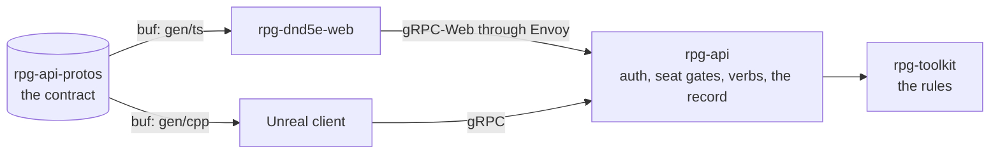

# The Unreal client — a second client of one engine

Index: [README.md](README.md). The spike's record and recipe:
[spike/README.md](spike/README.md). Rulings R2, R3 and R4 are the operator's
and are open; the checklist is on the design PR.

## Shape

The engine has one door: the contract in `rpg-api-protos`, served by
`rpg-api`. The browser is one client of that door. The Unreal client is a
second, shaped like the first — generated code from the same protos, the same
auth boundary, the same seat gates, the same verbs in and record out. It
opens no door of its own, and the engine gains nothing for its sake.

What differs between the two clients is presentation and transport, never
authority. The browser crosses Envoy as gRPC-Web; the Unreal client speaks
gRPC to the server port. Both send references and intent and render what
comes back. How the Unreal client turns a record beat into motion, sound and
animation is its own design and is not this document's (O1).

## Law

- **One engine, every client (R1).** An Unreal client reaches the engine only
  through `rpg-api-protos` and `rpg-api`. It links no toolkit code and hosts
  no Go runtime. Why: a second engine agrees with the first by hand.
- **Generated, never written (R1).** The client's message and stub code is
  generated from the protos by the protos repository's pipeline, beside the
  Go and TypeScript targets, and nothing generated is edited by hand. Why:
  the contract is over a thousand messages, and a hand copy drifts.
- **Intent in, record out (R1).** The client sends references and verbs and
  renders what the responses, the record and the story stream carry, on the
  streams' own terms. It computes no rule, modifier or difficulty. Why: a
  client that calculates is a second rules engine.
- **The same door (R1).** The client authenticates and is seated like every
  other client, through the api's auth boundary and seat gates, unchanged.
  The development scheme exists in development builds only. Why: a
  client-specific door is a second auth model to keep safe.
- **No side channel (R1).** The engine gains no Unreal-only verb, beat or
  field outside the protos. What the client needs and the contract lacks is a
  change to the contract, designed like any other. Why: the seams in session,
  resolution and encounter are deliberate.

## Rulings

| ID | ruling | status | scope | ruled by | date |
|---|---|---|---|---|---|
| R1 | An Unreal client is a client of the running engine over the published contract: not a Go library linked into its process, not a native port of the engine. | settled | clients, protos, api | KirkDiggler | 2026-11-23 |
| R2 | Where the two `descriptor` fields are renamed so that C++ generated code compiles: in place, wire-identical, with protos, web and api in one wave; or in a later proto version. | open | protos, web, api | — | — |
| R3 | TurboLink's place in the first Unreal leg: none, with raw stubs against the libraries it ships or against our own build; or in, once its generator preserves proto3 presence. | open | unreal-client | — | — |
| R4 | Where the engine runs for the Unreal client: hosted as for the web, or a local engine mode, which needs a store because the api requires Redis. | open | api, deployment | — | — |

## Open

- **O1 The interaction model.** How a first- or third-person controller
  commits movement and ends turns against the engine's two clocks: on the
  world clock, free-roam walking takes no declaration; on the turn clock,
  every verb is declared. And how a beat becomes motion, sound and animation.
  It is the client's own design, and it starts after R2 to R4.
- **O2 Engine version and platforms.** The prebuilt client runtime surveyed
  targets one engine version and a fixed platform list. This project's engine
  version and platforms are not chosen. Building the runtime ourselves
  reopens the list.
- **O3 The client's repository.** Its name; that it is private, because it
  will hold licensed content; and how it consumes generated code, as an
  artifact of the protos pipeline or a pinned fetch.
