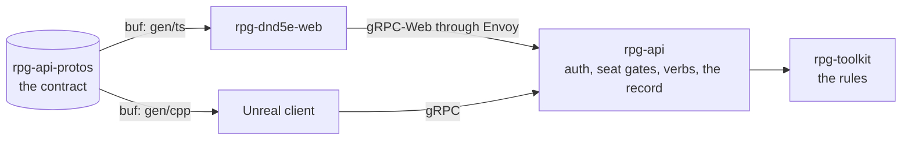

# The Unreal client — a second client of one engine

Index: [README.md](README.md). The spike's record and recipe:
[spike/README.md](spike/README.md). An open ruling waits on the story's checklist,
[rpg-project#1237](https://github.com/KirkDiggler/rpg-project/issues/1237), and the table below says so.

## Shape

The engine has one door: the contract in `rpg-api-protos`, served by
`rpg-api`. The browser is one client of that door. The Unreal client is a
second, shaped like the first — generated code from the same protos, the same
auth boundary, the same seat gates, the same verbs in and record out. It
opens no door of its own, and the engine gains nothing for its sake.

What differs between the two clients is presentation and transport, never
authority. The browser crosses Envoy as gRPC-Web; the Unreal client speaks
gRPC to the server port. Both send references and intent and render what
comes back. What a figure looks like is chosen when it appears: the mounted
content, or engine shapes (R10). How the Unreal client turns a record beat
into motion, sound and animation is its own design and is not this document's
(O1).

## Law

- **One engine, every client (R1).** An Unreal client reaches the engine only
  through `rpg-api-protos` and `rpg-api`. It links no toolkit code and hosts
  no Go runtime. Why: a second engine agrees with the first by hand.
- **Generated, never written (R1).** The client's message and stub code is
  generated from the protos by the protos repository's pipeline, beside the
  Go and TypeScript targets, and nothing generated is edited by hand. Why:
  the contract is over a thousand messages, and a hand copy drifts.
- **Intent in, record out (R1).** The client sends references and verbs and
  renders what the responses, the record and the story stream carry, on the
  streams' own terms. It computes no rule, modifier or difficulty. Why: a
  client that calculates is a second rules engine.
- **The same door (R1).** The client authenticates and is seated like every
  other client, through the api's auth boundary and seat gates, unchanged.
  The development scheme exists in development builds only. Why: a
  client-specific door is a second auth model to keep safe.
- **No side channel (R1).** The engine gains no Unreal-only verb, beat or
  field outside the protos. What the client needs and the contract lacks is a
  change to the contract, designed like any other. Why: the seams in session,
  resolution and encounter are deliberate.

## Rulings

| ID | ruling | status | scope | ruled by | date |
|---|---|---|---|---|---|
| R1 | An Unreal client is a client of the running engine over the published contract: not a Go library linked into its process, not a native port of the engine. | settled | clients, protos, api | KirkDiggler | 2026-11-23 |
| R2 | The two `descriptor` fields are renamed in place to `npc_descriptor`, tag numbers untouched, in one wave across protos, api and web under the protos repository's breaking-change label: in an alpha package a deliberate break is made in place, and a later version is for a released package. | settled | protos, web, api | KirkDiggler | 2026-11-26 |
| R3 | No TurboLink going forward, neither its code nor its binaries. protobuf and gRPC are built for the engine's toolchain, versions pinned, by a recipe kept in the client's repository; Linux first, and each further platform a named step. What runs today is the vendored archive, replaced by that recipe and not before: pragmatic about the step, not the direction. | settled | unreal-client | KirkDiggler | 2026-11-26 |
| R4 | The engine is hosted, as the web's is: the client uses the same backend and runs the way the web's client does. A peer-to-peer or local engine would be another auth-powered handler that authenticates differently; it is known of and not taken on, and a local development mode is its own thing, later. | settled | api, deployment | KirkDiggler | 2026-11-26 |
| R5 | The Unreal client's repository is `rpg-dnd5e-unreal`: the platform named beside the rules, as the web's is, so another engine would be `rpg-dnd5e-<engine>`. | settled | unreal-client | KirkDiggler | 2026-11-26 |
| R6 | The client's repository is public and holds no licensed content. Unreal-format licensed content lives in `rpg-game-assets`, the private canonical store, and the client mounts it; it is never committed to the client. | settled | unreal-client, game-assets | KirkDiggler | 2026-11-26 |
| R7 | The Unreal project is named after its repository, in PascalCase with an initialism as a word: `RpgDnd5eUnreal.uproject` at the repository's root, its module `RpgDnd5eUnreal`, until the operator names a product. | settled | unreal-client | KirkDiggler | 2026-11-26 |
| R8 | The client takes the contract from the protos repository's published tag and generates it itself, with generators pinned beside the runtime it links. No sibling checkout; a bump is a one-line pull request. Generated C++ published beside the other languages waits until the runtime is settled (R3). | settled | unreal-client, protos | KirkDiggler | 2026-11-26 |
| R9 | Unreal 5.9 Preview 2, as it runs today: Epic's tags stop at 5.9.0-preview-2 and no release exists. The release is taken when its tag appears. Linux first; platforms are named one at a time, as each is proven. | settled | unreal-client | KirkDiggler | 2026-11-26 |
| R10 | The client ships a stand-in look. A figure's look is chosen when it appears: the mounted content when its reference resolves, otherwise engine shapes — a flat-colour figure by side, a marker on the active figure, tinted hexes. The game is complete without the content; the content dresses it, as on the web. Motion comes only from the record, whichever look is shown. The shapes are built in two steps: the minimum that lets the game be played, with the game loop; then their polish. The content is Synty's, made for Unreal, from the private store (R6), and comes by reference behind the same seam. The game runs through the engine first; the HUD and control panel come after, and after the interaction model (O1) is designed. | settled | unreal-client | KirkDiggler | 2026-11-27 |

## Open

- **O1 The interaction model.** How a first- or third-person controller
  commits movement and ends turns against the engine's two clocks: on the
  world clock, free-roam walking takes no declaration; on the turn clock,
  every verb is declared. And how a beat becomes motion, sound and animation.
  It is the client's own design, and it starts now: the story is
  [rpg-project#1237](https://github.com/KirkDiggler/rpg-project/issues/1237). O2 is ruling R9; O3 is
  settled by R5 to R8, by R10 and by the slice that mounts the content plugin.
