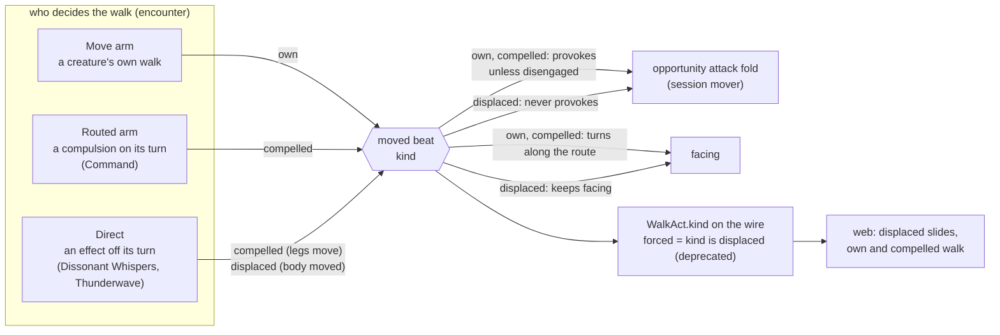

# When things fire — a moved beat names its kind

**Kirk, 2026-11-02 (#825):** "we built our pushing mechanism to occur on the
npc player turns. this works great for command, i think our first, dissonant
whispers is similar... I think it is time to take a look at how these things
currently work and see how we want them to work... I think we should be slow
and thoughtful at this phase."

## Shape

## The firing map

What fires when, read from toolkit main, api dev and web dev.

| mechanism | fires | spends | kind (this design) | on the web today |
|---|---|---|---|---|
| Thunderwave push | at cast, inside the caster's action | nothing of the target | `displaced` | a slide (`forced: true`) |
| Dissonant Whispers flee | at cast, right after the cast beat | the target's reaction, charged before it runs; refused when spent | `compelled` | a walk |
| Command approach / flee | the target's next turn, through its driver | the target's whole turn; never its reaction | `compelled` | a walk |
| Command grovel | the target's next turn | the whole turn; no move | (no moved beat) | prone |
| any creature's own Move | its own turn, or a round of the world | its movement | `own` | a walk |

The reaction meter is one per creature, refreshed at the start of its own
turn, spent by its own opportunity attack and by Dissonant Whispers. An
opportunity attack fires on every announced step that leaves reach; a spent
reaction blocks it; a player is asked, everyone else swings.

## The break

`WalkAct.forced` carries one bit for two questions. The encounter writes it
as `!Provokes`, so it means "does not provoke"; the web reads it as "shoved".
The two questions are whose legs move the body and whether leaving reach
invites a blow. They agree for Thunderwave and for every walk so far, and
they come apart the day an effect moves a body that should be struck on the
way, or marches legs that should not be.

The same cause shows as two flee shapes: Dissonant Whispers keeps its facing
and gets a full speed; Command flee turns to face its route and gets what
movement the turn has left.

## What is true today, read not guessed

| fact | where |
|---|---|
| The moved beat writes `forced` only when the step was classified as forced. | `rulebooks/dnd5e/encounter/encounter.go:1701-1708` |
| `Direct` walks with `forced = !in.Provokes` and `imposed = true` (keeps facing); a held directive stores the same `forced`. | `encounter/directive.go:669`, `:704` |
| `DirectInput.Provokes` is the inverse the Mover receives as `MoveStep.Forced`. | `encounter/directive.go:548-556`, `encounter/turndriver.go:1009-1017` |
| `walkPath` turns the walker along each step unless the walk is imposed. | `encounter/clocks.go:1717-1723` |
| A creature's own turn walk passes `forced = false, imposed = false`. | `encounter/clocks.go:1903` |
| A Routed turn (Command) walks as its own walk with the compulsion as cause, disengages first when it can, and faces the anchor at the end. | `encounter/clocks.go:1232-1263` |
| Resumes carry `forced` through: the held directive and the paused turn; the stored turn pause refuses `forced`. | `encounter/held.go:145`, `:157`; `encounter/pause.go:980`, `:993`, `:508-510` |
| The session decodes `forced` and a walk segment absorbs a step only when mover, cause and `forced` match. | `rulebooks/dnd5e/session/act_family.go:240-273` |
| The session hands the opportunity-attack fold a prevention source only for a forced step. | `session/mover.go:130-161` |
| A cast's pushes walk in order through `Direct`; a pause stops the loop. | `session/castmove.go:191-232` |
| A Dissonant Whispers flee is budgeted from the target's own speed. | `session/castmove.go:108-119` |
| A Command word becomes a `Routed` intent with the compulsion as cause; Grovel becomes `Pass`. | `session/compelled.go:318-363` |
| Obey's walk is the turn's movement, provokes, and pays nothing. | `rulebooks/dnd5e/resolution/obey.go:197-228` |
| A Dissonant Whispers flee pays the reaction first and is not taken when the reaction is spent. | `resolution/contest.go:770-826` |
| Thunderwave moves two cells in a line, pays nothing, provokes nothing. | `rulebooks/dnd5e/spells/cast.go:566`, `:603-612` |
| Dissonant Whispers moves away on its own speed, pays the reaction, provokes. | `spells/cast.go:637-650` |
| Command's menu is Approach, Flee, Grovel; Halt and Drop are absent. | `spells/cast.go:682-709`, `resolution/obey.go:32-36`, `:123-124` |
| An opportunity attack is refused to a reactor that is down or has no reaction. | `rulebooks/dnd5e/conditions/opportunity_attack.go:131-142` |
| The wire: `bool forced = 4` on `WalkAct`. | `rpg-api-protos` `dnd5e/api/session/v1alpha2/act.proto:374-376` |
| The api copies `Forced` across. | `rpg-api` `internal/handlers/dnd5e/session/v1alpha2/convert_act.go:558-565` |
| The web feeds a local member's walk only when `forced`, and slides a forced walk without turning or the walk cycle. | `rpg-dnd5e-web` `src/components/session/arrivingWalk.ts:28-35`, `src/components/hex-grid/useHexMovePath.ts:358-405`, `src/components/hex-grid/HexEntity.tsx:911-920`, `src/components/hex-grid/ClassCharacterModel.tsx:487-511` |

## Law

**A moved beat names its kind.** Every moved beat says how the body moved:
`own` (the creature chose the walk), `compelled` (its legs move under
somebody else's order), `displaced` (the body is moved; its legs do not).
The site that decides the walk names the kind: a creature's own Move is
`own`; a Routed turn is `compelled`; `Direct` names the kind its caller
gives it. Absent on a stored beat means `own`, so zero values tell the truth.

**Provoking is derived from the kind.** `own` and `compelled` provoke unless
the creature disengaged; `displaced` never provokes. Nothing else switches
an opportunity attack off.

**`forced` is a deprecated mirror.** It is written exactly when the kind is
`displaced`, on the beat, the session's walk and the wire, and read only as a
fallback by a reader that does not know `kind`. Protos deprecate, never
break.

**Facing follows the legs.** A `compelled` walk turns to face its route, step
by step, as an `own` walk does; a `displaced` walk keeps the facing it had.

**Budgets are what each spell says.** Dissonant Whispers runs one speed of
the target's own legs, as a reaction. Command spends the turn: the walk is
the turn's movement. A disengage happens only where a turn pays for it (a
Routed turn may spend its bonus action; a reaction flee has none to spend).

**The trigger pays.** A reaction flee spends the reaction and is refused when
it is spent. A turn flee spends the turn and never the reaction, so a
commanded creature keeps its opportunity attack.

**The web animates by kind.** `displaced` slides with no walk cycle and no
turn; `own` and `compelled` walk. A walk with no kind falls back to `forced`.

## Rulings

| # | question | options | ruled | scope | date |
|---|---|---|---|---|---|
| R1 | What does a moved beat say about the body? | A keep the bool as "does not provoke". B the beat names its kind (`own`, `compelled`, `displaced`); provoking is derived from the kind; `forced` stays as a deprecated mirror of `displaced`. C the kind plus the flee shape in one ruling. | B (Kirk: "I like B there too") | the moved beat, the session walk, the wire, the web | 2026-11-02 |
| R2 | One flee shape: budget and facing of a compelled walk. | A facing follows the legs (every `compelled` move turns to face its route; only `displaced` keeps facing); budgets stay what each spell says. B one speed for both. C leave both. | A (Kirk: "sounds right to me") | facing of every moved creature; budgets unchanged | 2026-11-02 |
| R3 | What reaction does a compelled move spend? | A the trigger pays: a reaction flee spends the reaction and is refused when spent; a turn flee spends the turn, never the reaction. B every compelled move spends the reaction. C none does. | A (Kirk: "i like being explicit. A") | Dissonant Whispers and Command; built both sides, the walk proves it | 2026-11-02 |

## Findings, not ruled

- **Command flee does not Dash.** The book's flee is "by the fastest
  available means"; today it is one speed (`Routed` carries a `Dash` field,
  `encounter/clocks.go:1181`, and `session/compelled.go` never sets it).
- **A provoking push that pauses for a player's reaction stops the rest of a
  cast's pushes** (`session/castmove.go:191-208`). Harmless while every cast
  that can pause has one target; a second hold is the encounter's to build.
- **Command offers no Halt and no Drop.** Halt is one menu row and one Obey
  arm (`spells/cast.go:682-685`). Drop waits on a creature that holds a
  weapon, a prop in its hand, and a drop primitive (`spells/cast.go:687-692`).
- **Content still says `Provokes`, not a kind** (`combat/actions/move.go`
  `CastMove`, `resolution/contest.go` `MoveDirective`). The session's crossing
  names the kind from it (true is `compelled`, false is `displaced`). No spell
  pushes a body that should provoke, so the content field stays until one does.
- **A local player's compelled walk is not fed to the web today**
  (`arrivingWalk.ts:30` skips the local member unless `forced`). No Move
  answer carries that route either; S1 feeds every non-`own` walk.

## Open

- Command flee and Dash: one speed or "fastest available means" (finding
  above; not asked).
- Doors on a directed walk: `Direct` walks with the doors as they are while a
  creature's own walk opens them (`encounter/clocks.go:1594`). R2 moved facing
  onto the kind; doors stay on `Direct` as today and are not asked.
- Drop: deferred until a creature holds things.

— cross-team agent, on behalf of KirkDiggler
